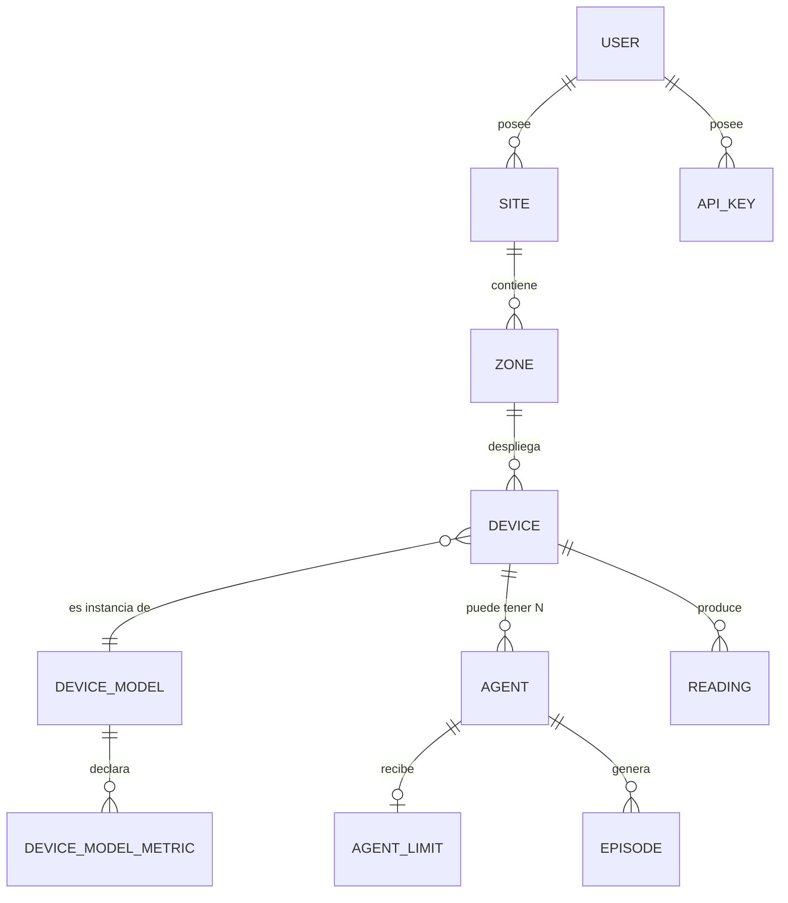

# 01 — Visión de la plataforma ⭐

> La visión completa de **AgriAgents**: una plataforma multiusuario donde microcontroladores baratos
> **controlan el mundo exterior** (riego, ventilación, persianas, alertas, alimentación, instrumentos
> de laboratorio) gracias a que el **cerebro vive en el servidor** y se **auto-mejora** con el tiempo.

---

## 1. La tesis: el microcontrolador siente y actúa, el servidor piensa

Históricamente, poner "IA en el campo" obligaba a meter un modelo de lenguaje o un sistema experto
dentro del microcontrolador: caro, frágil, sin actualizaciones, sin memoria entre dispositivos.
Invertimos la relación:

| Papel | Quién lo hace | Por qué |
|---|---|---|
| **Sentir** | MCU (sensores: humedad, T/HR, CO₂, cámara…) | Barato, always-on, en el punto exacto del problema |
| **Actuar** | MCU (relés: electroválvula, bomba, ventilador, persiana, trampa) | Latencia física mínima, seguridad local |
| **Pensar** | Servidor Ubuntu: agentes Hermes + FastAPI + PostgreSQL | Cerebro potente, actualizable, con memoria global y LLM |
| **Aprender** | Servidor: skills, episodios, LoRA, Curator de Hermes | La mejora es de software, no de hardware |
| **Recordar** | Servidor: PostgreSQL (histórico) + memoria del agente | El conocimiento sobrevive a reinicios y a años |

**Consecuencia práctica:** un ESP32 de USD 5 o un módulo SIM800L de USD 6 gana la inteligencia de un
sistema que costaría órdenes de magnitud más caro embebido, porque **la inteligencia se consume por
HTTP desde el servidor**. El MCU solo necesita: leer sensores, mandar lotes JSON, preguntar "¿hay
ejecuciones?" y activar relés.

```mermaid
flowchart LR
    subgraph CAMPO["Campo / exterior (barato, masivo)"]
        SENS[Sensores] --> MCU[MCU: ESP32 / RPi / SIM800 / SIM7000]
        MCU --> ACT[Actuadores: relés, válvulas, bombas, ventiladores]
    end
    subgraph SERVIDOR["Servidor Ubuntu (potente, único)"]
        API[FastAPI /v1]
        BD[(PostgreSQL 18<br/>+ TimescaleDB)]
        AG[Agentes Hermes<br/>memoria + skills + auto-mejora]
        LLM[LLM (MiniMax / local)]
        API <--> BD
        AG -->|MCP / HTTP| API
        AG <-->|inferencia| LLM
    end
    MCU <-->|"HTTP + HMAC<br/>(lote de datos ↑ / comandos ↓)"| API
```

### 1.1 El MCU no se queda "tonto" cuando cae la red: comportamiento histórico

Un dispositivo celular (SIM800/SIM7000) puede estar horas sin red. La plataforma no lo deja a ciegas:

1. **Última política válida**: el servidor, al entregar un comando, incluye una *política de fallback*
   compacta (horarios de riego, histéresis de humedad, umbrales de temperatura) firmada y con TTL.
2. **El MCU la aplica localmente** mientras no haya red (bucle de control simple: si humedad < umbral
   y dentro de ventana horaria → abre válvula X minutos).
3. **Al reconectar**, manda sus lecturas + comandos ejecutados localmente → el agente las procesa,
   las audita (guard evaluaciones) y recalibra la política.

Así el microcontrolador **controla el exterior en base al comportamiento histórico aprendido**, no solo
cuando el servidor responde. Es la pieza que hace robusto el sistema en campo real.

---

## 2. Ciclo de vida end-to-end: de un dato a una acción y a una mejora

Este es el latido del sistema. Nueve pasos, todos trazables en PostgreSQL:

```mermaid
sequenceDiagram
    autonumber
    participant DEV as Equipo de campo (MCU)
    participant API as FastAPI /v1
    participant BD as PostgreSQL
    participant AG as Agente Hermes (perfil)
    participant LLM as LLM

    DEV->>API: POST /v1/devices/{id}/readings (lote JSONB dinámico)
    API->>BD: INSERT readings (validado contra device_model_metrics)
    BD-->>API: 202 Accepted
    API-->>DEV: 202 (el MCU sigue midiendo)
    Note over BD: Continuous aggregates actualizan resúmenes hora/día

    AG->>API: GET /v1/agent/tasks/next?agent=perfil (cron cada 1 min)
    API-->>AG: 200 con tarea ó 204 (NO hay tarea → NO_REPLY, sin spam)
    AG->>API: GET datos del equipo + resúmenes + pronóstico (MCP/REST)
    AG->>LLM: razonar con skills cargadas + límites del agente
    LLM-->>AG: decisión (ej. "regar zona A 20 min")
    AG->>API: POST /v1/agent/decisions (si necesita aprobación) ó comando directo
    API->>BD: INSERT commands + guard_evaluations (guarda determinista)
    Note over API,BD: La guarda valida rangos, presupuesto de agua y lockouts.<br/>Si viola límites del agente → bloqueado y auditado.

    DEV->>API: GET /v1/devices/{id}/commands/next?wait=25 (long-poll)
    API-->>DEV: 200 con comando (ó 204 si no hay nada; el timeout lo "come" el MCU)
    DEV->>ACT: activa relé de riego
    DEV->>API: POST .../commands/{cid}/ack {status: ok, real: "20min"}
    API->>BD: UPDATE commands + INSERT episodes (episodio de entrenamiento)
    AG->>API: POST /v1/agent/episodes (resultado y métricas del episodio)
    Note over BD: episodes → trajectories → datasets → models → promotions<br/>= material para auto-mejora (Niveles 1 y 2)
```

### 2.1 Los tres "latidos" del sistema

| Latido | Periodo | Quién | Qué produce |
|---|---|---|---|
| **Ingesta** | 5–15 min (o por evento) | Cada equipo | Filas en `readings`, resúmenes actualizados |
| **Decisión** | 1 min (cron pull de Hermes) | Cada agente | Tareas tomadas, decisiones, comandos |
| **Aprendizaje** | Tras cada episodio / semanal / mensual | Agente + Curator + trainer | Skills refinadas, datasets, LoRA, promotiones |

---

## 3. Multiusuario: cada usuario, su mundo

La plataforma es **multi-tenant**: un operador (cliente) se registra y encuentra un árbol completo:



- **Usuario (cliente)**: ve solo SU árbol (sitios, zonas, equipos, agentes). Puede ajustar los
  **límites manuales de sus agentes** vía API o dashboard.
- **Administrador de plataforma**: ve todos los usuarios, gestiona capacidad, modelos globales,
  promociones de modelos y auditoría transversal.
- **Aislamiento**: cada consulta de agente lleva el `user_id`/`site_id`; el rol de Base de datos de
  Hermes es de solo lectura y acotado por `statement_timeout`.

### 3.1 N agentes por equipo, cada uno único

Un mismo equipo de riego puede tener simultáneamente:

| Agente | Entrenamiento propio | Límites propios | Métricas propias |
|---|---|---|---|
| `riego-fao56` | Skill de FAO-56 + histórico del sitio | m³/día, % humedad mín | agua ahorrada vs. riego programado |
| `alerta-heladas` | Skill de umbrales de frío + pronóstico | temp mín de alerta | falsas alarmas vs. heladas reales |
| `energia-bomba` | Skill de tarifas y consumo | kW/día | costo energético evitado |
| `salud-cultivo` | Skill de visión de plagas | solo advisory (nunca actúa) | acierto de diagnóstico |

Cada agente es **único en su entrenamiento y auto-mejora**: sus skills (`~/.hermes/skills/`), su
memoria (`MEMORY.md`/`USER.md`), su modelo (pinned o LoRA propio) y su historial de episodios viven
aislados. Las **métricas de mejora se ven** por agente y por versión (ver `06-agentes-y-auto-mejora.md`).

### 3.2 Límites manuales por agente vía API

El usuario no "programa": **poner límites**. Ejemplos reales que expone la API:

```json
PATCH /v1/users/{uid}/devices/{did}/agents/{aid}/limits
{
  "water_budget_l_per_day": 500,
  "allowed_actions": ["open_valve", "close_valve"],
  "humidity_min_pct": 35,
  "require_human_approval_above_l": 200,
  "active_window": "05:00-09:00"
}
```

Esos límites son **ley para el agente** (el LLM los ve en su contexto) **y para la guarda determinista**
(el código que finalmente escribe el comando los valida aunque el LLM intente excederlos). Detalle en
`04-base-de-datos.md` (tabla `agent_limits`) y `09-seguridad-y-roles.md`.

---

## 4. La plataforma como sistema operativo del agro

No es un gadget: es infraestructura. Cada pieza es **modular por diseño**:

| Módulo | Qué aporta | Reemplazable/sustituible |
|---|---|---|
| Ingesta HTTP | Puerta única de los dispositivos | Cualquier firmware que hable el contrato |
| Registro (BD) | Verdad única | — (núcleo) |
| Motor de agentes (Hermes) | Cerebro y auto-mejora | Sustituible por otro runtime que hable el mismo contrato de API |
| Guardas deterministas | Seguridad física y económica | Código propio, auditado |
| Clima (Open-Meteo + APIs) | Pronóstico y ET₀ | Cualquier fuente de datos meteorológicos |
| Visión | Diagnóstico de plagas | Modelos locales o cloud |
| LIMS / instrumentos | Laboratorio (SiLA 2, OPC-UA, SCPI) | Protocolos abiertos |
| Domótica (Home Assistant) | Casa e invernadero | HA es opcional, no obligatorio |
| Entrenamiento | LoRA/SFT y RL sobre simulador | GPU externa/CI cuando toque |

### 4.1 Cómo crece (del piloto a la operación completa)

| Etapa | Sitios | Equipos | Qué se aprende |
|---|---|---|---|
| **Piloto** | 1 invernadero + 1 bancal + 1 casa | 20–50 | Contrato HTTP, esquema, primeras skills |
| **Granja** | 1 finca completa | 100–300 | Multi-agente por equipo, límites por zona |
| **Cooperativa** | N fincas, N usuarios | 1 000+ | Aislamiento de tenants, costos por usuario |
| **Producto** | SaaS | 10 000+ | Modelos base compartidos, skills del marketplace |

En cada etapa **no cambia el hardware**: cambian cuántos agentes y usuarios existen. Eso es el
verdadero valor de la modularidad.

---

## 5. Visión por dominio (resumen; detalle en `08-dominios-aplicacion.md`)

| Dominio | Exterior controlado | Agente estrella | Dato que lo hace inteligente |
|---|---|---|---|
| **Riego** | Electroválvulas, bomba | `riego-fao56` | Humedad de raíz + ET₀ + lluvia prevista |
| **Invernadero** | Ventiladores, persianas, caldera, CO₂ | `clima-cea` | VPD, temp/HR, luz, consumo |
| **Ganadería** | Ventilación, enfriamiento, comederos | `plf-celo` | Rumia, actividad, THI |
| **Domótica** | Luces, persianas, HVAC, riego de jardín | `casa-inteligente` | Rutinas aprendidas del histórico |
| **Laboratorio** | Instrumentos (SiLA/OPC-UA/SCPI), cadenas de frío | `qc-westgard` | Series de control, muestras |

---

## 6. Diferenciadores frente a lo existente

| Oferta típica del mercado | AgriAgents |
|---|---|
| Tablero con gráficas y alertas fijas | **Agentes que razonan** con el histórico, el pronóstico y las reglas del usuario |
| App que manda un comando programado | **Decisión contextual** (¿va a llover? ¿cómo está el cultivo? ¿qué dije ayer?) |
| Modelo que se ajusta una vez | **Auto-mejora continua**: skills + episodios + LoRA + promotion gate |
| Hardware propietario caro | **MCU genérico barato** + SIM celular + HTTP |
| Un usuario = una instalación | **Multiusuario real** con roles, límites y métricas por agente |
| Negocio cerrado | Hermes MIT + PostgreSQL: sin lock-in, los datos son del usuario |

---

## 7. Riesgos de la visión y cómo los mitigamos

| Riesgo | Mitigación (referencia) |
|---|---|
| Un LLM alucina y abre una válvula en un mal momento | Guardas deterministas + límites por agente (`06`, `09`) |
| El MCU se queda sin red y no riega | Política de fallback local firmada (`07`) |
| Costo de tokens crece con el número de agentes | Pull-loop con `NO_REPLY` barato, tareas batch, modelos locales para lo repetitivo (`02`) |
| Un usuario ve datos de otro | Aislamiento por `user_id` en cada fila y en cada consulta del agente (`04`, `09`) |
| La auto-mejora produce una skill mala | `skills.write_approval` + Curator + backups/rollback (`02`, `06`) |
| Escala de ingesta | TimescaleDB hypertables + agregados continuos (`04`) |

---

## 8. Cómo se mide el éxito

| KPI | Definición | Dónde se calcula |
|---|---|---|
| Agua ahorrada | % de reducción vs. riego programado | `v_agent_performance` |
| Disponibilidad de agentes | % de tareas tomadas en < 2 ciclos de pull | `v_task_backlog` |
| Aceptación humana | % de decisiones aprobadas sin editar | `decisions` |
| Violaciones de guarda | Comandos bloqueados por límite | `guard_evaluations` |
| Mejora del agente | Delta de métricas clave por versión de skill/modelo | `eval_runs`, `promotions` |
| Tiempo hasta primera acción | De registrar equipo a primer comando correcto | auditoría |

---

**Siguiente lectura recomendada:** [`02-potencial-hermes-agent.md`](02-potencial-hermes-agent.md) —
el motor que hace posible todo esto.
