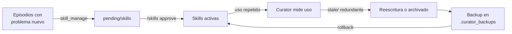

# 02 — Potencial de Hermes Agent ⭐

> Recorrido completo por **toda** la capacidad de [Hermes Agent](https://hermes-agent.nousresearch.com/docs)
> (Nous Research, licencia MIT, verificado el 2026-10-22) y, para cada capacidad, **cómo la usamos
> en la plataforma AgriAgents**. Este documento es la referencia maestra del "motor" del sistema.

Hermes no es solo un chatbot: es un **runtime de agentes auto-mejorables** con memoria persistente,
skills reutilizables que el propio agente crea y refina, automatización programada, delegación,
integración MCP, más de 21 plataformas de mensajería y múltiples formas de ser controlado por
código (API server OpenAI-compatible, ACP, JSON-RPC, librería Python).

---

## 1. Despliegue y plataforma

| Capacidad | Detalle | Uso en AgriAgents |
|---|---|---|
| Instalación | `curl … install.sh \| bash` (Linux/macOS/WSL2/Termux), PowerShell en Windows nativo; flags `--non-interactive --skip-browser` | Instalación silenciosa en el servidor Ubuntu (ver `10-despliegue-ubuntu.md`) |
| Plataformas soportadas | Linux, macOS, Windows, WSL2, Android/Termux; backends de terminal: local, Docker, SSH, Daytona, Modal, Vercel Sandbox | Servidor Ubuntu x86_64 como host único para todos los agentes |
| Licencia | MIT, código abierto | Sin lock-in; los datos y las skills son del usuario |
| Interfaces | CLI, TUI (Ink), app Desktop nativa, dashboard web, gateway de mensajería | El operador usa Telegram/WhatsApp/dashboard; nosotros usamos CLI para ops |
| Actualización | `hermes update`, canal `main`/estable; Nix opcional | Ventana de mantenimiento programada; backups de skills antes de actualizar |

**Potencial real:** un solo binario de ~45 MB + Python da un agente completo con todo lo de abajo.
No hay que construir el bucle de razonamiento, la memoria ni las herramientas: se **extiende**.

---

## 2. Identidad, memoria y contexto

| Capacidad | Detalle | Uso en AgriAgents |
|---|---|---|
| **SOUL.md** | Identidad primaria del agente (slot #1 del system prompt) | Cada agente de campo tiene su SOUL.md: "Eres el agente de riego del sitio X; prioriza agua sobre confort; nunca actúes fuera de tus límites" |
| **MEMORY.md / USER.md** | Memoria persistente del agente y modelo del usuario; tool `memory` (`add/patch/remove`) | El agente recuerda: tipo de cultivo, presupuesto de agua, error de calibración de una sonda, preferencias de reportes |
| **Búsqueda de sesiones (FTS5)** | Búsqueda full-text del histórico de conversaciones con resumen por LLM | "¿Qué decidimos la última vez que hubo helada?" → recuperación automática |
| **Providers de memoria externos** | Honcho (modelado dialéctico de usuario), Mem0, OpenViking, Hindsight, RetainDB… | Opcional: Honcho para personalización profunda por usuario en la versión SaaS |
| **Archivos de contexto** | `.hermes.md`, `AGENTS.md`, `CLAUDE.md`, `.cursorrules` inyectados | `AGENTS.md` por perfil con las reglas del dominio (ej. "el pH fuera de 5.5–6.5 siempre escala a humano") |
| **Referencias de contexto (@)** | Adjuntar archivos, URLs y diffs inline | El agente adjunta la ficha del cultivo o el gráfico de la serie al reportar |

**Potencial para el agro:** el agente **no empieza de cero cada mañana**. Si el lunes el técnico
corrigió la altura de la sonda, eso queda en memoria y el agente lo usa el martes. Es lo que
separa un chatbot de un *agente de campo*.

---

## 3. Skills (habilidades) y Curator (el bibliotecario que se auto-mejora)

| Capacidad | Detalle | Uso en AgriAgents |
|---|---|---|
| **Skills** | Documentos `SKILL.md` con *frontmatter*, cargados on-demand; progressive disclosure (solo lo necesario entra al contexto) | Skills de dominio: `riego-fao56`, `clima-invernadero`, `alerta-heladas`, `lab-qc-westgard`, `ganaderia-plf`… |
| **Creación por el agente** | Tool `skill_manage` (`create/patch/write_file/remove_file`) | Tras resolver un problema nuevo (ej. un protocolo de riego por estrés hídrico), el agente **escribe su propia skill** |
| **Aprobación de skills** | `skills.write_approval: true` → cambios a `~/.hermes/pending/skills/`, se aprueban con `/skills approve` | En producción: el agente propone, el humano aprueba. En piloto: autonomía total |
| **Curator** | Mantenimiento de fondo: usage tracking, detección de skills obsoletas, archivado, review con LLM, **backups y rollback** (`curator.backup/rollback`) | Cada 168 h revisa las skills agro: poda redundancias, reescribe pasos que fallaron, conserva versiones previas |
| **Skills Hub / agentskills.io** | Estándar abierto, skills portables y comunitarias | Instalar skills comunitarias (web scraping, reportes) y **publicar** las skills agro como producto |
| **Catálogo incluido** | ~90 skills incluidas + ~60 opcionales (Google Workspace, email, maps…) | Reutilizar sin construir: email para alertas, Sheets para reportes al cliente |
| **Linter automático** | `incident-log-shape`, `references-sprawl`, `oversized-body` | Mantiene las skills agro limpias y cortas |

**Potencial para el agro:** las skills son el **contrato de política** del agente. Cuando cambia una
norma (nueva ventana de riego permitida), se cambia la skill, no el modelo. Y cuando el Curator la
refina con lo aprendido en 500 episodios, **la mejora es instantánea para todos los agentes que la usan**.

---

## 4. Automatización: el sistema trabaja solo

| Capacidad | Detalle | Uso en AgriAgents |
|---|---|---|
| **Cron jobs** | Programación en lenguaje natural ("every 1m") o cron expr.; tool única `cronjob_manage`; ticker de 60 s en el gateway; pin de modelo y *reasoning effort* por job | **Pull-loop de cada agente**: cada minuto consulta `GET /v1/agent/tasks/next`; si 204 → `NO_REPLY` (cero spam, cero costo) |
| **Cron no-agent (scripts)** | Jobs que corren un script sin LLM; stdout entregado verbatim | Gates baratos: script que cuenta lecturas nuevas y solo despierta al agente si hay novedad (`wakeAgent: true/false`) |
| **Cron + webhooks** | Un webhook dispara el job al instante (no espera al tick) | Alerta de clima severo entrante → agente de heladas corre de inmediato |
| **Loops** | `/loop 5m <prompt>` con backoff autoregulado, min interval 30 s | Monitoreo continuo de una serie anómala mientras dura el evento |
| **Heartbeats** | `/heartbeat every 10m` reentra en la sesión solo cuando está idle | Vigilancia pasiva: "revisa el estado de las bombas"; `NO_REPLY` si todo bien |
| **Goals persistentes** | `/goal` con juez que emite `done/blocked/continue/wait` | Meta de temporada: "mantener humedad > 40 % en zona A hasta cosecha" — el agente persigue la meta entre turnos |
| **Delegación** | `delegate_task(goal, context, tasks[], background)` con hasta 10 subagentes aislados | El agente supervisor (`agro-ops`) descompone: uno revisa sensores, otro el pronóstico, otro el inventario de agua |
| **Kanban multi-agente** | Tablero SQLite con worker lanes por perfil, lease TTL | Opcional fase 2: visibilidad humana del trabajo de los agentes (hoy la cola vive en PostgreSQL; ver decisión B del plan) |
| **Hooks** | Código en puntos de vida del agente (post-tool, post-turno) | Auditoría: cada tool call de un agente se loguea a `audit_log` |
| **Batch processing** | Generación de trayectorias a escala con paralelismo y checkpointing | Nivel 1 del bucle de auto-mejora: crear datasets de entrenamiento a partir de miles de episodios |
| **Cron incidents** | Fallos repetidos con la misma firma alertan una vez, con cooldown y `ack` | Operación: si el pull-loop falla 3 veces seguidas, alerta al admin de plataforma |

**Potencial para el agro:** esto es la **guardia 24/7 sin nomina**. El cron baratísimo (scripts o
`NO_REPLY`) mantiene el costo bajo; el LLM solo se invoca cuando realmente hay trabajo.

---

## 5. Modelos, proveedores y resiliencia de inferencia

| Capacidad | Detalle | Uso en AgriAgents |
|---|---|---|
| **Cualquier provider** | Nous Portal, OpenRouter, OpenAI, Anthropic, Google, MiniMax, o **cualquier endpoint OpenAI-compatible** | MiniMax para razonamiento (ya configurado) |
| **Providers custom** | `providers: {agro-local: {api: http://127.0.0.1:11434/v1, transport: openai_chat}}` | Servir **nuestro LoRA** (entrenado con los episodios de la plataforma) vía Ollama/vLLM |
| **Fallback providers** | Cadena de respaldo automática si el provider primario cae | Si MiniMax falla → modelo local; si no hay GPU → modelo pequeño cloud |
| **Credential pools** | Varios API keys por provider, rotación y recuperación de rate limits | Pools de keys para la carga de miles de pull-loops |
| **Provider routing (OpenRouter)** | Preferencias por costo/velocidad/calidad | Tareas baratas a modelos económicos; decisiones críticas a modelos fuertes |
| **Modelos locales** | Ollama/llama.cpp/MLX; nada sale de la máquina | Modo offline-total para sitios con compliance estricta |
| **Mixture of Agents (MoA)** | Presets combinan varios modelos | Consenso para diagnóstico de plagas (visión + razonamiento) |
| **Pin por cron job** | Cada job puede clavar su modelo y su *reasoning effort* | Pull-loop a `minimal`; análisis diario a `high` |
| **Auxiliares** | Modelos de resumen/tarea secundaria configurables por separado | Compresión de contexto barata |

**Potencial para el agro:** el costo por decisión baja exponencialmente. Hoy un agente usa el LLM
caro para todo; con estas piezas: scripts para lo mecánico, modelo pequeño local para clasificar,
LLM fuerte solo para razonamiento complejo. Y **nuestro LoRA** eventually reemplaza al modelo base
para los flujos más repetidos (§9).

---

## 6. Integración programática (cómo Hermes se convierte en el cerebro detrás de FastAPI)

Tres protocolos + una librería, todos sobre el mismo core `AIAgent`:

| Protocolo | Transporte | Para qué lo usamos |
|---|---|---|
| **API server (OpenAI-compatible)** | HTTP + SSE bajo `API_SERVER_KEY`; `/v1/*`, `/api/sessions/*`, streaming `assistant.delta`, `tool.*`, `run.*` | Nuestra UI web y cualquier frontend hablan "OpenAI" contra Hermes |
| **ACP** | JSON-RPC sobre stdio | Editores (VS Code/Zed) para desarrollo de skills |
| **TUI gateway** | JSON-RPC stdio/WebSocket | Control fino de sesiones desde nuestro propio backend |
| **`AIAgent` como librería Python** | `import run_agent; AIAgent` | **Pieza clave**: FastAPI puede lanzar un turno de agente **en proceso** sin subproceso — un endpoint `/v1/agents/{id}/run` decide al instante |

**Potencial para el agro:** el endpoint de FastAPI no "adivina": llama al mismo core que usa el chat.
La latencia de una decisión baja de "esperar al próximo tick de cron" a **segundos** cuando el
evento es urgente (helada detectada ahora).

---

## 7. MCP: los agentes tocan nuestros datos de forma segura

| Capacidad | Detalle | Uso en AgriAgents |
|---|---|---|
| **MCP servers** | stdio o HTTP; tools con `outputSchema`; filtrado `tools.include/exclude` por glob; `lazy` para servidores pesados | Servidores propios: `agro-registry` (lectura), `agro-control` (comandos vía guarda), `agro-weather` (Open-Meteo), `agro-vision`, `agro-lims`, `homeassistant` |
| **Tools por perfil** | Cada perfil solo ve sus tools | Un agente de invernadero no ve herramientas de laboratorio |
| **`hermes mcp add/test`** | Alta y prueba desde CLI | CI: `hermes mcp test` en cada deploy |
| **Tokens OAuth** | `~/.hermes/mcp-tokens/` | Acceso a MCP servers externos (ej. Nous Portal MCP) |

**Potencial para el agro:** el LLM **nunca escribe directo en la BD**. Lee por `agro-registry` (rol
read-only con `statement_timeout`) y actúa por `agro-control` (que obliga a pasar por la guarda
determinista). Es el "permiso mínimo necesario" aplicado a agentes.

---

## 8. Mensajería y canales: el agente vive donde vive el usuario

| Familia | Plataformas (21+) | Uso en AgriAgents |
|---|---|---|
| Chat mayoritario | Telegram, Discord, Slack, WhatsApp (Baileys y Cloud API), Signal, SMS (Twilio), email (IMAP/SMTP), Matrix, Mattermost, Teams, LINE, DingTalk, Feishu, WeChat/WeCom, Google Chat, IRC | **Cliente** recibe alertas y aprueba decisiones donde ya trabaja (típicamente WhatsApp/Telegram) |
| Notificaciones | ntfy, webhooks salientes | Push a la app del campo |
| Home Assistant | Plugin dedicado, entrega `homeassistant` | El agente publica estado en HA y recibe eventos |
| A2A | Agent-to-Agent | Agentes de distintos sitios/se tenants se saludan (fase futura) |
| **Delivery de cron** | `origin`, `local`, `all`, fan-out combinado | El resultado del pull-loop va al chat del cliente correcto (por `chat_id` guardado en el usuario) |
| **Webhooks entrantes** | GitHub/GitLab y genéricos; evento → cron job | Proveedor de clima externo nos avisa de alerta → agente corre ya |
| **`hermes send`** | Enviar desde cualquier script | Scripts de monitoreo mandan alertas sin LLM |
| **`bot-chat` delivery** | El output se entrega a OTRO perfil de Hermes como mensaje | Un agente notifica a otro agente (handoff) |

**Potencial para el agro:** el cliente **no instala una app nueva**. Habla por WhatsApp con "su"
agente: le pregunta "¿cómo va la humedad?" y le manda "riega la zona B solo hasta las 9". La
aprobación de decisiones críticas ocurre en el mismo hilo.

---

## 9. Auto-mejora: el núcleo diferencial

| Capacidad | Detalle | Uso en AgriAgents |
|---|---|---|
| **Bucle de skills (Nivel 0)** | Agente crea/refina skills; Curator mantiene; humano aprueba | Mejora continua de la *política* sin tocar pesos |
| **Batch processing** | Trajectories.jsonl (formato ShareGPT) + statistics; filtros de calidad; `--resume` | Construcción de datasets desde los episodios de miles de decisiones reales |
| **Trajectory format / Agent Loop doc** | Formato y ciclo de ejecución documentados | Nuestro pipeline de entrenamiento conoce exactamente el formato |
| **LoRA/SFT externo (Nivel 1)** | Entrenamos con TRL/Axolotl y servimos por provider OpenAI-compatible | Modelo `agro-riego-v2` en Ollama; **promotion gate** en PostgreSQL antes de servirlo |
| **RL sobre simulador (Nivel 2)** | Entornos en ramas `atropos-*` (`HermesAgentBaseEnv`, `compute_reward`) | Entrenar política de riego CEA con recompensa = rendimiento − energía − agua |
| **Memoria del modelo de usuario** | Honcho dialectic | Personalización fina por cliente en SaaS |

**Potencial para el agro:** la plataforma **no se degrada con el tiempo — se ensaya**. Cada temporada
deja miles de episodios; de ahí salen la próxima skill y el próximo LoRA. Nadie reescribe el
firmware del MCU para mejorar: se mejora el cerebro.

---

## 10. Seguridad y aislamiento

| Capacidad | Detalle | Uso en AgriAgents |
|---|---|---|
| **Aprobación de comandos peligrosos** | Tool approval por comandos destructivos | Un agente no puede correr `rm` ni tocar el sistema sin aprobación |
| **Aislamiento en contenedores/sandboxes** | Docker/Modal/Daytona como terminal backend | Los agentes corren acotados; no ven el FS del servidor |
| **Egress proxy / iron-proxy** | Firewall de salida, allowlist de hosts, inyección de credenciales | El agente solo puede llamar a: nuestra API, Open-Meteo, el LLM |
| **Network isolation (Docker)** | Segmentación de redes | Borde de seguridad adicional |
| **Managed scope** | Configuración fijada por admin, inmutable por el usuario | El admin de plataforma fija el provider global; los clientes no lo cambian |
| **Secrets managers** | Bitwarden, 1Password, fuentes por comando | API keys de clima, credenciales de instrumentos |
| **Checkpoints y rollback** | Snapshots tipo git del filesystem del agente | Antes de una auto-mejora grande: snapshot restaurable |
| **Redacción de secretos** | En outputs de cron y entregas | Una clave nunca sale al chat del cliente |

---

## 11. Medios y web (visión, voz, navegador)

| Capacidad | Detalle | Uso en AgriAgents |
|---|---|---|
| **Vision** | Imágenes pegadas → análisis multimodal | Diagnóstico de hojas (oídio, Botrytis) desde foto del técnico o de la cámara del invernadero |
| **Image generation** | FAL.ai, FLUX/GPT-Image/etc. | Generar infografías de reportes al cliente |
| **Voice mode** | Voz en tiempo real (CLI, Telegram, Discord) + wake word "Hey Hermes" | Supervisor habla manos-libres desde el invernadero |
| **Browser** | CDP local o cloud; form-filling, scraping | Consulta de precios de commodity, portales de clima oficiales |
| **Web search & extract** | Varios backends, incl. SearXNG self-hosted | Investigación de plagas, normativa |
| **Document extraction** | PDF/Office/notebooks → texto | Fichas de cultivo, manuales de instrumentos → base RAG |
| **Deliverable mode** | Adjunta gráficas, PDFs, spreadsheets al chat | Reporte semanal PDF con curvas de humedad |

---

## 12. Observabilidad y operación

| Capacidad | Detalle | Uso en AgriAgents |
|---|---|---|
| **Dashboard web** | Config, API keys, MCP, mensajería, webhooks, memoria, sesiones, logs, analíticas, cron, skills | Panel del admin de plataforma (puerto 9119) |
| **Gateway monitoring** | Health export, diagnósticos estructurados, métricas | Prometheus/Grafana del estado de Hermes |
| **`hermes doctor` / `cron doctor`** | Diagnóstico de salud; exit 1 con hallazgos | Watchdog en systemd/cron del servidor |
| **Session storage recovery** | Recuperación de `state.db` corrupto | Runbook de DR (ver `11-roadmap`) |
| **Ejecuciones de cron auditables** | `hermes cron runs` con ledger inmutable | Auditoría de qué agente corrió cuándo y con qué resultado |
| **Extensión del dashboard** | Themes, plugins, slots, rutas backend | Pestañas custom: "Agentes Agri" dentro del dashboard de Hermes |

---

## 13. Plugins y ecosistema

| Capacidad | Detalle | Uso en AgriAgents |
|---|---|---|
| **Sistema de plugins** | Tools, hooks, integraciones propias | Empaquetar `agro-registry`/`agro-control` como plugin Hermes reutilizable |
| **Plugin catalog** | Instalación en un clic, revisada | `homeassistant` y otros del catálogo |
| **Built-in plugins** | Disk-cleanup y amigos por hooks | Mantenimiento del servidor |
| **Build a Plugin (guía)** | Paso a paso con tools, hooks, skills | El SDK con el que construiremos nuestros MCP/plugins |
| **Import from other agents** | Migra setups de OpenClaw/Claude Code/Codex/Cursor | Si el cliente ya usaba otro agente, migra skills y reglas |

---

## 14. Tabla maestra: feature de Hermes → pieza de AgriAgents

| Feature de Hermes | Pieza en la plataforma | Documento |
|---|---|---|
| SOUL.md / MEMORY.md / memory tool | Identidad y memoria por agente de campo | `06` |
| Skills + skill_manage | Skills de dominio (riego, heladas, plagas, QC…) | `06` |
| Curator + backups/rollback | Ciclo de refinamiento de skills con auditoría | `06` |
| Cron pull-loop + no-agent gates | "¿Hay ejecuciones?" de cada agente cada minuto | `05`, `06` |
| Cron webhooks / event-triggered | Alerta de clima severo → agente inmediato | `05` |
| Loops / heartbeats / goals | Vigilancia continua y metas de temporada | `06` |
| delegate_task | Supervisor que descompone problemas | `06` |
| Batch processing / trajectory format | Nivel 1 (SFT/LoRA) del bucle de auto-mejora | `06` |
| Providers custom + Ollama | Servir el LoRA propio `agro-*` | `06`, `10` |
| Fallback + credential pools | Disponibilidad 24/7 del razonamiento | `10` |
| AIAgent como librería | Endpoint `/v1/agents/{id}/run` (decisión urgente) | `05` |
| API server OpenAI-compatible | UI web y frontends externos | `05` |
| MCP servers + filtrado | agro-registry / agro-control / weather / vision / lims | `03`, `09` |
| 21+ plataformas de mensajería | Alertas y aprobaciones por WhatsApp/Telegram | `09` |
| Home Assistant plugin | Domótica de casa e invernadero | `08` |
| Vision / voice / browser | Diagnóstico visual, supervisión hablada, scraping | `08` |
| Egress proxy / iron-proxy / managed scope | Aislamiento del agente en producción | `09` |
| Secrets managers | Claves de APIs meteorológicas e instrumentos | `09` |
| Checkpoints / rollback | Red de seguridad de la auto-mejora | `06` |
| Dashboard + gateway monitoring | Panel del admin y métricas Prometheus | `10` |
| Kanban (fase 2) | Tablero humano espejo del trabajo de agentes | `03` |
| A2A messaging | Coordinación entre sitios (futuro) | `01` |

---

## 15. Límites y consideraciones reales

| Tema | Realidad | Manejo |
|---|---|---|
| Costo de LLM | Cada turno de agente cuesta tokens | Scripts no-agent para gates; `NO_REPLY` barato; modelos locales para lo repetitivo |
| Estado interno SQLite | `state.db` no es estable entre versiones | Nunca consultar; todo lo crítico vive en PostgreSQL nuestro |
| Cron no crea cron | Un job de cron no puede crear otros jobs (por defecto) | Orquestación de pull-loops desde nuestro despliegue (systemd/CLI), no por el agente |
| Entorno de RL (Atropos) | `environments/` no está en `main` | Pinear rama `atropos-hermes-agent`; Nivel 1 (SFT) no depende de eso |
| Skills auto-creadas | Pueden salir corruptas o peligrosas | `write_approval` + Curator + linters + backups |
| Aislamiento por perfil | Un perfil = una identidad; la BD nuestra debe filtrar por usuario | El rol de BD del agente es read-only + `statement_timeout`; el filtro por `user_id` está en la API/MCP, no en la BD de Hermes |

---

**Siguiente:** [`03-arquitectura.md`](03-arquitectura.md) — cómo se montan todas estas piezas.
