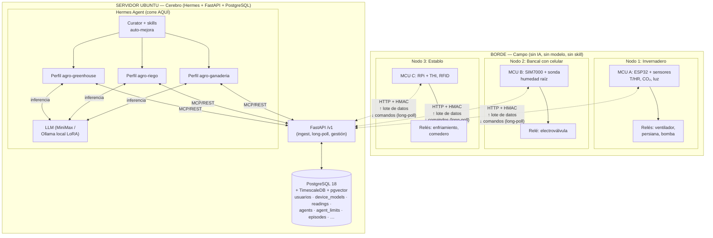
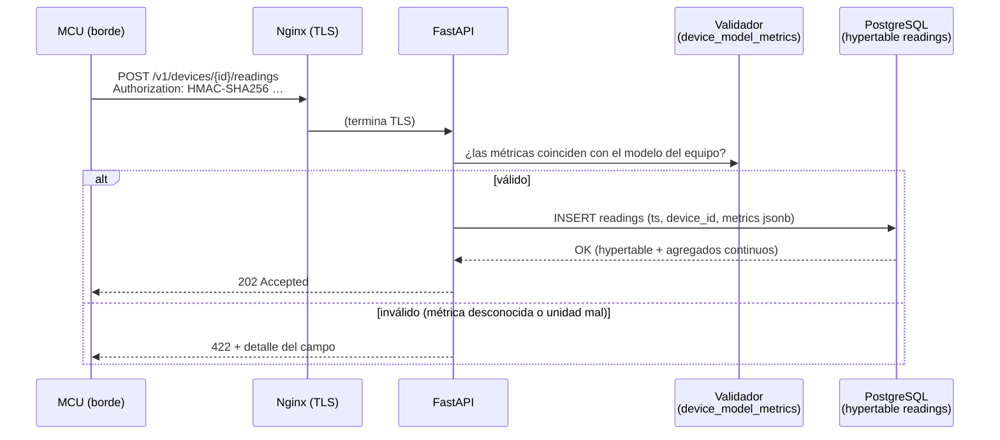
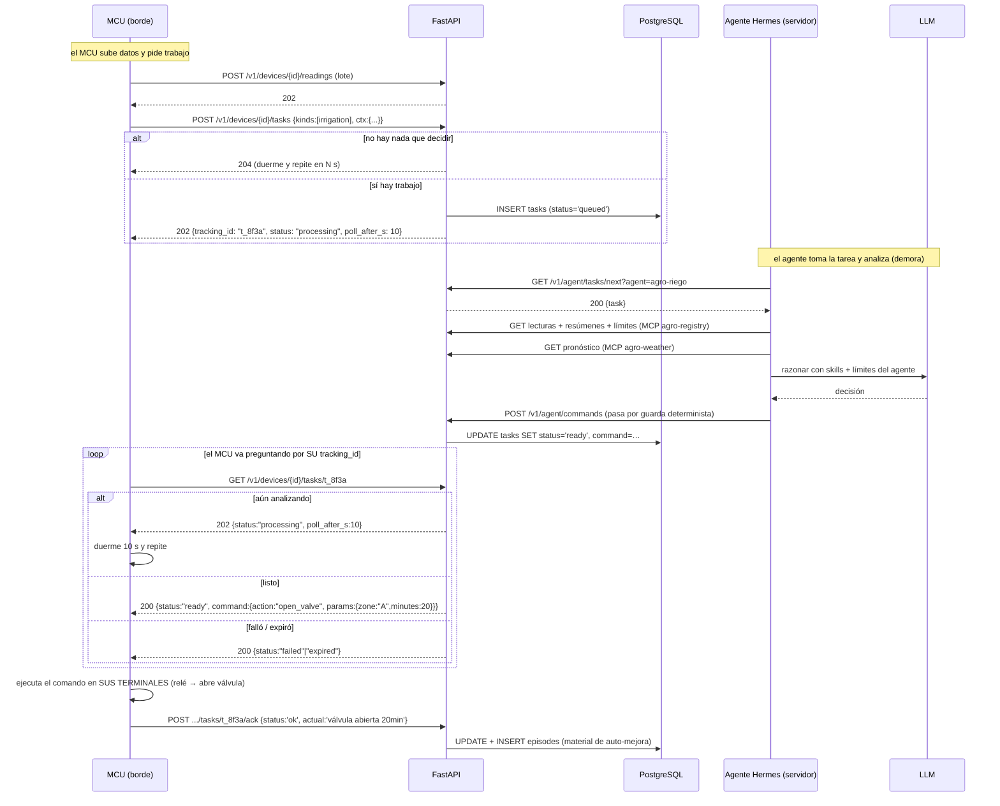
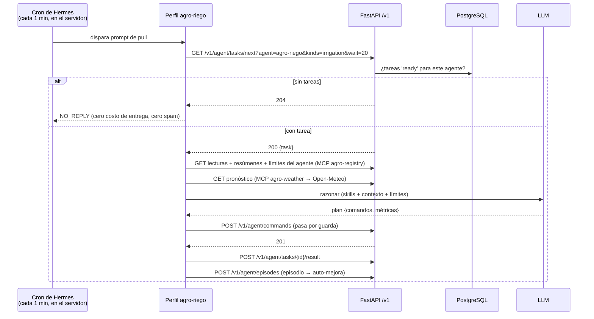
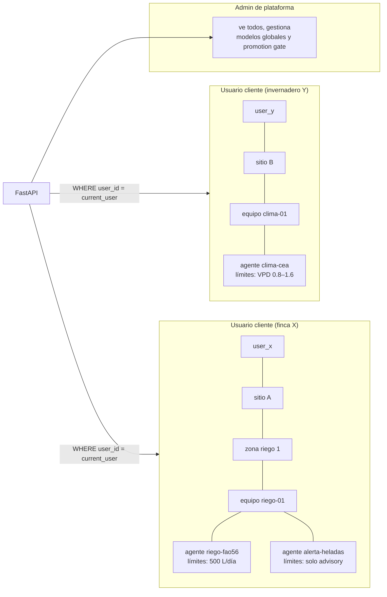

# 03 — Arquitectura

> Cómo se montan las piezas. **Regla de oro: todo lo que "piensa" corre en el servidor Ubuntu;
> el microcontrolador de campo solo mide, manda lotes HTTP y ejecuta relés.**

---

## 1. Separación servidor ↔ borde (la decisión estructural)



### 1.1 ¿Qué corre exactamente en el servidor?

| Componente | Rol | ¿Dónde vive? |
|---|---|---|
| **Hermes Agent** (procesos `hermes gateway`, perfiles, cron) | Los agentes: razonamiento, skills, memoria, pull-loop | **Servidor** |
| **LLM** (MiniMax remoto u Ollama local) | Inferencia de los agentes | Cloud u **otro servicio del servidor** |
| **FastAPI** (`agriapi.service`) | API REST `/v1`: ingest, long-poll de comandos, gestión de usuarios/agentes/límites | **Servidor** |
| **PostgreSQL 18 + TimescaleDB** | Única fuente de verdad | **Servidor** |
| **Nginx** | TLS, rate-limit, reverse proxy | **Servidor** |
| **Grafana + Prometheus** | Observabilidad | **Servidor** |
| **Ollama / vLLM** (opcional) | Servir el LoRA propio `agro-*` | **Servidor** (o GPU externa) |

### 1.2 ¿Qué corre en el microcontrolador? (nada de IA)

| Elemento | Rol |
|---|---|
| MCU (ESP32 / RPi / módem SIM800 o SIM7000 + MCU) | Procesador mínimo |
| Firmware HTTP-only | TLS client + HMAC-SHA256 + parser JSON + máquina de estados de comandos |
| Sensores (I²C/ADC/1-Wire) | Lectura física |
| Relés/MOSFET | Acción física |
| **Buffer local (flash/RAM)** | Cola de lecturas no enviadas + registro de comandos ejecutados sin ack |
| **Política de fallback firmada** | Último "cómo actuar si no hay red" que el servidor le entregó (horarios, umbrales, histéresis) |

**El MCU no tiene modelo, no tiene skill, no tiene prompt, no tiene "agente".** Si mañana aparece
otro MCU más capaz, se cambia el firmware, no la arquitectura.

---

## 2. Capas de la plataforma (servidor)

```mermaid
flowchart TB
    subgraph L5["L5 · Presentación"]
        DASH[Hermes Dashboard :9119<br/>+ futura UI AgriAgents]
        CHAT[WhatsApp / Telegram<br/>del cliente]
    end
    subgraph L4["L4 · Orquestación de agentes (Hermes)"]
        PROF[Perfiles: agro-greenhouse ·<br/>agro-riego · agro-ganaderia · agro-lab ·<br/>agro-home · agro-ops · agro-trainer]
        SK[Skills ~/.hermes/skills/agro/**]
        CR[Cron pull-loop 1 min]
    end
    subgraph L3["L3 · API de dominio (FastAPI /v1)"]
        ING[ingest]
        CMD[long-poll comandos]
        AGT[gestión agentes + límites]
        OPS[ops/health/board/audit]
    end
    subgraph L2["L2 · Motor de seguridad"]
        GUARD[Guard determinista<br/>(rangos, presupuesto, lockouts)]
    end
    subgraph L1["L1 · Datos"]
        PG[("PostgreSQL 18<br/>registro oficial")]
        LAKE[("Lake Parquet / DuckDB<br/>analítica + datasets")]
        RAG[("pgvector: docs agronómicos")]
    end
    L5 --> L4 --> L3 --> L2 --> L1
```

---

## 3. Flujo 1 — Telemetría (datos suben)



- El MCU **espera corto** (timeout ~10–30 s) y reintenta con backoff; si falla, acumula en buffer.
- `readings` es **hipertable** de TimescaleDB particionada por tiempo; los **agregados continuos**
  (hora/día) se materializan solos → los resúmenes que pide el agente son baratos de leer.

---

## 4. Flujo 2 — Tarea del dispositivo con **tracking_id** (protocolo principal)

El MCU **siempre funciona con internet (IoT)**: manda datos **y consulta tareas**. Pero el análisis
del agente (LLM) **demora** — puede tardar de segundos a un minuto. Por eso el protocolo es
**asíncrono con id de seguimiento**:

1. El MCU pide "¿hay trabajo para mí?" → el servidor le devuelve **inmediatamente** un `tracking_id`.
2. El agente (Hermes, **en el servidor**) analiza en segundo plano (tarda lo que tarde el LLM).
3. El MCU **vuelve a preguntar con ese `tracking_id`**: "¿ya terminaste?".
4. Cuando el servidor responde `ready`, el payload trae **la acción a ejecutar en sus terminales**
   (relés/válvulas). El MCU la ejecuta y manda el ack.



**Propiedades de este diseño:**

| Propiedad | Cómo se logra |
|---|---|
| El MCU nunca espera bloqueado el LLM | El servidor responde 202 con `tracking_id` en < 1 s; el análisis corre en el agente |
| El MCU controla su ritmo (batería/datos) | Elige cuándo volver a preguntar (`poll_after_s` es solo una sugerencia) |
| Sobrevive a latencia variable del LLM | El polling tolera 5 s o 90 s sin romperse |
| El MCU sabe QUÉ hacer "en sus terminales" | El `command` del payload es una acción concreta (`open_valve`, `set_fan`, …) |
| Trazabilidad total | `tracking_id` = `tasks.id`; su estado, decisión, guarda y ack quedan en PostgreSQL |

### 4.1 Carril rápido: `commands/next` (long-poll)

Para acciones que **no necesitan análisis** (override manual desde la app del cliente, comandos de
emergencia, políticas de fallback re-firmadas) existe además el long-poll clásico:

```
GET /v1/devices/{id}/commands/next?wait=25   →  200 con comando  |  204 si no hay nada
```

El MCU puede consultar ambos: primero `tasks/{id}` (si tiene un tracking abierto), luego
`commands/next` (carril rápido). En la práctica el firmware hace las dos peticiones en su ciclo.

**Por qué long-poll/polling y no websockets/MQTT:**

| Alternativa | Problema para SIM800/7000 | Long-poll HTTP |
|---|---|---|
| MQTT persistente | Sesión TCP larga = consumo de batería y de datos; brokers a mantener | Conexión corta por iteración |
| WebSocket | Mismo problema + complejidad en el módem | Nativo de HTTP/1.1 |
| Push del servidor | IMPOSSIBLE sin IP pública estable del MCU (CGNAT celular) | El MCU inicia siempre |

**Costo por consulta vacía:** unos cientos de bytes. Con `wait=25` el MCU hace ~2–3 peticiones/minuto
en ventana activa → costo de datos trivial aún en plan pre-pago.

---

## 5. Flujo 3 — Tarea de agente (pull-loop de Hermes)



---

## 6. Multiusuario: cómo se aísla cada mundo



Cada fila en las tablas lleva `user_id` (o lo hereda vía `site_id`/`device_id`). Los perfiles de
Hermes ejecutan sus queries **siempre** a través de la API o de un rol de BD read-only con
`statement_timeout`, y el filtro de tenant está en la capa de servicio, no en la confianza del LLM.

---

## 7. Por qué HTTP y no MQTT (resumen de la decisión)

| Criterio | MQTT | HTTP + long-poll |
|---|---|---|
| Dispositivo único tras CGNAT celular | Requiere broker público + sesión persistente | ✅ El MCU inicia la conexión |
| Batería (deep-sleep) | Mal: mantener sesión | ✅ Ciclo: despertar → HTTP → dormir |
| Costo de datos (SIM pre-pago) | Corazón de sesión constante | ✅ Bytes solo cuando hay tráfico |
| Complejidad en SIM800L | Client MQTT pesado | ✅ AT+HTTPGET simple |
| Firewall/empresa | Bloquean 1883 | ✅ 443 abierto |
| Auditoría | Payloads en broker | ✅ Todo pasa por nuestra API y BD |
| **Decisión** | Descartado para v1 | **Aprobado** |

---

## 8. Despliegue de procesos (vista del servidor Ubuntu)

```mermaid
flowchart LR
    subgraph SYSTEMD["systemd"]
        NG[nginx]
        PGW[postgresql@18]
        APIG[agriapi.service<br/>(uvicorn FastAPI)]
        HGW[hermes gateway.service<br/>(pull-loops + cron)]
        OLL[ollama.service<br/>(opcional)]
        GRA[grafana]
    end
    NG -->|:443 TLS| APIG
    APIG --> PGW
    HGW -->|HTTP /v1 + MCP| APIG
    HGW --> OLL
    APIG --> GRA
```

Un solo servidor Ubuntu aguanta el piloto completo (ver `10-despliegue-ubuntu.md` para el outline
y `11-roadmap` para las fases).

---

**Siguiente:** [`04-base-de-datos.md`](04-base-de-datos.md) — el esquema completo.
