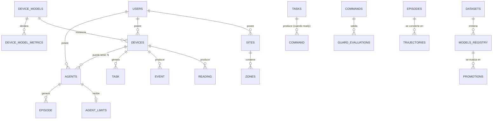

# 04 — Base de datos

> **PostgreSQL 18 + TimescaleDB** (+ PostGIS + pgvector) como única fuente de verdad de la plataforma.
> Cubre: usuarios, catálogo de modelos con **métricas dinámicas**, telemetría en **JSONB**,
> cola de tareas con `tracking_id`, comandos, agentes, **límites por agente**, y todo el material
> del bucle de **auto-mejora** (episodios → datasets → modelos → promociones).

---

## 1. Extensiones habilitadas

```sql
CREATE EXTENSION IF NOT EXISTS timescaledb;  -- hypertables + agregados continuos
CREATE EXTENSION IF NOT EXISTS postgis;      -- parcelas, zonas, geocodificación
CREATE EXTENSION IF NOT EXISTS vector;       -- embeddings RAG agronómico
CREATE EXTENSION IF NOT EXISTS pgcrypto;     -- gen_random_uuid(), HMAC en BD (si aplica)
```

---

## 2. Multiusuario: usuarios, roles, API keys

```sql
CREATE TABLE users (
  id            uuid PRIMARY KEY DEFAULT gen_random_uuid(),
  email         text UNIQUE NOT NULL,
  password_hash text,                          -- null si auth externa
  role          text NOT NULL DEFAULT 'cliente',  -- 'admin' | 'cliente'
  display_name  text,
  locale        text DEFAULT 'es',
  telegram_chat_id text,                       -- para entrega de alerts/decisions
  wa_phone      text,
  active        boolean DEFAULT true,
  created_at    timestamptz DEFAULT now(),
  updated_at    timestamptz DEFAULT now()
);

CREATE TABLE api_keys (
  id         uuid PRIMARY KEY DEFAULT gen_random_uuid(),
  user_id    uuid NOT NULL REFERENCES users(id) ON DELETE CASCADE,
  key_prefix text NOT NULL,          -- 'agri_sk_' + hash; la llave completa solo se ve al crear
  role       text NOT NULL DEFAULT 'cliente',
  scopes     text[] DEFAULT '{read,write}',   -- 'admin' añade 'admin'
  last_used_at timestamptz,
  revoked_at   timestamptz,
  created_at   timestamptz DEFAULT now()
);
```

**Aislamiento:** cada fila dominante (`sites`, `devices`, `agents`) lleva `user_id`. Todas las
consultas de la API y del agente se filtran por `user_id` del token; el rol de BD que usa el
agente es de **solo lectura** con `statement_timeout` (ver `09`).

---

## 3. Sitios, zonas, modelos de equipo y sus métricas dinámicas ⭐

```sql
CREATE TABLE sites (
  id        uuid PRIMARY KEY DEFAULT gen_random_uuid(),
  user_id   uuid NOT NULL REFERENCES users(id) ON DELETE CASCADE,
  name      text NOT NULL,
  kind      text NOT NULL,            -- 'invernadero'|'granja'|'casa'|'laboratorio'
  location  geography(Point, 4326),
  created_at timestamptz DEFAULT now()
);

CREATE TABLE zones (
  id       uuid PRIMARY KEY DEFAULT gen_random_uuid(),
  site_id  uuid NOT NULL REFERENCES sites(id) ON DELETE CASCADE,
  name     text NOT NULL,
  geom     geography(Polygon, 4326),
  crop     text,
  created_at timestamptz DEFAULT now()
);

-- Catálogo de modelos de equipo (la fuente de las "columnas dinámicas")
CREATE TABLE device_models (
  id          uuid PRIMARY KEY DEFAULT gen_random_uuid(),
  vendor      text,
  model_code  text UNIQUE NOT NULL,     -- 'meteostation-x200', 'riego-sim7000-v2'
  description text,
  created_at  timestamptz DEFAULT now()
);

-- Cada modelo declara SUS métricas → esto valida el JSONB dinámico
CREATE TABLE device_model_metrics (
  id         uuid PRIMARY KEY DEFAULT gen_random_uuid(),
  model_id   uuid NOT NULL REFERENCES device_models(id) ON DELETE CASCADE,
  name       text NOT NULL,             -- 'soil_moisture_pct'
  unit       text,                      -- '%', '°C', 'hPa'
  dtype      text NOT NULL DEFAULT 'double',  -- 'double'|'int'|'bool'|'string'
  min_value  double precision,
  max_value  double precision,
  is_primary boolean DEFAULT false,     -- métrica principal del modelo
  UNIQUE (model_id, name)
);
```

**Por qué así:** un modelo de estación meteoreológica manda `temp`, `hr`, `press`, `rain_mm`,
`wind_ms`; un equipo de riego manda `soil_moisture_pct`, `flow_lpm`, `valve_state`. El JSONB de
`readings` almacena lo que el modelo declare; `device_model_metrics` es el contrato que la API
valida en cada lote (si llega un `name` no declarado → `422`).

---

## 4. Dispositivos (equipos) y credenciales

```sql
CREATE TABLE devices (
  id          uuid PRIMARY KEY DEFAULT gen_random_uuid(),
  user_id     uuid NOT NULL REFERENCES users(id) ON DELETE CASCADE,
  site_id     uuid REFERENCES sites(id) ON DELETE SET NULL,
  zone_id     uuid REFERENCES zones(id) ON DELETE SET NULL,
  model_id    uuid NOT NULL REFERENCES device_models(id),
  serial      text UNIQUE,               -- número de serie físico
  label       text,
  comm_type   text,                      -- 'wifi'|'ethernet'|'sim800'|'sim7000'
  firmware_ver text,
  active      boolean DEFAULT true,
  last_seen_at timestamptz,
  created_at  timestamptz DEFAULT now()
);

CREATE TABLE device_credentials (
  device_id  uuid PRIMARY KEY REFERENCES devices(id) ON DELETE CASCADE,
  secret_hash text NOT NULL,             -- HMAC-SHA256 del device_secret (nunca el claro)
  rotated_at  timestamptz,
  created_at  timestamptz DEFAULT now()
);
```

---

## 5. Telemetría: `readings` (hypertable JSONB) + agregados

```sql
CREATE TABLE readings (
  time       timestamptz NOT NULL,
  device_id  uuid NOT NULL REFERENCES devices(id) ON DELETE CASCADE,
  seq        bigint,                     -- orden del MCU (anti-perdida)
  metrics    jsonb NOT NULL,             -- {"soil_moisture_pct":31.5,"air_temp_c":24.8,...}
  quality    smallint DEFAULT 1,         -- 1=ok, 0=dudosa
  PRIMARY KEY (time, device_id)
);

-- Hypertable de TimescaleDB particionada por tiempo
SELECT create_hypertable('readings', 'time', chunk_time_interval => INTERVAL '1 day');

-- Índice GIN para buscar por métrica concreta dentro del JSONB
CREATE INDEX idx_readings_metrics ON readings USING gin (metrics jsonb_path_ops);
CREATE INDEX idx_readings_device_time ON readings (device_id, time DESC);
```

### 5.1 Agregados continuos (los "resúmenes" que pide el agente)

```sql
CREATE MATERIALIZED VIEW readings_hour
WITH (timescaledb.continuous) AS
SELECT time_bucket('1 hour', time) AS bucket,
       device_id,
       avg((metrics->>'air_temp_c')::float)   AS air_temp_c_avg,
       min((metrics->>'air_temp_c')::float)   AS air_temp_c_min,
       max((metrics->>'air_temp_c')::float)   AS air_temp_c_max,
       avg((metrics->>'soil_moisture_pct')::float) AS soil_moisture_pct_avg,
       count(*) AS n
FROM readings
GROUP BY bucket, device_id;
```

> El agente casi nunca lee `readings` cruda para decidir: lee `readings_hour` (o `readings_day`),
> que son baratas y están precalculadas. La cruda se usa para auditar y para datasets de ML.

---

## 6. Eventos y alertas

```sql
CREATE TABLE events (
  time       timestamptz NOT NULL,
  device_id  uuid NOT NULL REFERENCES devices(id) ON DELETE CASCADE,
  kind       text NOT NULL,        -- 'heartbeat','actuator_state','fault','frost_warning'
  payload    jsonb,
  PRIMARY KEY (time, device_id, kind)
);
SELECT create_hypertable('events', 'time');

CREATE TABLE alerts (
  id        uuid PRIMARY KEY DEFAULT gen_random_uuid(),
  device_id uuid REFERENCES devices(id) ON DELETE CASCADE,
  agent_id  uuid,                   -- ver §9
  severity  text NOT NULL,          -- 'info'|'warning'|'critical'
  kind      text NOT NULL,
  message   text,
  created_at timestamptz DEFAULT now(),
  acked_at  timestamptz
);
```

---

## 7. Cola de tareas con `tracking_id` ⭐

```sql
CREATE TABLE tasks (
  id          uuid PRIMARY KEY DEFAULT gen_random_uuid(),   -- == tracking_id que ve el MCU
  device_id   uuid NOT NULL REFERENCES devices(id) ON DELETE CASCADE,
  user_id     uuid NOT NULL REFERENCES users(id) ON DELETE CASCADE,
  agent_id    uuid,                         -- agente asignado (ver §9)
  kind        text NOT NULL,                -- 'irrigation'|'alert'|'ventilation'|...
  status      text NOT NULL DEFAULT 'queued',
                -- 'queued'|'processing'|'ready'|'failed'|'expired'|'done'
  input       jsonb,                        -- contexto que mandó el MCU + snapshot de datos
  command     jsonb,                        -- resultado: la acción a ejecutar (cuando status='ready')
  rationale   text,                         -- explicación del agente (auditable)
  decision_id uuid,
  poll_after_s int DEFAULT 10,              -- sugerencia de reintento al MCU
  lease_until timestamptz,                  -- lease del agente que la tomó
  attempts    int DEFAULT 0,
  max_attempts int DEFAULT 3,
  expires_at  timestamptz,
  created_at  timestamptz DEFAULT now(),
  updated_at  timestamptz DEFAULT now()
);

CREATE INDEX idx_tasks_claim ON tasks (agent_id, status, created_at)
  WHERE status IN ('queued','processing');
CREATE INDEX idx_tasks_device ON tasks (device_id, status);
```

**Flujo de estado:** `queued` → (agente hace claim) → `processing` → `ready`/`failed`/`expired` →
`done` (tras el `ack` del MCU). El `id` de esta tabla es el **`tracking_id`** que el MCU consulta.

---

## 8. Comandos, decisiones y guardas deterministas

```sql
CREATE TABLE commands (
  id        uuid PRIMARY KEY DEFAULT gen_random_uuid(),
  device_id uuid NOT NULL REFERENCES devices(id) ON DELETE CASCADE,
  task_id   uuid REFERENCES tasks(id) ON DELETE SET NULL,
  action    text NOT NULL,          -- 'open_valve','set_fan','set_light',...
  params    jsonb,                  -- {"zone":"A","minutes":20}
  status    text DEFAULT 'ready',   -- 'ready'|'sent'|'acked'|'failed'|'expired'
  deadline  timestamptz,
  acked_at  timestamptz,
  actual    jsonb,                  -- estado real reportado por el MCU
  guard_id  uuid,
  created_at timestamptz DEFAULT now()
);

CREATE TABLE decisions (
  id         uuid PRIMARY KEY DEFAULT gen_random_uuid(),
  agent_id   uuid REFERENCES agents(id) ON DELETE SET NULL,
  user_id    uuid NOT NULL REFERENCES users(id) ON DELETE CASCADE,
  question   text,
  options    jsonb,
  rationale  text,
  status     text DEFAULT 'pending',  -- 'pending'|'approved'|'rejected'|'expired'
  decided_by uuid REFERENCES users(id),
  created_at timestamptz DEFAULT now()
);

CREATE TABLE guard_policies (
  id         uuid PRIMARY KEY DEFAULT gen_random_uuid(),
  user_id    uuid REFERENCES users(id) ON DELETE CASCADE,
  scope      text NOT NULL,          -- 'global'|'site'|'device'|'agent'
  scope_id   uuid,
  rule       jsonb NOT NULL,         -- {"type":"range","metric":"air_temp_c","min":15,"max":30}
  mode       text DEFAULT 'enforce', -- 'enforce'|'advisory'
  created_at timestamptz DEFAULT now()
);

CREATE TABLE guard_evaluations (
  id          uuid PRIMARY KEY DEFAULT gen_random_uuid(),
  command_id  uuid REFERENCES commands(id) ON DELETE CASCADE,
  guard_id    uuid,
  passed      boolean NOT NULL,
  details     jsonb,
  evaluated_at timestamptz DEFAULT now()
);
```

---

## 9. Registro de agentes y **límites por agente** ⭐

```sql
CREATE TABLE agents (
  id             uuid PRIMARY KEY DEFAULT gen_random_uuid(),
  user_id        uuid NOT NULL REFERENCES users(id) ON DELETE CASCADE,
  device_id      uuid REFERENCES devices(id) ON DELETE CASCADE,   -- null = agente de sitio
  name           text NOT NULL,
  kind           text NOT NULL,          -- 'irrigation'|'frost_alert'|'climate'|'health'|...
  hermes_profile text NOT NULL,          -- perfil Hermes: 'agro-riego', 'agro-heladas'...
  skills         text[] DEFAULT '{}',    -- skills activas
  model_pin      text,                   -- modelo LLM pineado (null = default)
  schedule       text DEFAULT 'every 1m',
  enabled        boolean DEFAULT true,
  version        int DEFAULT 1,          -- se incrementa al cambiar skills/modelo
  created_at     timestamptz DEFAULT now(),
  updated_at     timestamptz DEFAULT now()
);

-- Límites manuales por agente, ajustables vía API (auditoría por cada cambio)
CREATE TABLE agent_limits (
  id            uuid PRIMARY KEY DEFAULT gen_random_uuid(),
  agent_id      uuid NOT NULL REFERENCES agents(id) ON DELETE CASCADE,
  -- ejemplo de límites:
  water_budget_l_per_day   double precision,
  humidity_min_pct         double precision,
  allowed_actions          text[],        -- whitelist de acciones
  require_human_approval_above_l double precision,
  active_window            text,          -- '05:00-09:00'
  min_minutes_between_commands int,
  extra                     jsonb,        -- límites específicos del dominio
  updated_by    uuid REFERENCES users(id),
  created_at    timestamptz DEFAULT now(),
  updated_at    timestamptz DEFAULT now()
);
```

> Los `agent_limits` son **doble ley**: (1) se inyectan en el contexto del agente Hermes y
> (2) la guarda determinista los re-valida en código antes de escribir el comando. Aunque el LLM
> intente excederlos, el comando queda bloqueado y auditado en `guard_evaluations`.

---

## 10. Auto-mejora: episodios → datasets → modelos → promociones

```sql
CREATE TABLE episodes (
  id          uuid PRIMARY KEY DEFAULT gen_random_uuid(),
  agent_id    uuid REFERENCES agents(id) ON DELETE SET NULL,
  task_id     uuid REFERENCES tasks(id) ON DELETE SET NULL,
  input       jsonb,          -- snapshot de datos + contexto
  actions     jsonb,          -- qué decidió el agente
  outcome     jsonb,          -- resultado real (ej. humedad llegó a 42%)
  reward      double precision,  -- métrica de calidad (para RL/Nivel 2)
  guard_ok    boolean,
  created_at  timestamptz DEFAULT now()
);

CREATE TABLE trajectories (
  id         uuid PRIMARY KEY DEFAULT gen_random_uuid(),
  episode_id uuid REFERENCES episodes(id) ON DELETE CASCADE,
  format     text DEFAULT 'sharegpt',
  data       jsonb NOT NULL,   -- trayectoria en formato ShareGPT
  quality    double precision  -- score de calidad del filtro
);

CREATE TABLE datasets (
  id          uuid PRIMARY KEY DEFAULT gen_random_uuid(),
  name        text NOT NULL,
  agent_kind  text,
  size        int,
  created_from text,           -- ventana de episodios usada
  created_at  timestamptz DEFAULT now()
);

CREATE TABLE models_registry (     -- evita colisión con 'models' reservada
  id          uuid PRIMARY KEY DEFAULT gen_random_uuid(),
  agent_kind  text,
  name        text NOT NULL,       -- 'agro-riego-v2'
  base        text,                -- modelo base
  weights_hash text,
  trained_from uuid REFERENCES datasets(id),
  endpoint    text,                -- 'http://127.0.0.1:11434/v1'
  is_active   boolean DEFAULT false,
  created_at  timestamptz DEFAULT now()
);

CREATE TABLE promotions (
  id          uuid PRIMARY KEY DEFAULT gen_random_uuid(),
  model_id    uuid REFERENCES models_registry(id),
  metric_name text,
  before_val  double precision,
  after_val   double precision,
  verdict     text,                -- 'promoted'|'rejected'
  evaluated_by text,               -- 'eval_suite'
  created_at  timestamptz DEFAULT now()
);

CREATE TABLE skills_registry (
  id         uuid PRIMARY KEY DEFAULT gen_random_uuid(),
  agent_id   uuid REFERENCES agents(id) ON DELETE SET NULL,
  skill_name text NOT NULL,
  file_hash  text NOT NULL,        -- hash del SKILL.md activo
  version    int,
  created_at timestamptz DEFAULT now()
);

CREATE TABLE feedback (
  id         uuid PRIMARY KEY DEFAULT gen_random_uuid(),
  user_id    uuid REFERENCES users(id),
  agent_id   uuid REFERENCES agents(id),
  kind       text NOT NULL,        -- 'approve'|'veto'|'correct'
  comment    text,
  created_at timestamptz DEFAULT now()
);
```

---

## 11. RAG agronómico (pgvector)

```sql
CREATE TABLE docs (
  id       uuid PRIMARY KEY DEFAULT gen_random_uuid(),
  user_id  uuid REFERENCES users(id) ON DELETE CASCADE,   -- null = doc global de plataforma
  title    text,
  content  text,
  created_at timestamptz DEFAULT now()
);

CREATE TABLE docs_embedding (
  doc_id   uuid REFERENCES docs(id) ON DELETE CASCADE,
  chunk_i  int,
  embedding vector(1536),
  PRIMARY KEY (doc_id, chunk_i)
);
```

---

## 12. Vistas de métricas y de operación ⭐

```sql
-- Métricas de mejora por agente (lo que ve el cliente en su dashboard)
CREATE VIEW v_agent_performance AS
SELECT
  a.id AS agent_id, a.name, a.kind,
  count(t.id) FILTER (WHERE t.status='done')            AS tasks_done,
  count(t.id) FILTER (WHERE t.status='failed')          AS tasks_failed,
  avg(EXTRACT(EPOCH FROM (t.updated_at - t.created_at))) AS avg_latency_s,
  count(e.id)                                            AS episodes,
  avg(e.reward)                                          AS avg_reward,
  bool_and(e.guard_ok)                                   AS all_guards_ok
FROM agents a
LEFT JOIN tasks t ON t.agent_id = a.id
LEFT JOIN episodes e ON e.agent_id = a.id
GROUP BY a.id;

-- Backlog de tareas ( salud de la cola )
CREATE VIEW v_task_backlog AS
SELECT agent_id, status, count(*) AS n, min(created_at) AS oldest
FROM tasks GROUP BY agent_id, status;

-- Serie de un sensor (lo que consulta el agente vía MCP)
CREATE VIEW v_sensor_series AS
SELECT device_id, time, metrics FROM readings;

-- Salud por usuario (multi-tenant)
CREATE VIEW v_user_fleet AS
SELECT u.id AS user_id, count(d.id) AS devices,
       max(d.last_seen_at) AS last_seen
FROM users u LEFT JOIN devices d ON d.user_id=u.id GROUP BY u.id;
```

---

## 13. Resumen del esquema (relaciones)



---

## 14. Particionado, índices y rendimiento

| Tabla | Estrategia |
|---|---|
| `readings`, `events` | Hypertable Timescale, chunks de 1 día; retención por política (ej. cruda 90 días, hora 2 años) |
| `readings_hour/day` | Agregados continuos (materializados automáticamente) |
| `tasks` | Índice parcial `WHERE status IN ('queued','processing')` para el claim rápido |
| `episodes` | Particionado por mes si supera millones |
| `docs_embedding` | Índice IVFFlat/HNSW para búsqueda vectorial |

---

**Siguiente:** [`05-api-fastapi.md`](05-api-fastapi.md) — los endpoints que exponen este esquema.
