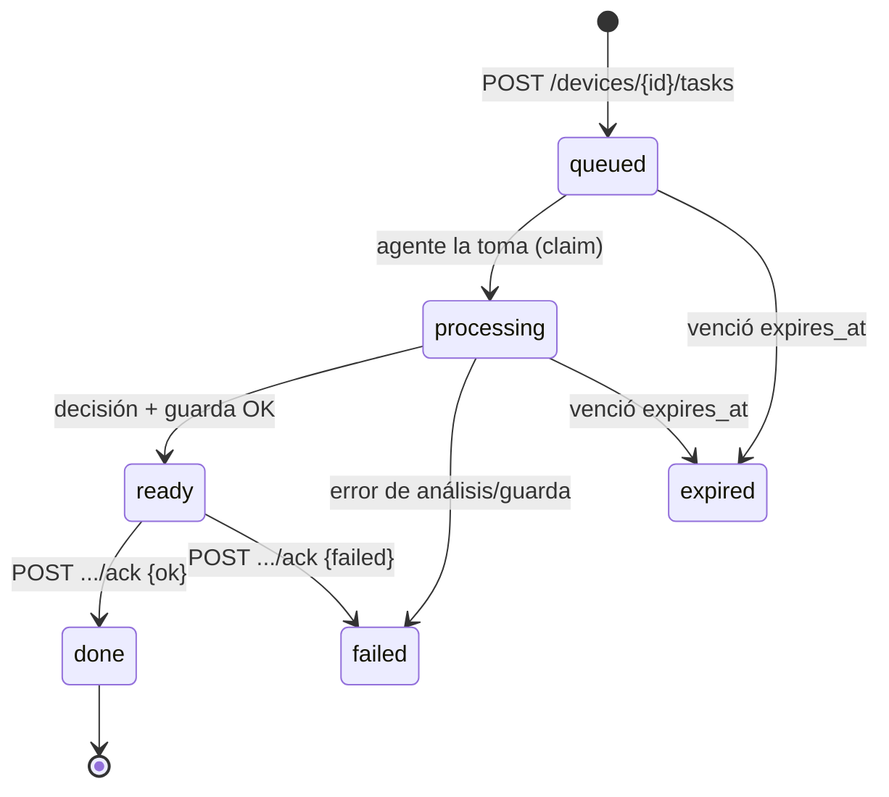

# 05 — API FastAPI

> Contrato REST de la plataforma. Todo bajo `/v1/`. **El protocolo de tareas con `tracking_id` es el
> núcleo**: el dispositivo pide trabajo, recibe un id de seguimiento en < 1 s, el agente (en el
> servidor) analiza en segundo plano, y el dispositivo va preguntando por ese id hasta que le llega
> la acción a ejecutar en sus terminales.

---

## 1. Convenciones generales

| Aspecto | Regla |
|---|---|
| Prefijo | `/v1/` — cambios incompatibles → `/v2/` |
| Formato | JSON (`application/json`), UTF-8, timestamps **UTC ISO-8601** (`2026-10-22T14:05:00Z`) |
| IDs | UUID v4 en text (`"t_8f3a…"` o UUID completo); el `tracking_id` es el `tasks.id` |
| Errores | Estructura `{"error": {"code": "...", "message": "...", "detail": {...}}}` + código HTTP |
| Rate-limit | Por `device_id` y por `user_id`; cabeceras `X-RateLimit-*`; 429 con `Retry-After` |
| Idempotencia | Writes aceptan cabecera `Idempotency-Key` (evita duplicados en reintentos de red) |
| Paginación | `?limit=50&offset=0` o cursor `?cursor=…`; `Link` header |

### 1.1 Autenticación

| Quién | Cómo | Cabecera |
|---|---|---|
| **Dispositivo (MCU)** | HMAC-SHA256 sobre `device_id:ts:nonce:body_hash` con su `device_secret` | `Authorization: HMAC-SHA256 <device_id>:<ts>:<nonce>:<sig>` — ventana ±5 min, nonce anti-replay |
| **Usuario / cliente** | API key (`Bearer`) emitida por la plataforma | `Authorization: Bearer agri_sk_…` |
| **Admin de plataforma** | API key con rol `admin` | ídem |
| **Agente Hermes (servidor)** | Su propia API key de perfil **o** llamada interna a localhost (ver `09`) | ídem |

---

## 2. Endpoints de dispositivos — ingesta

| Método | Ruta | Descripción |
|---|---|---|
| POST | `/v1/devices/{device_id}/readings` | Lote de lecturas (JSONB dinámico por modelo) → `202` |
| POST | `/v1/devices/{device_id}/events` | Eventos, heartbeat, estado de actuadores → `202` |
| GET | `/v1/devices/{device_id}/firmware/latest` | Manifiesto OTA firmado Ed25519 → `200`/`304` |

### `POST /v1/devices/{id}/readings`

```json
{
  "ts": "2026-10-22T14:05:00Z",
  "seq": 1842,
  "metrics": [
    {"name": "soil_moisture_pct", "value": 31.5, "unit": "%", "quality": 1},
    {"name": "air_temp_c", "value": 24.8, "unit": "°C", "quality": 1},
    {"name": "battery_v", "value": 3.71, "unit": "V", "quality": 1}
  ]
}
```

- `metrics[].name` **debe existir** en `device_model_metrics` del modelo del equipo → si no, `422`.
- Respuesta: `202 Accepted` (el servidor garantiza persistencia, no análisis en este paso).

---

## 3. Endpoints de dispositivos — tareas con **tracking_id** ⭐

Este es el corazón del contrato dispositivo↔servidor.

### 3.1 El dispositivo pide trabajo

**`POST /v1/devices/{device_id}/tasks`**

```json
{
  "kinds": ["irrigation", "alert"],
  "ctx": {
    "battery_v": 3.71,
    "signal_dbm": -95,
    "local_policy_active": false,
    "since_last_agent_cmd_min": 37
  }
}
```

| Respuesta | Cuándo | Cuerpo |
|---|---|---|
| `204 No Content` | No hay trabajo pendiente ni datos que analizar | — (el MCU duerme y repite en su intervalo) |
| `202 Accepted` | Se creó una tarea que requiere análisis del agente | `{"tracking_id":"t_8f3a","status":"processing","poll_after_s":10,"expires_at":"…"}` |

El `202` es **inmediato** (< 1 s). El análisis lo hará el agente Hermes en el servidor; el
dispositivo **no espera el LLM**, solo recibe el id de seguimiento.

### 3.2 El dispositivo pregunta por su tracking_id

**`GET /v1/devices/{device_id}/tasks/{tracking_id}`**

| Respuesta | Significado | El MCU hace… |
|---|---|---|
| `202 {status:"processing", "poll_after_s":10}` | El agente aún analiza | duerme y repite |
| `202 {status:"queued"}` | La tarea aún no la tomó ningún agente | duerme y repite |
| `200 {status:"ready", "command":{…}}` | **Listo**: aquí está la acción | **ejecuta el comando en sus terminales** |
| `200 {status:"failed", "reason":…}` | El análisis falló | no actúa (o fallback local) |
| `200 {status:"expired"}` | Venció el `expires_at` (ej. la helada ya pasó) | no actúa |
| `404` | tracking_id inexistente o de otro device | descarta el id |

**Ejemplo `200` con `ready`:**

```json
{
  "tracking_id": "t_8f3a",
  "status": "ready",
  "command": {
    "id": "c_5512",
    "action": "open_valve",
    "params": {"zone": "A", "minutes": 20},
    "deadline": "2026-10-22T14:35:00Z",
    "sig": "ed25519:…"
  },
  "decision_ref": "d_991",
  "rationale": "Humedad 31.5% < umbral 35% del agente riego-fao56; ET₀ prevista 4.2 mm; sin lluvia en 24 h; dentro de límites (500 L/día, 180 L consumidos)."
}
```

### 3.3 El dispositivo confirma la ejecución

**`POST /v1/devices/{device_id}/tasks/{tracking_id}/ack`**

```json
{"status": "ok", "actual": "valve_open", "measured_l": 18.4, "ts": "2026-10-22T14:25:10Z"}
```

- `status`: `ok` | `failed` | `partial`.
- El servidor cierra la tarea, registra el resultado y crea un **episodio** (material de auto-mejora).

### 3.4 Carril rápido de comandos (sin análisis)

Para acciones que **no necesitan agente** (override manual, emergencia, refresco de política de fallback):

| Método | Ruta | Descripción |
|---|---|---|
| GET | `/v1/devices/{id}/commands/next?wait=25` | **Long-poll**; `200` con comando o `204`; el timeout lo "come" el MCU |
| POST | `/v1/devices/{id}/commands/{cid}/ack` | Confirma ejecución `{status, actual, error}` |

El firmware típico consulta **ambos** en su ciclo: primero `tasks/{tracking_id}` (si tiene una
abierta), luego `commands/next` (carril rápido).

### 3.5 Máquina de estados de una tarea



---

## 4. Endpoints de agentes (el Hermes del servidor usa estos)

| Método | Ruta | Descripción |
|---|---|---|
| GET | `/v1/agent/tasks/next?agent=&kinds=&wait=20` | Toma la siguiente tarea del agente (`204` si no hay; `200` con la tarea) |
| POST | `/v1/agent/tasks/{id}/claim` | Lease explícito `{agent, lease_seconds}` (idempotencia) |
| POST | `/v1/agent/tasks/{id}/result` | Resultado `{status, summary, artifacts[], metrics{}}` |
| POST | `/v1/agent/tasks/{id}/fail` | Fallo `{reason, retryable}` → reintento con backoff o `blocked` |
| GET | `/v1/agent/decisions/next?agent=` | Decisión pendiente de **aprobación humana** |
| POST | `/v1/agent/decisions/{id}/resolve` | Aprobación `{choice, rationale, approver}` |
| POST | `/v1/agent/commands` | Crea comando (pasa por **guard determinista**) |
| POST | `/v1/agent/episodes` | Graba episodio (→ auto-mejora) |
| POST | `/v1/agent/feedback` | Feedback humano (aprobación, veto, corrección) |

---

## 5. Gestión multiusuario: usuarios, equipos, agentes, límites ⭐

### 5.1 Usuarios y API keys

| Método | Ruta | Rol |
|---|---|---|
| POST | `/v1/users` | admin |
| GET/PATCH | `/v1/users/{user_id}` | admin (o el propio usuario con limitación de campos) |
| POST | `/v1/users/{user_id}/api-keys` | admin → devuelve `agri_sk_…` una sola vez |
| DELETE | `/v1/users/{user_id}/api-keys/{key_id}` | admin / dueño |

### 5.2 Modelos de equipo y sus métricas (columnas dinámicas)

| Método | Ruta | Descripción |
|---|---|---|
| POST | `/v1/device-models` | Declara un modelo (ej. `meteostation-x200`) |
| POST | `/v1/device-models/{model_id}/metrics` | Declara una métrica: `{name, unit, min, max, type}` |
| GET | `/v1/device-models` / `{model_id}` | Consulta |

> Las métricas de `device_model_metrics` son la **validación** de los lotes JSONB: un MCU que mande
> un nombre o unidad no declarados recibe `422`.

### 5.3 Equipos (devices)

| Método | Ruta | Descripción |
|---|---|---|
| POST | `/v1/users/{user_id}/sites/{site_id}/devices` | Registra un equipo; asigna `model_id`, devuelve `device_secret` |
| GET | `/v1/users/{user_id}/devices` | Lista (paginado, filtro por site/model) |
| PATCH | `/v1/devices/{device_id}` | Metadata, zona, activo/inactivo |
| POST | `/v1/devices/{device_id}/rotate-secret` | Rotación de credencial HMAC |

### 5.4 Agentes (N por equipo/modelo) ⭐

| Método | Ruta | Descripción |
|---|---|---|
| POST | `/v1/users/{user_id}/devices/{device_id}/agents` | Crea un agente (registro + perfil Hermes asociado) |
| GET | `/v1/.../agents` / `{agent_id}` | Lista / detalle |
| PATCH | `/v1/.../agents/{agent_id}` | Cambia modelo pinneado, skills activas, horario, `enabled` |
| DELETE | `/v1/.../agents/{agent_id}` | Deshabilita/elimina lógicamente |

**Ejemplo de creación:**

```json
POST /v1/users/u_1/devices/d_42/agents
{
  "name": "riego-fao56-zonaA",
  "kind": "irrigation",
  "hermes_profile": "agro-riego",
  "skills": ["riego-fao56", "anomalia-serie"],
  "model_pin": null,
  "schedule": "every 1m"
}
→ 201 {agent_id: "ag_7", hermes_profile: "agro-riego", status: "active"}
```

### 5.5 Límites manuales por agente vía API ⭐

| Método | Ruta | Descripción |
|---|---|---|
| GET | `/v1/.../agents/{agent_id}/limits` | Ver límites vigentes (y su historial) |
| PATCH | `/v1/.../agents/{agent_id}/limits` | Ajusta límites (auditoría automática) |

**Ejemplo (lo que el cliente ajusta):**

```json
PATCH /v1/users/u_1/devices/d_42/agents/ag_7/limits
{
  "water_budget_l_per_day": 500,
  "humidity_min_pct": 35,
  "allowed_actions": ["open_valve", "close_valve"],
  "require_human_approval_above_l": 200,
  "active_window": "05:00-09:00",
  "min_minutes_between_commands": 30
}
→ 200 {…, "updated_by": "u_1", "ts": "…"}
```

> **Estos límites son doble ley**: (1) van en el contexto del agente Hermes (el LLM los respeta) y
> (2) la **guarda determinista** los valida en código antes de escribir el comando — aunque el LLM
> intente excederlos, quedan bloqueados y auditados en `guard_evaluations`.

---

## 6. Datos y analítica (consultas del agente y del cliente)

| Método | Ruta | Descripción |
|---|---|---|
| GET | `/v1/devices/{id}/readings?from=&to=&metrics=` | Serie cruda (paginada) |
| GET | `/v1/devices/{id}/summary?bucket=hour\|day` | Resumen (agregados continuos de Timescale) |
| GET | `/v1/sites/{id}/summary` | Resumen agregado de un sitio |
| GET | `/v1/agents/{id}/performance?window=30d` | **Métricas de mejora del agente** (ver `06`) |
| GET | `/v1/agents/{id}/episodes` | Histórico de episodios del agente |
| GET | `/v1/.../audit` | Auditoría de comandos/guards/decisiones |

---

## 7. Ops y salud

| Método | Ruta | Descripción |
|---|---|---|
| GET | `/v1/ops/health` | Salud: BD, Hermes gateway, cola de tareas, latencia LLM |
| GET | `/v1/ops/board` | Kanban visual del trabajo de los agentes |
| GET | `/v1/ops/audit` | Auditoría transversal |
| GET | `/metrics` | Prometheus |

---

## 8. Webhooks salientes (plataforma → cliente)

| Método | Ruta | Descripción |
|---|---|---|
| POST | `/v1/webhooks` | Registra un webhook del cliente (`url`, `events[]`, `secret`) |
| — | eventos | `task.ready`, `decision.pending_approval`, `alert.frost`, `agent.limit_violation`, `model.promoted` |

Firma HMAC del cuerpo con `secret` del webhook; reintento con backoff exponencial.

---

## 9. Ejemplo end-to-end (resumen del contrato)

```
1. MCU  → POST /v1/devices/d_42/readings            (202)
2. MCU  → POST /v1/devices/d_42/tasks               → 202 {tracking_id:"t_8f3a"}
3.       … agente Hermes analiza en el servidor …   (5–60 s)
4. MCU  → GET  /v1/devices/d_42/tasks/t_8f3a        → 202 processing (repite)
5. MCU  → GET  /v1/devices/d_42/tasks/t_8f3a        → 200 ready {command:{open_valve…}}
6. MCU  → ejecuta relé en sus terminales
7. MCU  → POST /v1/devices/d_42/tasks/t_8f3a/ack    (ok)
8.       servidor graba episode → auto-mejora
```

---

**Siguiente:** [`06-agentes-y-auto-mejora.md`](06-agentes-y-auto-mejora.md) — cómo funcionan esos
agentes del lado del servidor.
