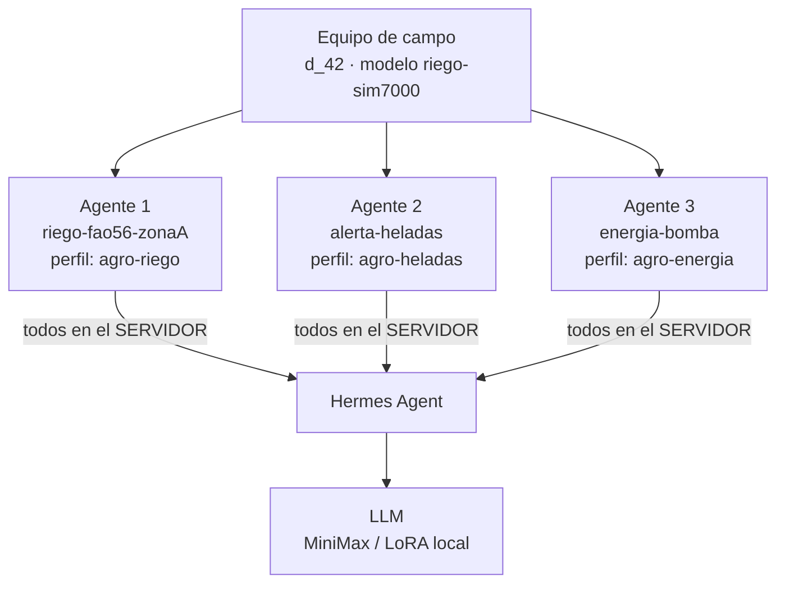
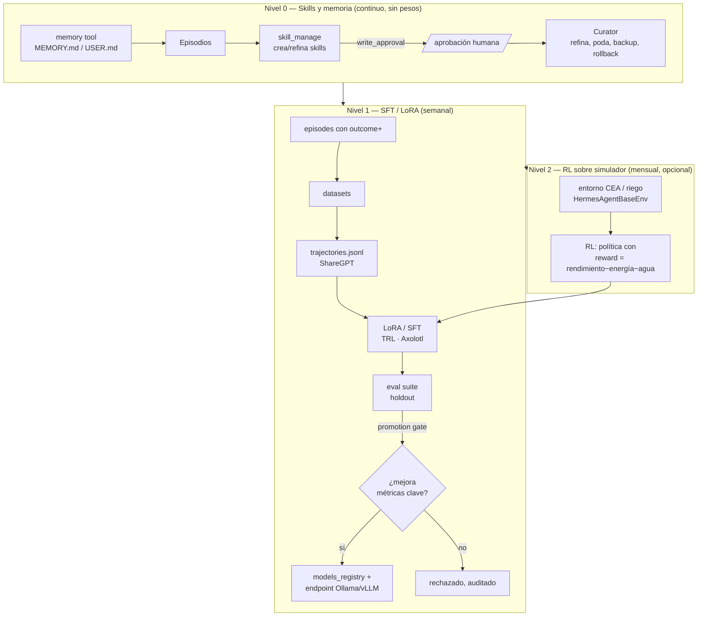
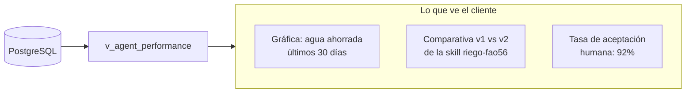

# 06 — Agentes y auto-mejora

> **Todos los agentes corren en el servidor**, dentro de Hermes Agent. El microcontrolador no ejecuta
> ningún agente: solo pide tareas y ejecuta la acción que le devuelven. Aquí se explica el registro
> de N agentes por equipo, el bucle de auto-mejora en 3 niveles y un ejemplo completo: el agente de
> alerta de heladas con su tool de pronóstico.

---

## 1. Modelo de agentes: N por equipo, cada uno único

Un **agente** = un perfil de Hermes con su identidad (SOUL.md), sus skills, su memoria y sus
límites. La tabla `agents` (ver `04`) asocia cada agente a un `device_id` (o a un `site_id`) y a un
`hermes_profile`.



**Ejemplo real de un mismo equipo de riego con 3 agentes simultáneos:**

| Agente | Perfil Hermes | Skills | Límites (vía API) | Métrica estrella |
|---|---|---|---|---|
| `riego-fao56-zonaA` | `agro-riego` | `riego-fao56`, `anomalia-serie` | 500 L/día, humedad mín 35 %, ventana 05–09 h | agua ahorrada vs. riego programado |
| `alerta-heladas` | `agro-heladas` | `alerta-heladas`, `clima-invernadero` | solo advisory (no actúa), T mín alerta −1 °C | falsas alarmas vs. heladas reales |
| `energia-bomba` | `agro-energia` | `auditoria-serie`, `guardia-actuacion` | kW/día máx, costo máx | costo energético evitado |

Cada agente tiene su propio entrenamiento (episodios), sus propias skills y sus propias métricas
de mejora. **Son intercambiables e independientes**: si uno se deshabilita, los otros siguen.

---

## 2. Cómo se crea y opera un agente

1. **Registro vía API** (`POST /v1/users/{uid}/devices/{did}/agents`) → crea la fila en `agents`.
2. **Hermes provisioning**: el backend crea el perfil `~/.hermes/profiles/<hermes_profile>/`,
   escribe su `SOUL.md`, copia sus skills y su cron pull-loop.
3. **Pull-loop**: `hermes cron create --schedule "every 1m" --prompt "..."` por perfil (ver `05`).
4. **Ciclo de vida**: `enabled=true/false`, `version` se incrementa al cambiar skills/modelo, y
   `skills_registry` guarda el hash del `SKILL.md` activo para atribuir mejoras.

---

## 3. Bucle de auto-mejora en 3 niveles



### 3.1 Nivel 0 — Skills y memoria (el corazón de la auto-mejora diaria)

- **`skill_manage`**: el agente crea o edita sus skills (`~/.hermes/skills/agro/<dom>/<skill>/SKILL.md`).
- **`write_approval: true`** (producción): los cambios van a `~/.hermes/pending/skills/` y se aprueban
  con `/skills approve <id>`. En piloto se puede poner `false` (autonomía total, con riesgo).
- **Curator** (`curator.enabled: true`, `interval_hours: 168`): usage tracking, detección de skills
  obsoletas, archivado, review con LLM, **backup y rollback** (`curator.backup/rollback`).
- **`memory` tool**: `add/patch/remove` sobre `MEMORY.md`/`USER.md` → el agente recuerda
  el cultivo, el presupuesto de agua, el error de calibración de una sonda, etc.
- **Feedback humano** (`POST /v1/agent/feedback`): veto/corrección del usuario → parche inmediato
  de la skill correspondiente (mismo día).

### 3.2 Nivel 1 — SFT / LoRA (entrenamiento del modelo)

1. Los episodios con `outcome+` y `guard_ok=true` se curan en `datasets`.
2. Se convierten a `trajectories.jsonl` (formato **ShareGPT**) con filtros de calidad
   (sin razonamiento, tools alucinados → descartados) usando `batch_runner` de Hermes.
3. **SFT/LoRA** (TRL/Axolotl) sobre el modelo base → modelo `agro-riego-v2`.
4. **Eval suite** de holdout con el mismo `batch_runner`: guard violations, agua ahorrada,
   acierto de diagnóstico, tasa de aceptación humana.
5. **Promotion gate**: solo si mejora las métricas clave → se registra en `models_registry` y se
   sirve vía **Ollama/vLLM** como provider OpenAI-compatible:

```yaml
# ~/.hermes/config.yaml
providers:
  agro-local:
    api: http://127.0.0.1:11434/v1
    transport: openai_chat
    models: [{name: agro-riego-v2, context_length: 32768}]
model: {provider: agro-local, default: agro-riego-v2}
```

### 3.3 Nivel 2 — RL sobre simulador (opcional)

- El código de entornos (`HermesAgentBaseEnv`) vive en las ramas `atropos-hermes-agent` /
  `atropos-integrations` (**no en `main`** → hay que pinear la rama).
- Contrato: subclase con `setup()`, `get_next_item()`, `format_prompt()`, `compute_reward()`,
  `evaluate()`; se sirve OpenAI-compatible para que lo consuma el `batch_runner`.
- Entornos propios: **invernadero CEA** (reward = rendimiento − energía − agua − guard violations)
  y **riego domótico** (reward = sostener humedad objetivo − agua).
- Ciclo: política → LoRA → eval en simulación → promotion gate → despliegue **canario** (5 % del
  tráfico) con reversión automática.

---

## 4. Ejemplo completo: agente de alerta de heladas

Este ejemplo muestra cómo se monta un agente con **tool de pronóstico** y cómo el MCU lo consume.

### 4.1 Registro del agente (API)

```json
POST /v1/users/u_1/devices/d_77/agents
{
  "name": "alerta-heladas",
  "kind": "frost_alert",
  "hermes_profile": "agro-heladas",
  "skills": ["alerta-heladas", "clima-invernadero"],
  "schedule": "every 1m"
}
```

### 4.2 Límites del agente (el usuario ajusta vía API)

```json
PATCH /v1/.../agents/ag_2/limits
{
  "allowed_actions": ["send_alert", "close_vent"],
  "frost_threshold_c": -1.0,
  "require_human_approval_above_l": null,
  "active_window": null
}
```

### 4.3 Skill `alerta-heladas` (contenido típico del `SKILL.md`)

```markdown
---
name: alerta-heladas
description: Detecta riesgo de helada combinando sensores del equipo y pronóstico Open-Meteo.
---
# Alerta de heladas

## Cuándo usarla
Cuando el agente recibe una tarea kind=frost_alert o detecta T_min < umbral en las lecturas.

## Pasos
1. Leer las últimas 24 h de readings_hour del device (T min, T media, HR).
2. Obtener el pronóstico de las próximas 48 h vía MCP agro-weather
   (Open-Meteo: temperature_2m_min, wind_speed_10m, precipitation_probability).
3. Calcular riesgo: si T_min_pronóstico < frost_threshold_c Y viento < 5 m/s → RIESGO.
4. Si hay riesgo:
   - Crear comando send_alert (carril rápido) para que el MCU notifique al cliente.
   - Si el agente tiene allowed_actions incluyendo close_vent → cerrar persianas.
5. Registrar episodio con outcome (T real mínima alcanzada) para auto-mejora.

## Errores comunes
- Alertar por una sola lectura ruidosa: exigir 2 lecturas consecutivas bajo umbral.
- No considerar la humedad relativa (helada blanca vs. negra).
```

### 4.4 Tool de pronóstico (MCP `agro-weather`)

| Parámetro | Tipo | Descripción |
|---|---|---|
| `lat`, `lon` | float | Ubicación del equipo (de `sites.location`) |
| `hours` | int | Horizonte (48) |
| `variables` | string[] | `temperature_2m_min`, `wind_speed_10m`, `precipitation_probability` |

Devuelve serie horaria; el agente la combina con las lecturas reales.

### 4.5 Flujo completo

```mermaid
sequenceDiagram
    participant MCU as MCU (d_77)
    participant API as FastAPI
    participant AG as Agente heladas (servidor)
    participant W as MCP agro-weather
    participant LLM as LLM

    MCU->>API: POST /v1/devices/d_77/tasks {kinds:[frost_alert]}
    API-->>MCU: 202 {tracking_id:"t_h1"}
    AG->>API: GET /v1/agent/tasks/next?agent=agro-heladas
    AG->>API: GET lecturas 24h (MCP agro-registry)
    AG->>W: pronóstico 48h (Open-Meteo)
    W-->>AG: T_min 48h = -2.1°C, viento 2 m/s
    AG->>LLM: skill alerta-heladas + límites del agente
    LLM-->>AG: RIESGO de helada; acción: send_alert + close_vent
    AG->>API: POST /v1/agent/commands (2 comandos, pasa guarda)
    API->>API: UPDATE tasks SET status='ready', command=…
    MCU->>API: GET /v1/devices/d_77/tasks/t_h1
    API-->>MCU: 200 {command: {action:"close_vent"}} + {action:"send_alert"}
    MCU->>MCU: cierra persiana + envía alerta al cliente (WhatsApp)
    MCU->>API: POST .../tasks/t_h1/ack {ok}
    AG->>API: POST /v1/agent/episodes {outcome: T_real_min=-1.8, alerta_valida:true}
```

---

## 5. Métricas de mejora visibles por agente ⭐

El cliente ve la evolución de **su** agente. Vistas y endpoints:

| Métrica | Definición | Fuente |
|---|---|---|
| `tasks_done` / `tasks_failed` | Tareas completadas / fallidas | `v_agent_performance` |
| `avg_latency_s` | Latencia media task→ack | `v_agent_performance` |
| `avg_reward` | Recompensa media de los episodios (para Nivel 2) | `episodes.reward` |
| `all_guards_ok` | Si **alguna** violó guarda → `false` | `guard_evaluations` |
| `acceptance_rate` | % de decisiones aprobadas sin editar | `decisions` |
| `water_saved_pct` | Ahorro de agua vs. baseline (dominio riego) | cálculo sobre `readings` |
| `skill_version` / `model_version` | Versión activa y su hash | `skills_registry`, `models_registry` |
| `delta_vs_prev` | Delta de métricas vs. versión anterior | `promotions` |

**Endpoint:** `GET /v1/agents/{id}/performance?window=30d` → serie temporal + comparativa versiones.



---

## 6. Perfiles y skills recomendados por dominio

| Perfil Hermes | Dominio | Skills típicas |
|---|---|---|
| `agro-riego` | Riego / domótica | `riego-fao56`, `domotica-suelo`, `anomalia-serie` |
| `agro-invernadero` | CEA | `clima-invernadero`, `fertilizacion-ec-ph`, `plagas-enfermedades` |
| `agro-heladas` | Alertas | `alerta-heladas`, `clima-invernadero` |
| `agro-ganaderia` | Ganadería | `ganaderia-plf`, `deteccion-celo-parto`, `calidad-leche` |
| `agro-lab` | Laboratorio | `lab-protocolo`, `lab-qc-westgard`, `instrumento-opcua-sila` |
| `agro-ops` | Supervisor | orquesta y descompone (delegate_task) |
| `agro-trainer` | ML | genera datasets y evals |

---

**Siguiente:** [`07-dispositivos-y-borde.md`](07-dispositivos-y-borde.md) — el lado del microcontrolador.
