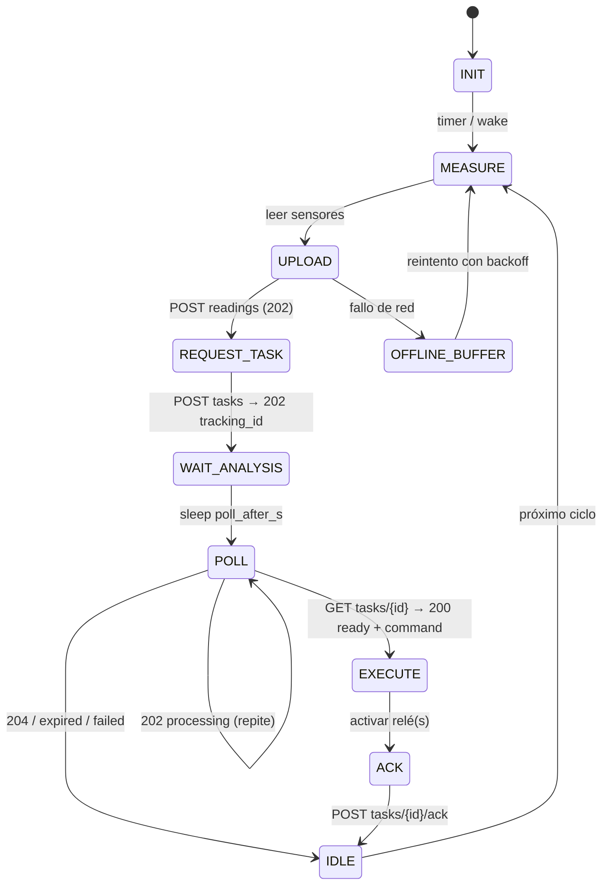

# 07 — Dispositivos y borde

> El lado del **microcontrolador**. Recordatorio de arquitectura: **el agente vive en el servidor;
> el MCU solo mide, manda lotes HTTP, pide tareas con tracking_id y ejecuta relés.** Aquí el
> firmware HTTP-only para ESP32 / Raspberry Pi / SIM800 / SIM7000, la autenticación HMAC, el
> buffer offline, el OTA y el **fallback por comportamiento histórico** cuando no hay red.

---

## 1. Matriz de hardware

| Dispositivo | Rol típico | Red | Consideraciones |
|---|---|---|---|
| **ESP32** | Nodo de sensores + relés en sitio con WiFi | WiFi | Barato, deep-sleep, ADC para sondas |
| **Raspberry Pi 3/4/5** | Hub con cámara, varios buses, Home Assistant | Ethernet/WiFi | Corre Python, buffer robusto, visión |
| **SIM800L/SIM900** | Módem celular 2G para MCU | GSM | Solo HTTP AT commands; consumo bajo |
| **SIM7000/SIM7080** | Módem celular 4G LTE-M/NB-IoT | LTE-M/NB | Mejor cobertura y eficiencia energética que 2G |
| **ESP32 + SIM7000** | Nodo celular completo (común en campo) | LTE-M | Placas tipo "TTGO T-SIM7000" / "LILYGO" |

> **Sin MQTT**: los módems celulares usan HTTP+HMAC y long-poll/tracking_id. SIM800 y SIM7000
> ejecutan `AT+HTTPACT` / `AT+HTTPGET`; no se mantiene sesión TCP persistente (ahorra batería y datos).

---

## 2. Firmware HTTP-only — máquina de estados



### 2.1 Pseudocódigo del ciclo (C/Arduino o Python para RPi)

```python
# MCU — el agente NO vive aquí; solo ejecuta lo que el servidor decide
def ciclo():
    metrics = leer_sensores()                     # I2C / ADC / 1-Wire
    ok = post("/readings", {"ts": now(), "metrics": metrics})
    if not ok:
        buffer_offline.append(...)                # reintenta luego
        aplicar_fallback_local()                  # política de comportamiento histórico
        return

    r = post("/tasks", {"kinds": ["irrigation"], "ctx": ctx})
    if r.status == 204:
        dormir(PROXIMO_CICLO)                     # no hay nada que decidir
        return
    tid = r.tracking_id                           # ← el servidor devuelve el id de seguimiento

    # El servidor analiza (LLM) en el servidor; yo solo voy preguntando
    for _ in range(MAX_POLLS):
        s = get(f"/tasks/{tid}")
        if s.status == "processing":
            dormir(s.poll_after_s)                # aún analiza; espero
        elif s.status == "ready":
            ejecutar_en_terminales(s.command)      # relés / válvulas / ventiladores
            post(f"/tasks/{tid}/ack", {"status": "ok", "actual": ...})
            return
        else:                                      # failed / expired
            break
    aplicar_fallback_local()                       # no llegó acción → uso histórico
```

### 2.2 Autenticación HMAC-SHA256

Cada petición lleva:

```
Authorization: HMAC-SHA256 <device_id>:<ts>:<nonce>:<sig>
sig = HMAC_SHA256(device_secret, device_id + ts + nonce + sha256(body))
```

- Ventana ±5 min (`ts`); servidor guarda `nonce` usados (anti-replay) por 10 min.
- `device_secret` se rota vía `POST /v1/devices/{id}/rotate-secret`.
- En 4G/LTE-M el TLS (HTTPS) va "gratis" en el módem; HMAC añade identidad por dispositivo.

---

## 3. Buffer offline (sobrevivir sin red)

| Aspecto | Diseño |
|---|---|
| Dónde | Flash SPIFFS/LittleFS (ESP32) o SQLite (RPi) |
| Qué se guarda | Lotes de lecturas no enviadas + comandos ejecutados sin ack |
| Política de reintento | Backoff exponencial (30 s → 60 s → 120 s → … → 30 min), tope |
| Orden | FIFO con `seq` creciente; el servidor deduplica por `(device_id, seq)` |
| Tope | 7 días de lecturas (ajustable) o N MB; luego descarta las más viejas |
| Al reconectar | Envía todo en lote; el servidor los acepta con timestamp original (`ts`) |

---

## 4. OTA (actualización de firmware)

| Paso | Detalle |
|---|---|
| 1 | El MCU consulta `GET /v1/devices/{id}/firmware/latest` |
| 2 | Si `version` local < remota, baja el manifiesto |
| 3 | El manifiesto trae URL del binario + **firma Ed25519** |
| 4 | Verifica la firma localmente; si no coincide, **aborta** |
| 5 | Escribe en partición A/B; reinicia; si el boot falla, vuelve a la anterior |

El OTA es **firmado** y **A/B**: un firmware corrupto no deja al equipo "ladrillo" en campo.

---

## 5. Fallback por comportamiento histórico ⭐

Cuando no hay red (o el servidor no responde a tiempo), el MCU **no se queda a ciegas**: aplica la
**última política de comportamiento histórico** que el servidor le entregó y firmó.

### 5.1 Qué es una "política de fallback"

```json
{
  "policy_id": "pol_12",
  "version": 3,
  "issued_at": "2026-10-22T06:00:00Z",
  "ttl_hours": 72,
  "rules": [
    {"action": "open_valve", "zone": "A",
     "window": "05:00-07:00", "minutes": 18,
     "only_if": {"soil_moisture_pct_lt": 35}},
    {"action": "close_vent",
     "window": "always", "only_if": {"air_temp_c_gt": 30}},
    {"action": "send_alert", "only_if": {"air_temp_c_lt": 0}}
  ],
  "sig": "ed25519:..."
}
```

- El servidor la genera cuando el agente aprende un patrón estable (histéresis, horarios, umbrales).
- El MCU la aplica con su **propia máquina de estados local** (un `if` simple, no un LLM).
- Tiene **TTL**: si vence, el MCU entra en modo seguro (no actúa, solo mide y avisa).

### 5.2 Por qué es "comportamiento histórico"

La política se deriva de **deciones pasuales validadas** del agente (episodios con `guard_ok=true`
y `outcome+`). Es el "cómo actuaste bien las últimas 200 veces" condensado en reglas ejecutables
en el borde. El MCU gana inteligencia **sin correr IA**, solo aplicando lo aprendido en el servidor.

---

## 6. Consumo de energía (guía rápida)

| Modo | ESP32 | ESP32+SIM7000 |
|---|---|---|
| Deep-sleep | ~10 µA | ~10 µA (módem apagado) |
| Medir + subir (1 lote) | ~80 mA × 2 s | ~200 mA × 8 s (attach LTE) |
| Long-poll `wait=25` | ~80 mA × 25 s | ~200 mA × 25 s (costoso en celular) |

**Recomendación celular:** usar `tasks` + polling corto (`poll_after_s` en vez de long-poll) para
no mantener el módem 2G/4G activo 25 s cada vez. El long-poll está pensado para WiFi/ethernet.

---

## 7. Resumen: qué hace y qué NO hace el MCU

| ✅ Hace | ❌ NO hace |
|---|---|
| Leer sensores y mandar lotes JSONB | Ejecutar LLM o modelo alguno |
| Pedir tarea y recibir `tracking_id` | Correr skills ni prompts |
| Preguntar por el `tracking_id` | Decidir por sí mismo (la decisión es del servidor) |
| Ejecutar la acción en relés/válvulas | Almacenar historia larga (eso es la BD del servidor) |
| Aplicar fallback local firmado cuando no hay red | Aprender (aprende el servidor) |
| Recibir y aplicar OTA firmado | — |

---

**Siguiente:** [`08-dominios-aplicacion.md`](08-dominios-aplicacion.md) — riego, invernadero,
ganadería, domótica, laboratorio.
