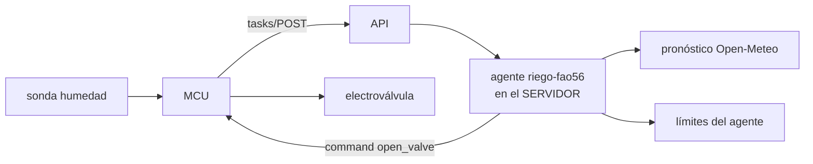

# 08 — Dominios de aplicación

> La misma plataforma sirve **cinco dominios**. Cambian los sensores, los actuadores y las skills;
> no cambian la arquitectura, la BD ni el protocolo de tareas con `tracking_id`.

---

## 1. Riego (el dominio ancla)

| Elemento | Detalle |
|---|---|
| Sensores | Humedad de suelo capacitivo (%), caudal (LPM), presión, T/HR ambiental, lluvia |
| Actuadores | Electroválvulas por zona, bomba, caudalímetro |
| Agente(s) | `riego-fao56` (FAO-56: ET₀→ETc con Kc), `anomalia-serie`, `energia-bomba` |
| Skills | `riego-fao56`, `domotica-suelo`, `auditoria-serie` |
| Límites típicos | m³/día por zona, humedad mín, ventana horaria, máx L por comando |
| Caso de uso | "Riego automático que aprende del histórico y del pronóstico; ahorra agua sin secar el cultivo" |

---

## 2. Invernadero (CEA — agricultura de ambiente controlado)

| Elemento | Detalle |
|---|---|
| Sensores | T, HR, CO₂ (MH-Z19), luz PAR/BH1750, VPD (calculado), suelo (EC, pH) |
| Actuadores | Ventiladores, persianas/termoabribles, caldera/bomba de calor, inyección CO₂, luces, electroválvulas de riego |
| Agente(s) | `clima-cea`, `fertilizacion-ec-ph`, `plagas-enfermedades` (visión), `energia` |
| Skills | `clima-invernadero`, `fertilizacion-ec-ph`, `plagas-enfermedades` |
| Límites típicos | VPD 0.8–1.6 kPa, T 15–30 °C, HR 60–85 %, presupuesto energético |
| Caso de uso | "Control climático que optimiza rendimiento vs. energía; detecta oídio desde cámara" |

---

## 3. Ganadería y cría

| Elemento | Detalle |
|---|---|
| Sensores | THI ambiente, collares con acelerómetro/RFID (PLF: rumia, actividad, ubicación), cámaras |
| Actuadores | Enfriamiento (aspersores/ventilación), comederos, dosificación de agua |
| Agente(s) | `plf-celo`, `plf-parto`, `calidad-leche`, `thi-estres-termico` |
| Skills | `ganaderia-plf`, `deteccion-celo-parto`, `calidad-leche` |
| Límites típicos | THI máx, ventanas de actividad, presupuesto de enfriamiento |
| Caso de uso | "Detección de celo y parto por patrones de rumia; alerta de estrés térmico" |
| Modelo de referencia | FIWARE Smart Data Models (Livestock) como esquema canónico |

---

## 4. Domótica (casa, jardín, pequeños cultivos)

| Elemento | Detalle |
|---|---|
| Sensores | Suelo, T/HR, luz, presencia, cámaras |
| Actuadores | Luces, persianas, HVAC, electroválvulas de jardín, cerraduras |
| Agente(s) | `casa-inteligente`, `riego-jardin`, `seguridad` |
| Skills | `domotica-suelo`, `domotica-clima`, `anomalia-serie` |
| Integración | **Home Assistant** (plugin `homeassistant` de Hermes / `homeassistant-mcp`) |
| Caso de uso | "Casa que aprende las rutinas del hogar; riego de jardín según histórico y clima" |

---

## 5. Laboratorio (agro-lab)

| Elemento | Detalle |
|---|---|
| Sensores / instrumentos | SiLA 2 (`silapy`), OPC-UA (`asyncua`), SCPI (`pyserial`), lectores de muestras |
| Actuadores | Instrumentos, cadenas de frío, agitadores |
| Agente(s) | `lab-protocolo`, `lab-qc-westgard`, `instrumento` |
| Skills | `lab-protocolo`, `lab-qc-westgard`, `instrumento-opcua-sila` |
| Reglas QC | Westgard (1-3s, 2-2s, R-4s, 4-1s, 10x) sobre series de control |
| Caso de uso | "Ejecución asistida de métodos, control de calidad automático, trazabilidad de muestras" |

---

## 6. Tabla comparativa de dominios

| Dominio | Agente estrella | Dato que lo hace inteligente | Actuador principal |
|---|---|---|---|
| Riego | `riego-fao56` | Humedad raíz + ET₀ + lluvia prevista | Electroválvula / bomba |
| Invernadero | `clima-cea` | VPD, T/HR, luz, consumo | Ventilador / persiana / caldera |
| Ganadería | `plf-celo` | Rumia, actividad, THI | Enfriamiento / comedero |
| Domótica | `casa-inteligente` | Rutinas aprendidas del histórico | Luces / persianas / HVAC |
| Laboratorio | `qc-westgard` | Series de control, muestras | Instrumentos / cadena de frío |

---

## 7. Cómo se monta un nuevo dominio

1. **Declarar el `device_model`** con sus `device_model_metrics` (las "columnas dinámicas").
2. **Registrar los actuadores** (`allowed_actions` que el firmware conoce).
3. **Crear el perfil Hermes** + skills del dominio (`~/.hermes/skills/agro/<dominio>/`).
4. **Definir guard_policies** (rangos, presupuestos) y `agent_limits` por defecto.
5. **Escribir el fallback local** (política de comportamiento histórico) para ese actuador.
6. **Probar end-to-end** con un equipo real (ver `11-roadmap`).

> El mismo contrato de tareas con `tracking_id` sirve para todos: el MCU pregunta, el agente del
> servidor analiza, el MCU ejecuta la acción en sus terminales.

---

**Siguiente:** [`09-seguridad-y-roles.md`](09-seguridad-y-roles.md).
