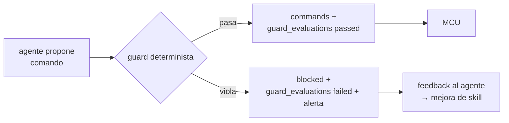

# 09 — Seguridad y roles

> Cómo se aíslan los usuarios, cómo el agente **nunca** puede exceder los límites y cómo se audita
> cada acción. Regla de oro: **el LLM decide, pero una guarda determinista en código tiene la última
> palabra** antes de tocar un relé.

---

## 1. Roles

| Rol | Qué puede | Qué no puede |
|---|---|---|
| **`admin`** (plataforma) | Ver todos los usuarios, gestionar modelos globales, promotion gate, auditoría transversal | — |
| **`cliente`** (usuario final) | CRUD de **sus** sitios/equipos/agentes, ajustar **sus** límites, ver **sus** métricas y auditoría | Ver datos de otros usuarios; tocar modelos globales |
| **Dispositivo (MCU)** | Subir lecturas, pedir tareas, consultar su `tracking_id`, hacer ack | Consultar otros dispositivos; crear agentes; ver la BD |
| **Agente (perfil Hermes)** | Leer datos de **su** device vía API/MCP (rol read-only), crear comandos vía guarda | Escribir directo en la BD; saltarse la guarda; ver otros tenants |

---

## 2. Matriz de permisos (resumen)

| Recurso | admin | cliente | device | agente |
|---|---|---|---|---|
| `/v1/users/*` | CRUD | self (limitado) | ✗ | ✗ |
| `/v1/.../devices` | CRUD global | CRUD propio | read own | read own |
| `/v1/.../agents` | CRUD global | CRUD propio | ✗ | ✗ |
| `/v1/.../agents/{id}/limits` | CRUD global | CRUD propio | ✗ | read own |
| `/v1/devices/{id}/readings` | read | read own | **write own** | read own (vía API) |
| `/v1/devices/{id}/tasks` | read | read own | **create + poll + ack** | read (claim) |
| `/v1/agent/commands` | read | read own | ✗ | **create (vía guarda)** |
| `/v1/.../audit` | read global | read own | ✗ | ✗ |

---

## 3. Aislamiento multi-tenant

- Cada fila dominante lleva `user_id` (o lo hereda de `site_id`/`device_id`).
- El token (`Bearer agri_sk_…`) fija el `user_id` del contexto; **toda consulta** se filtra por él.
- El agente Hermes usa una API key de perfil con alcance `read,write` de **su** dispositivo;
  el filtro de tenant está en la capa de servicio (FastAPI/MCP), no en la confianza del LLM.
- Si se prefiere BD directa: rol de PostgreSQL **read-only** + `statement_timeout` + vista
  filtrada por `user_id` (ver `04`).

---

## 4. Guards deterministas (la última palabra antes del relé)

El agente propone; **la guarda valida en código**. Evaluaciones en `guard_evaluations`.

| Tipo de guarda | Ejemplo |
|---|---|
| Rangos de métrica | pH 5.5–6.5, EC 1.2–2.4 dS/m, T 15–30 °C, HR 60–85 %, VPD 0.8–1.6 kPa |
| Presupuesto | ≤ 500 L/día por zona; ≤ kW/día por invernadero |
| Anti-oscilación | Histéresis + *dwell* mínimo entre cambios (no alternar válvula cada segundo) |
| Lockouts | Lluvia prevista > X %, viento > Y m/s, helada, sensor en alarma, comms caídas |
| Coherencia agronómica | ET₀ FAO-56 recalculado; Kc por etapa; caudal real vs. planificado |
| Límites del agente | `agent_limits` (doble ley: contexto del LLM + re-validación en código) |

**Modos:** `advisory` (registra y sugiere) y `enforce` (bloquea). Default: `advisory` para sensores,
`enforce` para válvulas y fertilización.

---

## 5. Autenticación y transporte

| Capa | Medida |
|---|---|
| TLS | Nginx con TLS 1.3 en :443; HSTS |
| Dispositivos | HMAC-SHA256 + ventana ±5 min + nonce anti-replay + rotación de `device_secret` |
| Usuarios | API keys `agri_sk_…` con scopes; rotación y `revoked_at` |
| Red interna | Firewall: el servidor solo expone :443; Postgres y Hermes escuchan en localhost |
| Egress del agente | **iron-proxy / egress allowlist**: el agente solo puede llamar a: nuestra API, Open-Meteo, el LLM |

---

## 6. Auditoría

| Tabla | Qué registra |
|---|---|
| `audit_log` (extensión) | Quién hizo qué (API keys, IPs, payloads resumidos) |
| `guard_evaluations` | Cada comando aceptado/bloqueado con detalle |
| `decisions` | Cada decisión pendiente, aprobación y quién aprobó |
| `episodes` | Cada episodio de agente (entrada, acción, resultado) |
| `promotions` | Cada promoción de modelo con métricas antes/después |
| Hermes `cron runs` / `executions.db` | Qué agente corrió cuándo y con qué resultado |

---

## 7. Producción: endurecimiento

- **Secrets**: Bitwarden/1Password (`secrets.*` de Hermes) — nunca `.env` en claro en disco de producción.
- **Managed scope**: config fijada por admin, inmutable por el cliente.
- **Checkpoints y rollback**: snapshot del filesystem del agente antes de auto-mejoras grandes.
- **Backups**: `pg_dump` diario + `hermes curator backup` + snapshot de `~/.hermes/skills/`.
- **Rate-limit** por `device_id` y `user_id` en Nginx/FastAPI.
- **Red de seguridad del LLM**: si el provider falla → fallback chain; si todo falla → el MCU
  usa su fallback local (política de comportamiento histórico).

---

**Siguiente:** [`10-despliegue-ubuntu.md`](10-despliegue-ubuntu.md) — outline de despliegue.
