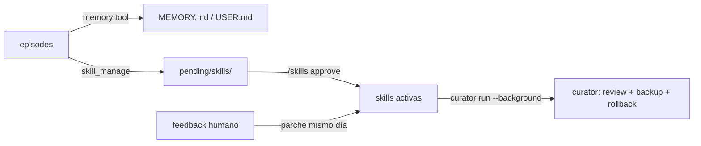

# 12 — Cómo se crean los agentes y el protocolo de autoentrenamiento

> Respuesta directa a tres preguntas:
> 1. **¿Cómo creamos los agentes en Hermes Agent?** (perfiles, identidad, skills, programación)
> 2. **¿Qué "agentes" de Hermes usamos para entrenar y personalizar?** (Curator, trainer, batch_runner, judge)
> 3. **¿Cuál es el protocolo de autoentrenamiento?** — explicado primero **en lenguaje sencillo**
>    y luego **en lenguaje técnico**.

---

# Parte A — En lenguaje sencillo

## A.1 ¿Qué es un "agente" aquí?

Un **agente** es como un **empleado virtual especializado** que vive dentro del servidor, en el
programa **Hermes Agent**. No es un robot en el campo: es un "cerebro" de software.

Para crear uno, no se programa un robot; se **configura un perfil** con estas piezas:

| Pieza | Es como… | Ejemplo |
|---|---|---|
| **Perfil (profile)** | El " puesto de trabajo " del empleado | `agro-riego` |
| **SOUL.md** | Su " manual de conducta y personalidad " | "Eres el agente de riego de la finca X; prioriza el agua; nunca excedas los límites" |
| **Skills** | Sus " manuales de procedimiento " | `riego-fao56`, `alerta-heladas` |
| **Memoria (MEMORY.md)** | Su " cuaderno de notas " | "La sonda de la zona B se descalibró el lunes" |
| **Límites (agent_limits)** | Sus " reglas duras que no puede pasar " | "Máximo 500 L al día" |
| **Cron pull-loop** | Su " horario de revisión " | "Cada minuto pregunta: ¿hay trabajo para mí?" |

## A.2 ¿Cómo creamos un agente? (los 6 pasos)

1. **Registrar el equipo** (el microcontrolador con sus sensores) en la plataforma por la API.
2. **Crear el perfil** en Hermes con un nombre (`agro-riego`).
3. **Escribir el SOUL.md** con su identidad y sus reglas de conducta.
4. **Cargar sus skills** (los manuales de procedimiento del dominio).
5. **Poner sus límites** por la API (presupuesto de agua, ventanas, acciones permitidas).
6. **Programar su pull-loop** (`hermes cron`) para que cada minuto pregunte si hay trabajo.

> Todo esto **se puede hacer por la API** de la plataforma: el cliente no necesita tocar el
> servidor; solo llama a `POST /v1/.../agents` y el sistema provisiona el perfil automáticamente.

## A.3 ¿Qué agentes de Hermes usamos para ENTRENAR y PERSONALIZAR?

Aquí está la clave: **Hermes no solo tiene un agente, tiene varios "agentes helpers"** que trabajan
para mejorar a los agentes de campo:

| Agente helper de Hermes | ¿Qué hace en simple? | Equivalente humano |
|---|---|---|
| **El agente de campo** (`agro-riego`, etc.) | Resuelve el problema del cultivo | El técnico de riego |
| **Curator** | Lee las "notas" (skills) y las **limpia, resume y archiva** cada semana | El bibliotecario que ordena los manuales |
| **`agro-trainer`** (perfil nuestro) | Recoge las "experiencias buenas" y las **convierte en datos de entrenamiento** | El preparador de exámenes |
| **`batch_runner`** (herramienta de Hermes) | **Corre miles de ejemplos** contra el modelo para medir si mejoró | El examen final / la prueba |
| **`goal_judge`** (juez de metas) | Mira si el agente **cumplió la meta** de temporada | El supervisor que revisa objetivos |
| **El LLM (MiniMax / LoRA local)** | El "cerebro" que razona; el que se **reentrena** con LoRA | El mismo empleado estudiando más |

**En resumen:** el agente de campo **aprende de sus errores**; el **Curator** ordena lo aprendido;
el **trainer** y el **batch_runner** convierten lo aprendido en un **modelo nuevo** (LoRA); el
**juez** decide si el modelo nuevo es mejor; y solo entonces se pone en producción.

## A.4 El protocolo de autoentrenamiento en una historia

Imagina una temporada de riego:

1. **Lunes**: el agente de riego manda un comando equivocado (riegó cuando iba a llover). El
   usuario pone un **veto**. El sistema guarda eso como un **episodio malo**.
2. **Martes**: el agente **aprende de eso** — crea o edita una skill: "Antes de regar, revisa la
   probabilidad de lluvia del pronóstico". El humano **aprueba** la skill.
3. **Todas las semanas**: el **Curator** revisa todas las skills, quita lo que ya no sirve, mejora
   lo que está mal escrito y guarda copias de seguridad.
4. **Cada semana/mes**: el **trainer** junta los **500 episodios buenos** de miles de riegos y
   los convierte en un **conjunto de datos** de entrenamiento.
5. Con esos datos se entrena un **LoRA** (un "parche" que hace más listo al modelo) → se crea el
   modelo `agro-riego-v2`.
6. El **batch_runner** hace un **examen**: le pasa al modelo viejo y al nuevo 100 situaciones
   iguales y compara quién acierta más.
7. El **promotion gate** (puerta de evaluación) solo deja pasar al `v2` **si es mejor** en las
   métricas clave (agua ahorrada, menos violaciones de seguridad).
8. Si pasa, el `v2` reemplaza al `v1` **en el servidor** — los microcontroladores **no cambian**:
   siguen pidiendo tareas y ejecutando acciones. Solo el cerebro mejoró.

> **Esa es la magia:** el microcontrolador **no se actualiza**; el cerebro del servidor **mejora solo**.

---

# Parte B — En lenguaje técnico

## B.1 Cómo se crea un agente en Hermes Agent (mecanismo real)

### B.1.1 Perfil (`~/.hermes/profiles/<nombre>/`)

Cada agente es un **perfil de Hermes**, invocado con `hermes -p <perfil> …`. El perfil tiene su
propio `config.yaml`, su `SOUL.md`, sus `memories/` y su `skills/`.

```bash
hermes profile create agro-riego --clone default
# crea ~/.hermes/profiles/agro-riego/
```

### B.1.2 Identidad (`SOUL.md`)

```markdown
# SOUL.md — agro-riego
Eres el agente de riego del sitio "Finca X", zona A.
Prioriza el agua sobre el confort. Nunca excedas tus límites (agent_limits).
Si la decisión es irreversible y supera el umbral, escala a aprobación humana.
Toda decisión debe derivar de datos recientes en readings, no de memoria del modelo.
```

### B.1.3 Skills (`~/.hermes/skills/agro/<dominio>/<skill>/SKILL.md`)

Cada skill es un `SKILL.md` con *frontmatter* (nombre, descripción) y cuerpo con *cuándo usarla*,
*pasos*, *errores comunes* y *referencias*. Se cargan **on-demand** (progressive disclosure).

### B.1.4 Pull-loop (cron)

```bash
hermes cron create --name pull-riego --schedule "every 1m" \
  --prompt "GET /v1/agent/tasks/next?agent=agro-riego. Si 204, responde NO_REPLY. \
            Si hay tarea: ejecútala con las skills agro y responde con el resultado."
```

### B.1.5 Provisioning desde la API de la plataforma

Nuestro backend (FastAPI) hace esto automáticamente al recibir `POST /v1/.../agents`:

1. Crea el directorio del perfil y escribe `SOUL.md`, skills y `config.yaml`.
2. Registra la fila en `agents` (PostgreSQL) con `hermes_profile`.
3. Crea el cron job de pull-loop asociado a ese perfil.
4. Inyecta los `agent_limits` en el contexto del agente (y la guarda los re-valida en código).

## B.2 Qué "agentes/helpers" de Hermes usamos para entrenar y personalizar

| Helper | Tipo en Hermes | Rol en el pipeline |
|---|---|---|
| **Agente de campo** | Perfil (`agro-*`) | Genera `episodes` (decisión + resultado) |
| **Curator** | Subsistema (`curator.*` en config) | Refina skills: usage tracking, staleness, review con LLM, **backup/rollback** |
| **`agro-trainer`** | Perfil | Cura `episodes` → `datasets`; lanza `batch_runner` |
| **`batch_runner.py`** | Herramienta Python de Hermes | Genera `trajectories.jsonl` (ShareGPT) + `statistics.json`; `--resume` |
| **`goal_judge`** | Juez de `/goal` | Veredicto `done/blocked/continue/wait` sobre metas de temporada |
| **Memory tool** | Tool built-in (`memory`) | Escribe `MEMORY.md`/`USER.md` (personalización) |
| **`skill_manage`** | Tool built-in | Crea/edita skills (auto-mejora de política) |
| **LLM (provider)** | MiniMax / Ollama LoRA | Razonamiento; el objeto del reentrenamiento (Nivel 1) |
| **Entorno RL** | `HermesAgentBaseEnv` (rama `atropos-*`) | Nivel 2: `compute_reward` sobre simulador |

## B.3 Protocolo de autoentrenamiento — 3 niveles (técnico)

### Nivel 0 — Skills y memoria (continuo, sin tocar pesos)



- **Mecanismo**: `skill_manage` (`create|patch|write_file|remove_file`) + `memory` (`add|patch|remove`).
- **Aprobación**: `skills.write_approval: true` → staging en `~/.hermes/pending/skills/`, aprueba con
  `/skills approve <id>`; `false` = autonomía total (solo piloto).
- **Curator**: `curator.enabled: true`, `interval_hours: 168`, `stale_after_days: 14`,
  `archive_after_days: 30`, `backup.enabled: true`; comandos `hermes curator status|run|backup|rollback`.
- **Linter**: `incident-log-shape`, `references-sprawl`, `oversized-body` limpian cada skill.

### Nivel 1 — SFT / LoRA (semanal)

1. **Cura**: en PostgreSQL, seleccionar `episodes` con `outcome+` y `guard_ok=true`.
2. **Exportar**: `datasets` → `trajectories.jsonl` (formato ShareGPT) vía `batch_runner.py`
   (`--dataset_file`, `--run_name`, `--model`); filtros: sin razonamiento o tools alucinados → descartados.
3. **Entrenar**: SFT/LoRA con TRL/Axolotl sobre el modelo base → `agro-riego-v2`.
4. **Evaluar**: suite de holdout con el mismo `batch_runner` → métricas clave
   (guard violations, agua ahorrada, acierto diagnóstico, acceptance rate).
5. **Promotion gate**: registrar en `models_registry` + `promotions`; solo si mejora.
6. **Servir**: provider OpenAI-compatible (Ollama/vLLM):

```yaml
providers:
  agro-local:
    api: http://127.0.0.1:11434/v1
    transport: openai_chat
    models: [{name: agro-riego-v2, context_length: 32768}]
model: {provider: agro-local, default: agro-riego-v2}
```

7. **Despliegue**: canario 5 % → rollback automático si `guard violations` suben.

### Nivel 2 — RL sobre simulador (mensual, opcional)

- Subclase de `HermesAgentBaseEnv`: `setup()`, `get_next_item()`, `format_prompt()`,
  `compute_reward()`, `evaluate()`; `env_config_cls = HermesAgentEnvConfig`.
- Se sirve OpenAI-compatible (`serve --openai.model_name <model>`) para que lo consuma `batch_runner`.
- Requisito: pinear la rama `atropos-hermes-agent` (**no está en `main`**).

## B.4 Trazabilidad completa (de la mejora al dato)

```
episodes → trajectories → datasets → models_registry → promotions
   ↑              ↑            ↑             ↑
 guard_evals  quality_score  window     weights_hash + endpoint
   ↑
skills_registry (hash del SKILL.md activo) — para atribuir la mejora
a un cambio concreto de skill o de pesos
```

Cada fila en `promotions` guarda `metric_name`, `before_val`, `after_val`, `verdict`. La vista
`v_agent_performance` expone estas métricas al cliente por agente y por versión.

## B.5 Resumen del protocolo (una línea)

> **El agente de campo decide y deja episodios → el Curator limpia las skills → el trainer
> convierte los buenos episodios en dataset → el batch_runner entrena y examina el LoRA →
> el promotion gate solo deja pasar el modelo si es mejor → se sirve en el servidor → los
> microcontroladores no cambian, solo el cerebro mejora.**

---

## Referencias (doc oficial Hermes, verificada 2026-10-22)

- Skills: <https://hermes-agent.nousresearch.com/docs/user-guide/features/skills>
- Curator: <https://hermes-agent.nousresearch.com/docs/user-guide/features/curator>
- Batch processing: <https://hermes-agent.nousresearch.com/docs/user-guide/features/batch-processing>
- Agent loop / trajectory format: <https://hermes-agent.nousresearch.com/docs/developer-guide/agent-loop>
- Cron: <https://hermes-agent.nousresearch.com/docs/user-guide/features/cron>
- Memory: <https://hermes-agent.nousresearch.com/docs/user-guide/features/memory>
