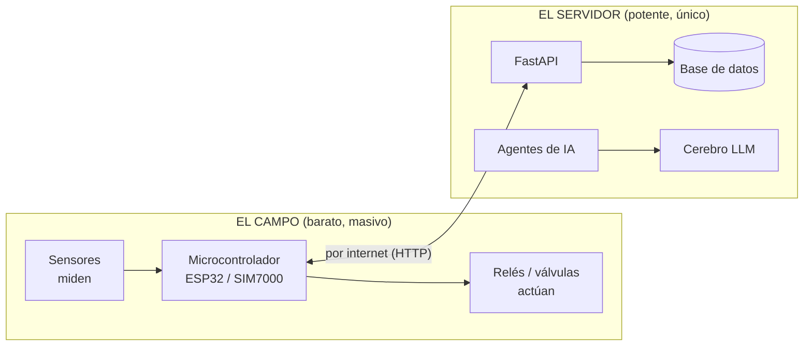

# Resumen general de la plataforma (en lenguaje sencillo)

> Este documento lo explica **todo** el sistema de forma simple, pero **muy detallado**, con tablas
> y diagramas. Está pensado para que cualquier persona lo entienda sin ser técnica. Si algo necesita
> más detalle técnico, cada punto remite al capítulo correspondiente.

---

## 1. ¿Qué es esto, en una frase?

**Es un sistema donde cerebros de inteligencia artificial (que viven en un servidor) le dicen a
máquinas baratas del campo (microcontroladores) qué hacer — riego, ventilación, alertas — y esos
cerebros aprenden solos con el tiempo, como un técnico experto que gana experiencia.**

---

## 2. Las dos partes del sistema (lo más importante)



| Parte | Dónde está | Qué hace | Ejemplo |
|---|---|---|---|
| **Campo** | En la finca/invernadero/casa | **Mide** y **ejecuta órdenes** | Sonda de humedad; relé que abre la válvula |
| **Servidor** | En un computador Ubuntu | **Piensa, decide y aprende** | Agente que decide cuánto regar y mejora con los errores |

> ### ⚠️ Regla de oro
> **El agente de IA SIEMPRE está en el servidor. NUNCA en el microcontrolador.**
> El microcontrolador es como un **"empleado que solo obedece y reporta"**: mide, manda los datos,
> pregunta "¿hay algo que hacer?" y ejecuta lo que le digan. Todo el pensamiento pasa en el servidor.

---

## 3. ¿Cómo funciona un día normal? (el viaje completo)

```mermaid
sequenceDiagram
    participant C as Campo (microcontrolador)
    participant S as Servidor
    participant A as Agente IA (servidor)

    Note over C: 1. La sonda mide la humedad del suelo
    C->>S: 2. Manda los datos por internet
    C->>S: 3. Pregunta "¿hay trabajo para mí?"
    S-->>C: 4. "Sí, toma un número de seguimiento" (tracking_id)
    Note over A: 5. El agente analiza (tarda unos segundos)
    C->>S: 6. Pregunta "¿ya terminaste? (número X)"
    S-->>C: 7. "Sí: abre la válvula de la zona A, 20 minutos"
    Note over C: 8. El microcontrolador ejecuta (abre la válvula)
    C->>S: 9. Confirma "ya lo hice"
    Note over S: 10. Todo queda guardado; el agente aprende de esto
```

**En palabras:** el microcontrolador manda datos y **pide instrucciones**. Como el análisis de IA
**tarda**, el servidor no lo hace esperar: le da un **número de seguimiento** (`tracking_id`) y el
microcontrolador **va preguntando** cada cierto tiempo. Cuando el agente termina de analizar, en la
respuesta viene **la acción concreta a ejecutar** en los relés.

---

## 4. ¿Qué es un "agente" y cómo se crea?

Un agente es un **empleado virtual especializado**. Se crea configurando estas piezas:

| Pieza | Es como… | Ejemplo |
|---|---|---|
| Perfil | Su puesto de trabajo | `agro-riego` |
| SOUL.md | Su manual de conducta | "Prioriza el agua; respeta los límites" |
| Skills | Sus manuales de procedimiento | Cómo regar con la fórmula FAO-56 |
| Memoria | Su cuaderno de notas | "La sonda B se descalibró" |
| Límites | Sus reglas duras | "Máximo 500 L al día" |
| Pull-loop | Su horario | "Cada minuto pregunta si hay trabajo" |

> Un mismo equipo puede tener **varios agentes a la vez** (uno de riego, uno de alertas, uno de
> energía), cada uno con sus propias reglas y su propia memoria. Detalle: capítulo `12`.

---

## 5. ¿Cómo se auto-mejora? (la parte mágica, en simple)

```mermaid
flowchart TB
    A[El agente comete un error<br/>ej: regó cuando iba a llover] --> B[El usuario corrige / veta]
    B --> C[El agente aprende:<br/>edita su manual (skill)]
    C --> D[Cada semana el "bibliotecario"<br/>ordena los manuales]
    D --> E[Cada mes se juntan las mejores<br/>experiencias y se entrena un modelo nuevo]
    E --> F[Un examen compara el modelo<br/>viejo vs. el nuevo]
    F --> G{¿El nuevo es mejor?}
    G -->|sí| H[Se pone en producción]
    G -->|no| I[Se descarta, todo queda auditado]
    H --> J[Los microcontroladores NO cambian:<br/>solo el cerebro mejoró]
```

**En una historia:**
1. **Lunes**: el agente riega mal. El usuario lo corrige. Eso queda guardado como una "experiencia".
2. **Martes**: el agente **edita su propio manual** para no repetir el error. Un humano lo aprueba.
3. **Semanas**: el "bibliotecario" (Curator) **ordena y limpia** los manuales.
4. **Meses**: se juntan las mejores experiencias y se entrena un **modelo más listo** (LoRA).
5. Un **examen** decide si el modelo nuevo es mejor. Si lo es, **reemplaza al viejo en el servidor**.
6. El microcontrolador **sigue igual** — no se toca el hardware. **Solo mejoró el cerebro.**

---

## 6. ¿Por qué varios usuarios? (multiusuario)

| Quién | Qué ve y hace |
|---|---|
| **Administrador** | Ve todo; gestiona modelos y evaluaciones de la plataforma |
| **Cliente (usuario)** | Ve **solo su finca/casa**: sus equipos, sus agentes, sus métricas; ajusta **sus** límites por API |

Cada cliente tiene su **mundo aislado**: sus sitios, sus equipos, sus agentes. Nadie ve lo de otro.

---

## 7. Los cinco mundos donde sirve (dominios)

| Mundo | Ejemplo concreto | El agente decide… |
|---|---|---|
| 🚿 **Riego** | Un bancal con sonda de humedad | Cuánto y cuándo regar (ahorrando agua) |
| 🌿 **Invernadero** | Casas de cultivo con ventiladores | Cuándo ventilar, calentar, dar luz |
| 🐄 **Ganadería** | Establo con sensores y cámaras | Alerta de celo, estrés por calor |
| 🏠 **Domótica** | Casa con luces y persianas | Rutinas aprendidas del hogar |
| 🔬 **Laboratorio** | Análisis de muestras | Control de calidad automático |

> Los cinco usan **la misma plataforma**; solo cambian los sensores y las reglas.

---

## 8. ¿Qué pasa si se va la internet (en el campo)?

El microcontrolador **no se queda tonto**: el servidor le había entregado una **"instrucción de
respaldo"** (por ejemplo: "si la humedad baja de 35 % y son las 5–7 AM, riega 18 minutos"). Mientras
no hay red, él aplica esa instrucción aprendida. Cuando vuelve la internet, manda todo lo que pasó
y el agente lo revisa y aprende.

> Eso es "**comportamiento histórico**": el microcontrolador ejecuta lo que el servidor aprendió que
> funciona, sin necesidad de ser inteligente él mismo.

---

## 9. ¿Y la seguridad? ¿Y los límites?

| Protección | Cómo |
|---|---|
| Cada usuario solo ve lo suyo | Aislamiento por usuario en la base de datos |
| El agente no puede pasarse de listo | **Límites dobles**: el agente los respeta (en su cabeza) **y** un programa aparte (la "guarda") los **verifica en código** antes de mover cualquier relé |
| Nada se mueve sin registrar | Cada acción, cada permiso, cada bloqueo queda **auditado** |
| Comunicación cifrada | Todo por internet va con HTTPS |

---

## 10. ¿Cuánto cuesta de construir? (fases)

| Fase | Qué se logra |
|---|---|
| F0 | Servidor listo: base de datos + Hermes + API |
| F1 | Ya se guardan y consultan los datos de los sensores |
| F2 | El primer agente decide y el equipo ejecuta |
| F3 | Varios usuarios con sus límites y métricas |
| F4 | Funciona en un campo real con celular (SIM) |
| F5 | Se agregan invernadero, ganadería y laboratorio |
| F6 | El auto-entrenamiento produce un modelo mejor |
| F7 | Endurecimiento: seguridad, backups, respaldo |

---

## 11. Preguntas rápidas (FAQ sencillo)

| Pregunta | Respuesta |
|---|---|
| ¿El microcontrolador tiene IA? | **No.** Solo mide, manda datos y ejecuta órdenes. |
| ¿Dónde está el agente? | **En el servidor.** |
| ¿Y si falla internet? | El microcontrolador aplica su "instrucción de respaldo" aprendida. |
| ¿Quién aprueba las decisiones importantes? | El usuario (por WhatsApp/Telegram o la app), cuando el agente lo pide. |
| ¿Se mejora el hardware para mejorar? | **No.** Mejora el cerebro (software) en el servidor. |
| ¿Cada usuario tiene sus propios agentes? | Sí, y cada agente tiene sus propios límites y métricas. |
| ¿Cuántos agentes puede tener un equipo? | Varios (N), cada uno especializado. |

---

**Siguiente:** [Potencialidades agrícolas](01-potencialidades-agricolas.md) — hacia dónde puede crecer esto.
