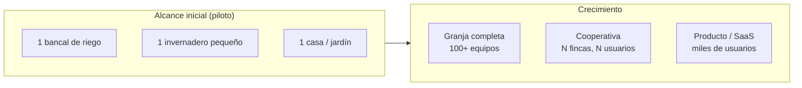
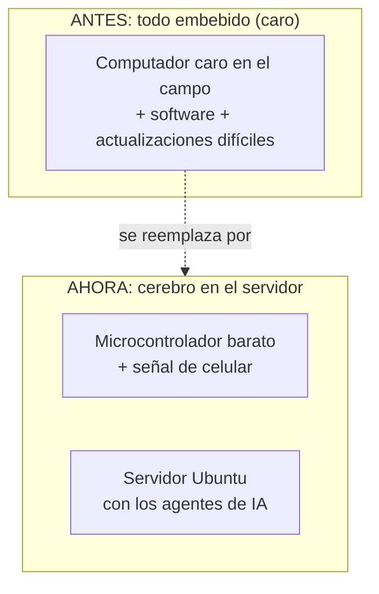

# Potencialidades agrícolas (en lenguaje sencillo)

> **Potencialidades, alcances, ventajas, revolución agrícola y potencial** de la plataforma,
> explicado para cualquier persona. Esta es la "visión grande": qué puede lograr esto en el campo,
> en la ganadería, en la casa y en el laboratorio.

---

## 1. La idea central, en lenguaje de todos los días

Imagínense un **"técnico experto" que nunca se cansa, que trabaja de día y de noche, que aprende
de cada error y que está en un solo computador sirviendo a cientos de fincas**. Eso es lo que hace
esta plataforma: convierte **cerebros de IA** (que viven en un servidor) en **asistentes agrícolas**
que le dan órdenes a máquinas baratas del campo.

**Lo nuevo aquí no es un sensor ni una app de gráficas.** Lo nuevo es que el sistema **aprende solo**:
cada riego, cada alerta, cada error se convierte en experiencia que mejora al agente.

---

## 2. La revolución: del "campo que se registra" al "campo que decide solo"

| Antes (lo típico de hoy) | Después (con esta plataforma) |
|---|---|
| El agricultor revisa el medidor y decide a mano | El agente decide y **ejecuta** solo, con límites seguros |
| Se riega "por costumbre" a ciertas horas | Se riega **solo cuando el suelo lo necesita** y el clima lo permite |
| Las alertas son fijas (suena una alarma) | Las alertas son **inteligentes** (consideran el pronóstico y el historial) |
| Cada finca compra su software aparte | **Multiusuario**: muchos agricultores en un mismo sistema, cada uno con lo suyo |
| Para "mejorar" hay que comprar equipo nuevo | **Mejora el software solo** (el cerebro se entrena con la experiencia) |
| Un técnico experto cuesta caro y se va | El "experto virtual" trabaja 24/7 y **crece con cada temporada** |

---

## 3. Ventajas concretas

| Ventaja | En palabras simples |
|---|---|
| 💧 **Ahorra agua** | Riega solo lo necesario; usa el pronóstico para no regar si va a llover |
| ⚡ **Ahorra energía** | Ventila o calienta solo cuando conviene; cuida el consumo |
| 🕐 **Ahorra tiempo** | El agricultor ya no tiene que estar mirando todo el día |
| 📉 **Reduce errores** | La "guarda" impide que algo se haga fuera de las reglas seguras |
| 📈 **Mejora con el tiempo** | Cada temporada el agente queda más listo que la anterior |
| 🔌 **Hardware barato** | Usa microcontroladores económicos (no equipos costosos propietarios) |
| 🌐 **Funciona donde hay celular** | Donde hay señal de celular (SIM800/SIM7000) ya sirve |
| 🔒 **Cada quien lo suyo** | Cada usuario ve solo su finca; sus datos son suyos |

---

## 4. Alcances: hasta dónde llega hoy y hacia dónde crece

| Nivel | Alcance | Qué se aprende |
|---|---|---|
| Piloto | 1–3 sitios | El sistema funciona end-to-end |
| Granja | Una finca completa | Muchos agentes por equipo |
| Cooperativa | Varias fincas, varios usuarios | Aislamiento y costos por usuario |
| Producto | Escala regional/nacional | Modelos y manuales compartidos |

---

## 5. Potencial por caso de uso

### 5.1 Riego 💧
- **Potencial**: riego que **nunca se equivoca de momento**. Usa la humedad real de la raíz + el
  pronóstico del clima + el histórico de la finca.
- **Impacto**: muchos agricultores reportan ahorros de agua de **15–40 %** sin perder cosecha.

### 5.2 Invernadero 🌿
- **Potencial**: controlar temperatura, humedad, CO₂ y luz **automáticamente** para que la planta
  siempre esté en su punto óptimo; detectar enfermedades (como el oídio) desde una cámara.
- **Impacto**: más rendimiento con menos energía.

### 5.3 Ganadería 🐄
- **Potencial**: detectar **celo** o **parto** por cómo se mueve y rumia el animal; alertar por
  estrés por calor antes de que afecte la producción.
- **Impacto**: más terneros, menos pérdidas, mejor bienestar animal.

### 5.4 Domótica / casa 🏠
- **Potencial**: una casa que **aprende las rutinas** (luces, persianas, riego del jardín) y las
  ejecuta sola; integración con Home Assistant.
- **Impacto**: comodidad y ahorro de energía en el hogar.

### 5.5 Laboratorio 🔬
- **Potencial**: ejecutar **análisis automáticamente**, controlar la calidad de los resultados
  (reglas de Westgard) y trazar cada muestra.
- **Impacto**: resultados más rápidos y confiables; menos errores humanos.

---

## 6. El microcontrolador "gana cerebro" (la gran ventaja técnica)

**Antes:** para tener un sistema inteligente en el campo, había que meter computación cara allá.
**Ahora:** el microcontrolador es **barato** y el **cerebro está en el servidor**.

Y **si se va la luz o la internet**, el microcontrolador sigue funcionando con la **última
instrucción aprendida** que el servidor le dio. No se queda sin hacer nada.

---

## 7. Revolución agrícola: por qué esto importa

| Problema del campo hoy | Cómo lo ataca esta plataforma |
|---|---|
| Falta de agua | Riego inteligente que ahorra |
| Envejecimiento de la mano de obra | Automatización que reduce la carga física |
| Decisiones "a ojo" basadas en costumbre | Decisiones basadas en **datos + pronóstico + experiencia aprendida** |
| Software caro y cerrado | Sistema **abierto** (código libre) y de **bajo costo de hardware** |
| Cada finca reinventa la rueda | Los agentes **comparten aprendizaje** (los manuales mejorados son reutilizables) |
| Péndula de rendimiento por clima extremo | Alertas tempranas (heladas, calor) y respuestas automáticas |

> **La visión:** que cualquier agricultor, con una señal de celular y un microcontrolador económico,
> tenga el mismo nivel de "asistencia experta" que una gran corporación — y que ese asistente mejore
> cada temporada sin comprar nada nuevo.

---

## 8. Un vistazo al futuro próximo

| Futuro cercano | Qué aportará |
|---|---|
| 🤖 Más dominios | Apicultura, acuaponía, viñedos, jardinería urbana |
| 📸 Visión computacional | Cámaras que detectan plagas y malezas solas |
| 🗣️ Control por voz | "¿Cómo va la humedad?" desde el celular, hablando |
| 🧠 Modelos locales | Cerebros que corren en el propio servidor sin depender de internet para el LLM |
| 🤝 Agentes que cooperan | Un agente de una finca avisa a otro de la finca vecina de una helada en camino |
| 📦 Manuales compartidos | Los agricultores pueden vender/compartir sus "manuales" (skills) mejorados |

---

## 9. En resumen

| Concepto | En una frase |
|---|---|
| **Potencialidad** | Poner un "experto agrícola virtual" en cualquier campo con señal de celular |
| **Alcance** | Riego, invernadero, ganadería, casa y laboratorio — con la misma plataforma |
| **Ventaja** | Ahorra agua, energía, tiempo y dinero; y **mejora solo** |
| **Revolución** | Del campo que se registra al campo que **decide y aprende** solo |
| **Futuro** | Más dominios, visión por cámara, control por voz y cooperación entre agentes |

---

**Volver al [resumen general](00-resumen-general.md) o al [índice de documentación](../README.md).**
