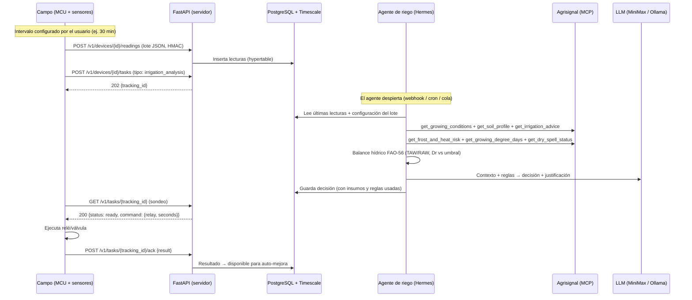
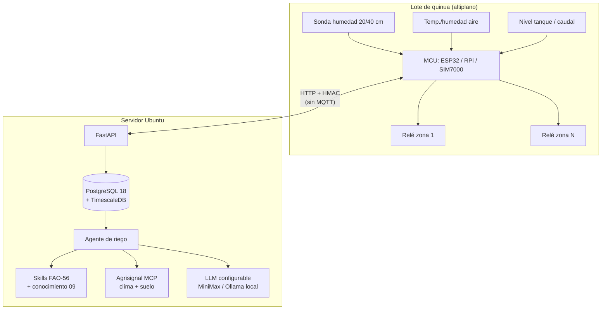

# 01 — Visión del piloto

> El piloto responde una sola pregunta bien concreta: **"¿cuándo y cuánto regar la quinua
> de este lote, con este equipo, hoy?"** — y lo contesta con datos del campo, clima
> verificado y reglas agronómicas trazables.

---

## 1. Qué buscamos

| Objetivo | Qué significa en la práctica | Cómo se mide que funciona |
|---|---|---|
| **Riego oportuno** | Regar cuando el suelo llega al umbral, no antes ni después | Menos riegos innecesarios, sin episodios de estrés hídrico |
| **Agua medida** | Cada riego con duración/volumen calculado, no "de memoria" | Historial de riego vs. balance hídrico calculado |
| **Decisiones trazables** | Cada orden guarda qué datos y qué regla la produjo | Auditoría completa en la BD |
| **Campo simple** | Un MCU, sensores configurables, relés; todo lo inteligente en el servidor | El firmware no cambia aunque cambien las variables |
| **Mejora continua** | El agente aprende de errores (riego de más/de menos) y refina reglas | Métricas de acierto por temporada |

**Alcance:** UN equipo de riego (MCU + sensores + 1–N zonas con relé), UN cultivo (quinua),
UN lote en el altiplano boliviano. Multiusuario y múltiples fincas quedan para `docs/`.

---

## 2. El viaje completo de un dato a la decisión

**Carril rápido** (para respuestas inmediatas, sin agente): `GET /v1/commands/next?wait=25`
→ `200` con comando directo, o `204` si no hay nada.

---

## 3. Los 3 componentes del piloto

| Componente | Dónde vive | Qué hace | Doc |
|---|---|---|---|
| **Equipo de campo** | En el lote | Mide variables configurables, manda lotes, ejecuta relés | [03](03-equipo-variables-y-medicion.md) |
| **Servidor** | Ubuntu | API, BD, agentes, LLM, MCP de Agrisignal | [02](02-despliegue-ubuntu.md), [05](05-api.md) |
| **Conocimiento** | Documento + skills del agente | Reglas agronómicas verificadas (fenología, Kc, umbrales) | [09](09-conocimiento-agronomico.md) |

---

## 4. Qué es configurable (y quién lo configura)

El usuario toca **solo la API / panel**, nunca el firmware:

| Qué se configura | Ejemplo | Dónde queda | Efecto |
|---|---|---|---|
| **Variables a medir** | `humedad_suelo_20cm` (%), `temp_aire` (°C), `presion_linea` (bar) | Tabla `variables` + `sensor_variables` | El MCU sabe qué leer y cómo llamar cada lectura |
| **Sensores y rangos** | Sonda FDR mide 2 variables con rango 0–60 % | Tabla `sensors` + `sensor_variables` | Inventario del equipo, validación y alertas (doc 12) |
| **Intervalo de medición** | 30 min de día, 60 min de noche | `sensor_variables.interval_seconds` | Frecuencia de lote y de análisis |
| **Umbrales de riego** | Umbral de reposición (% CC), MAD (p), duración máx. | `field_config` | Regla de decisión del agente |
| **Zonas y relés** | Zona 1 = surco A (relé 1) | `zones` + `actuators` | A qué válvula se abre |
| **Fenología (siembra)** | Fecha de siembra → fase actual | `field_config.sowing_date` | Kc y criticidad de la fase |
| **Modelo LLM** | MiniMax (nube) u Ollama (local) | Configuración de Hermes | Cerebro del agente |

---

## 5. Los agentes del piloto

| Agente | Rol | Herramientas principales | Cuándo actúa |
|---|---|---|---|
| ⭐ **`agro-riego`** | Decide si regar, cuánto y cuándo | Lecturas + Agrisignal (condiciones, suelo, riego) + cálculo FAO-56 | Por cada tarea del MCU / cron horario |
| **`agro-alertas`** | Vigila helada, calor y sequía; emite avisos | `get_frost_and_heat_risk`, `get_dry_spell_status` | Cron 2×/día + eventos |
| **`agro-supervisor`** (fase 2) | Revisa desempeño de los otros dos y propone ajustes de umbrales | Métricas de la BD, historial de acks | Cron semanal |

Detalle completo (perfil, skills, flujo, formato de órdenes): [06-agentes-riego.md](06-agentes-riego.md).

---

## 6. Criterios de éxito del piloto

1. **100 %** de lotes de lecturas con HMAC válido y sin pérdida > 1 % por caídas.
2. Toda decisión de riego **guardada con sus insumos** (lecturas, clima Agrisignal, umbral usado).
3. Cero órdenes de riego durante **helada pronosticada** o con tanque vacío (guardas deterministas).
4. El usuario puede **agregar una variable nueva** sin tocar firmware: solo API + sensor.
5. Reporte de temporada: riegos aplicados vs. balance teórico vs. rendimiento (ack + cosecha).
