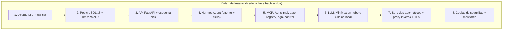

# 02 — Despliegue en Ubuntu (guía narrativa)

> Esta guía explica **qué instalar, en qué orden y por qué**, sin comandos: es la lectura
> previa a la instalación real. Los comandos concretos se ejecutan después, paso a paso,
> siguiendo este mismo orden. Público objetivo: quien va a montar el servidor del piloto.

---

## 0. Idea general del montaje

El servidor del piloto es una máquina con **Ubuntu** (versión LTS recomendada) que va a
albergar, de abajo hacia arriba: la **base de datos** (donde viven las lecturas), la
**API** (la puerta por donde habla el campo), el **agente** (el cerebro) y su **motor de
herramientas** (Agrisignal, MCP propios). Todo se deja como **servicios del sistema** para
que arranquen solos al encender y se reinicien si fallan, detrás de un **reverso proxy**
que termina TLS y filtra tráfico.

**Regla de la instalación:** cada capa se deja **probada** antes de pasar a la siguiente.
Si la BD no responde, montar la API no tiene sentido; si la API no responde, el agente no
tendrá dónde leer; si Agrisignal no responde, el agente decide a ciegas. En cada peldaño
hay una verificación simple antes de seguir.

---

## 1. Ubuntu y la red del servidor

Se instala Ubuntu Server LTS en la máquina que va a ser el cerebro. Antes que nada se le
da una **dirección de red fija** (los dispositivos del campo necesitan una URL estable a
la cual hablar), se revisa que el reloj del sistema esté bien (la firma HMAC y los sellos
de tiempo dependen de la hora) y se actualizan los paquetes base del sistema.

También se decide el **nombre público del servidor** (un dominio o una IP fija) porque
los MCU y el panel de configuración hablarán siempre con ese nombre. Si el servidor queda
detrás de NAT, se plantea aquí mismo cómo exponer solo el puerto de la API (TLS obligatorio).

**Por qué primero:** todo lo demás depende de red estable y hora correcta.

---

## 2. PostgreSQL 18 + TimescaleDB

Se crea la base de datos del piloto. Se instala **PostgreSQL 18** y sobre él la extensión
**TimescaleDB** (que convierte la tabla de lecturas en una hipertable con retención y
agregados automáticos). Opcionales pero recomendables: **PostGIS** (si algún día hay
mapas/lotes georreferenciados) y **pgvector** (memoria semántica del agente).

Se crea un usuario de aplicación con permisos mínimos (solo CRUD sobre las tablas del
piloto, nunca superusuario) y se deja la **copia de seguridad programada** desde este
momento: dumps automáticos con retención diaria/semanal, guardados fuera de la máquina.

**Verificación:** conectarse con el usuario de aplicación, crear las tablas del
esquema ([04-base-de-datos.md](04-base-de-datos.md)) y confirmar que la hipertable de
lecturas acepta inserciones con sello de tiempo.

---

## 3. API FastAPI

Se despliega la aplicación API (módulo Python del proyecto) con su entorno de dependencias
aislado. La API es la **única puerta del campo**: acepta lotes de lecturas firmados con
HMAC-SHA256, expone las tareas con `tracking_id`, el carril rápido de comandos y los
endpoints de configuración (variables, intervalos, zonas, umbrales) que usará el usuario.

En este paso se cargan las **tablas de configuración inicial**: el dispositivo piloto, sus
variables (las que eligió el usuario), sus intervalos, las zonas y los relés.

**Verificación:** simular un lote de lecturas firmado y verlo aterrizar en la BD; pedir
un `tracking_id` y comprobar que se puede consultar su estado; verificar que un HMAC
incorrecto es rechazado.

---

## 4. Hermes Agent (el agente de riego)

Se instala **Hermes Agent** (proyecto Nous Research, licencia MIT) en el servidor: es el
motor de agentes que da perfil, memoria persistente, skills, automatización por cron y
trazabilidad. Se crea el perfil del piloto (`agro-riego` y `agro-alertas`), sus archivos
de conducta (SOUL.md) y sus skills basadas en el conocimiento agronómico del
documento [09](09-conocimiento-agronomico.md) (balance FAO-56, umbrales, fenología).

Se conecta Hermes a **nuestra API y base de datos** mediante el MCP `agro-control` (leer
lecturas, escribir decisiones, publicar comandos) y se define el **kit de herramientas**
de cada agente (qué MCP incluye y qué tool excluye), tal como describe [07](07-herramientas-agrisignal-multitool.md).

**Verificación:** disparar manualmente una tarea `irrigation_analysis` con lecturas
de prueba y confirmar que el agente produce una decisión completa (registrarla en la BD)
con sus justificaciones e insumos citados.

---

## 5. MCP de herramientas: Agrisignal y los propios

Se registran los servidores MCP que el agente usará:

| MCP | Origen | Para qué | Llaves |
|---|---|---|---|
| `agrisignal-mcp` | npm (paquete público) | Clima, suelo, riego, heladas, GDD, sequía | **Ninguna** (gratis, datos públicos Open-Meteo + SoilGrids) |
| `agro-control` | Nuestro | Leer/escribir en API+BD: lecturas, decisiones, comandos | HMAC interno |
| `agro-registry` | Nuestro | Catálogo de variables, zonas, configuración | HMAC interno |
| Adaptador de pronóstico | Nuestro (futuro) | Modelo de pronóstico propio del usuario | Definida con el usuario |

Agrisignal se prueba **antes** que los propios: se confirma que `geocode_location`
resuelve la localidad del lote y que `get_soil_profile` devuelve la textura de las
coordenadas del campo.

**Verificación:** desde el perfil del agente, ejecutar `get_irrigation_advice` para las
coordenadas del lote y comprobar que devuelve la estimación con sus números.

---

## 6. El cerebro (LLM) — agnóstico

Se configura el proveedor de LLM en Hermes. Opciones del piloto, en orden de simplicidad:

1. **MiniMax vía API** (default del proyecto): pago por uso, sin infraestructura local.
2. **Proveedor compatible OpenAI** (OpenRouter, API propia, etc.): misma llave en otro lado.
3. **Ollama local** (recomendado para campo con conectividad intermitente): modelos
   pequeños corriendo en la misma máquina o en una GPU vecina; cero costo por uso.

Se deja configurada la **ruta al modelo objetivo futuro** (`agro-*` afinado con LoRA y
entrenado con la memoria del piloto) sin bloquear el arranque: mientras tanto, el agente
funciona con cualquier proveedor. Cualquier cambio de proveedor es **solo configuración**:
ningún archivo del agente depende de un modelo específico.

**Verificación:** pedirle al agente una respuesta de prueba y confirmar trazas en el log;
cambiar de proveedor y repetir sin tocar skills.

---

## 7. Servicios automáticos, proxy inverso y TLS

Todo lo anterior se deja declarado como **servicios del sistema** (arranque automático,
reinicio ante caída, dependencias en orden: BD → API → agente → MCP). Detrás de la API se
coloca un **reverso proxy** (nginx o similar) que:

- termina **TLS** (certificado válido) — la firma HMAC protege los cuerpos, pero el canal
  también debe ser HTTPS;
- expone **solo** lo necesario: la API y el panel; nada de BD ni de puertos internos;
- aplica límites básicos (tamaño de lote, tasa de peticiones) y cabeceras de seguridad.

Se configuran además: registro de logs con rotación, alertas de servicio caído y un
**panel mínimo** (aunque sea la propia API servida con una página estática) para que el
usuario vea lecturas y decisiones.

**Verificación:** encender la máquina con el servicio apagado y confirmar que todo vuelve
solo; simular caída de la API y ver cómo el MCU queda en fallback sin perder datos
(el lote se acumula en su buffer y se reenvía al reconectar).

---

## 8. Copias de seguridad, monitoreo y actualizaciones

- **Backups:** dumps diarios de PostgreSQL con retención semanal; se guarda además la
  configuración del piloto (variables, umbrales, skills) como archivos versionados.
  Se prueba **restaurar** un dump en una máquina limpia — un backup no probado no cuenta.
- **Monitoreo:** discos llenándose, edad de la última lectura recibida, edad de la última
  decisión del agente, latencia del LLM y fallos HMAC. Si el campo deja de hablar, debe
  saltar una alerta.
- **Actualizaciones:** todo congelado por versión; se actualiza en un entorno de prueba
  primero. El firmware del MCU solo se actualiza si cambia su protocolo (casi nunca).

---

## 9. Resumen del orden

| Paso | Qué se deja listo | Señal de que está bien |
|---|---|---|
| 1 | Ubuntu, red fija, hora, dominio | Servidor alcanzable y cron sincronizado |
| 2 | PostgreSQL 18 + TimescaleDB + backup | Insert de prueba en la hipertable |
| 3 | API + esquema + config inicial | Lote firmado entra; HMAC malo sale |
| 4 | Hermes + perfiles + skills FAO-56 | Tarea manual produce decisión registrada |
| 5 | MCP Agrisignal + propios | `get_irrigation_advice` responde con números |
| 6 | LLM (MiniMax u Ollama) | Respuesta de prueba + trazas |
| 7 | Servicios + proxy + TLS | Reinicio limpio; MCU en fallback sin pérdida |
| 8 | Backups + monitoreo | Restauración de prueba exitosa |

Con este orden cumplido, el piloto está listo para el primer lote real de lecturas de
quinua: continúa en [03-equipo-variables-y-medicion.md](03-equipo-variables-y-medicion.md).
