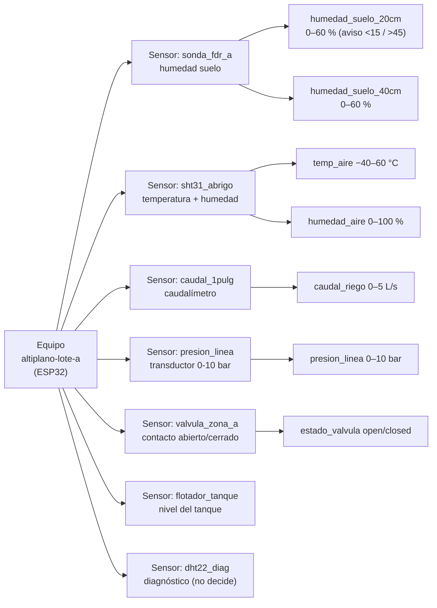
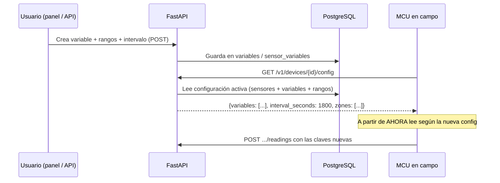

# 03 — Equipo, variables y medición (configurables por el usuario)

> El usuario define **qué medir** y **cada cuánto**; el equipo de campo obedece sin
> firmware nuevo. Esta configuración es el contrato entre el campo, la base de datos
> y el agente.

---

## 1. El equipo del piloto

| Pieza | Ejemplos | Función | ¿Cambia si cambian las variables? |
|---|---|---|---|
| **MCU** | ESP32, Raspberry Pi, SIM800/SIM7000 (con red celular) | Lee sensores, arma lotes JSON, firma HMAC, ejecuta relés | No |
| **Sensores** | Sonda de humedad (20/40 cm), caudalímetro, sensor de temperatura/humedad de aire (SHT31), **sensor de presión de línea**, **contacto de estado de válvula (abierta/cerrada)**, flotador de tanque y DHT22 de diagnóstico (7 en el piloto) | Generan la señal física | No (el cableado se interpreta según config.) |
| **Actuadores** | Relé 12 V → válvula solenoide / bomba | Abren/cierran el riego por zona | No |
| **Alimentación** | Fuente + (opcional) batería/solar | Energía del equipo | No |

Regla de arquitectura: el MCU **no sabe nada agronómico**. Solo sabe: *leer la lista de
variables que le dijo el servidor, cada `interval_seconds`, mandar el lote, preguntar si
hay tareas y disparar relés con duración en segundos*.

---

## 2. Variables configurables

### 2.1 Catálogo de variables (tabla `variables`)

El usuario crea variables con un nombre propio, unidad y tipo:

| Campo | Ejemplo 1 | Ejemplo 2 | Ejemplo 3 |
|---|---|---|---|
| `key` | `humedad_suelo_20cm` | `temp_aire` | `nivel_tanque` |
| `label` | "Humedad suelo 20 cm" | "Temperatura del aire" | "Nivel del tanque" |
| `unit` | `%` | `°C` | `%` |
| `value_type` | `double` | `double` | `double` |
| `sensor_hint` | "sonda FDR/TDR, canal A" | "DHT22/AM2302, puerto 1" | "flotador analógico 4–20 mA" |
| `depth_cm` (opcional) | 20 | null | null |
| `role` | `soil_moisture` | `air_temp` | `tank_level` |

El `role` es el que el agente usa en sus reglas: aunque el usuario renombre la variable,
el agente la reconoce por su rol (ver [06](06-agentes-riego.md)).

### 2.2 Variables sugeridas para el piloto de quinua

| Rol | Variable sugerida | Profundidad / nota | ¿Por qué |
|---|---|---|---|
| `soil_moisture` | `humedad_suelo_20cm` | 20 cm (zona radicular activa) | Dispara el riego (umbral % CC) |
| `soil_moisture` | `humedad_suelo_40cm` | 40 cm (control de percolación) | Detecta riego en exceso |
| `air_temp` | `temp_aire` | 1.5 m, con abrigo | Helada, GDD, estrés térmico |
| `air_humidity` | `humedad_aire` | junto a temp. | Vapor de presión, enfermedades |
| `soil_temp` | `temp_suelo` | 5–10 cm | Germinación y GDD del suelo |
| `tank_level` | `nivel_tanque` | tanque de reserva | **Guarda:** no ordenar riego sin agua |
| `flow` | `caudal_riego` | línea de bomba | Volumen aplicado (m³) por riego |
| `line_pressure` | `presion_linea` | descarga de bomba / antes de la válvula (bar) | Detecta **fuga, válvula atascada o bomba parada**: presión alta con válvula "cerrada" o presión cero con relé "encendido" |
| `valve_state` | `estado_valvula` | contacto auxiliar/limit switch en la válvula (`open`/`closed`) | **Verificación real** de la orden: el `ack` dice "ejecutado", el sensor confirma que la válvula **realmente** abrió |
| `battery` / `rssi` | diagnóstico del equipo | — | Salud del dispositivo |

Todas son **opcionales**: el usuario arma su lista; el piloto mínimo es humedad 20 cm +
temperatura de aire.

### 2.3 Intervalo de medición (por variable)

| Campo | Ejemplo | Efecto |
|---|---|---|
| `interval_seconds` | 1800 (30 min) | Cada cuánto lee y acumula esa variable |
| `enabled` | true | Pausar sin borrar (vacaciones, mantenimiento) |

Ejemplos de uso: humedad cada 30 min; temperatura cada 15 min durante ventana de helada
(el agente puede pedir el ajuste vía API); nivel de tanque cada hora.

**Perfilado de batería:** si el MCU va con solar/celular, se suben intervalos (ej. 60 min)
y el MCU acumula en **buffer local** para reenviar el lote al reconectar — la
configuración define la frecuencia, el buffer cubre las caídas.

### 2.4 Inventario jerárquico: equipo → sensores → variables → rangos

El usuario registra el equipo en **tres niveles** (todo por API, ver [12](12-api-crud-completa.md)):



| Nivel | Qué se registra | Ejemplo |
|---|---|---|
| **Equipo** | id, modelo, firmware, red, clave HMAC | `altiplano-lote-a`, ESP32 v1.4, WiFi |
| **Sensor** | id, tipo, marca/modelo, puerto/canal, profundidad, fecha de instalación | `sonda_fdr_a`, FDR SMD500, I²C 0x77, 20 y 40 cm |
| **Variable** | `key`, unidad, `role` (catálogo §2.1) | `humedad_suelo_20cm`, %, `soil_moisture` |
| **Rango** | `range_min`/`range_max` (físico del sensor) + `warn_min`/`warn_max` (umbral de aviso) por variable **instanciada** | 0–60 %; aviso <15 % o >45 % |

Los **rangos** cumplen dos funciones: (1) **validación en la API** — una lectura fuera de
`range_min..range_max` se guarda con `quality='suspect'` y se marca en reportes (cable
suelto, sonda quemada); (2) **alertas tempranas** en `warn_min..warn_max` — no esperar a
la regla de riego para avisar que algo anda mal. Cambiar rangos no toca firmware:
`PUT /v1/sensors/{sid}/variables/{key}`.

---

## 3. Cómo viaja la configuración (sin tocar firmware)



El MCU **pregunta la configuración** al arrancar y **periódicamente** (y tras cada lote
aceptado, como cabecera opcional `X-Config-Version`). Si el servidor cambió algo, el
próximo sondeo lo trae. **El firmware nunca se reprograma** por cambiar variables.

---

## 4. Ciclo de vida de una lectura

1. **Lectura:** el MCU lee todos los canales activos al vencer sus `interval_seconds`.
2. **Lote:** acumula hasta `N` muestras o `T` minutos (ej. 10 muestras / 5 min), arma JSON:

```json
{
  "device_id": "altiplano-lote-a",
  "seq": 1842,
  "sent_at": "2026-10-22T14:30:00Z",
  "readings": [
    {"key": "humedad_suelo_20cm", "ts": "2026-10-22T14:28:00Z", "value": 22.4},
    {"key": "humedad_suelo_40cm", "ts": "2026-10-22T14:28:00Z", "value": 26.1},
    {"key": "temp_aire",          "ts": "2026-10-22T14:28:00Z", "value": 14.7},
    {"key": "humedad_aire",       "ts": "2026-10-22T14:28:00Z", "value": 62.0},
    {"key": "caudal_riego",       "ts": "2026-10-22T14:28:00Z", "value": 0.0},
    {"key": "presion_linea",      "ts": "2026-10-22T14:28:00Z", "value": 0.0},
    {"key": "estado_valvula",     "ts": "2026-10-22T14:28:00Z", "value": 0},
    {"key": "nivel_tanque",       "ts": "2026-10-22T14:28:00Z", "value": 81.0}
  ]
}
```

3. **Firma:** HMAC-SHA256 sobre el cuerpo con el secreto del dispositivo; el servidor
   valida y rechaza firmas inválidas (antifalsificación).
4. **Inserción:** la API escribe en la hipertable (`readings`) con `device_id + key + ts`.
5. **Salida hacia el agente:** cada variable queda disponible como columna/tupla que el
   agente consulta; el `role` guía las reglas.

---

## 5. Actuadores: zonas, relés y ejecución

| Tabla | Qué define | Ejemplo |
|---|---|---|
| `zones` | Unidad de manejo del riego | `zona_surcos_a` — "Surcos A (1.0 ha)" |
| `actuators` | Relé físico asociado a una zona | `relay_1` GPIO 26 → válvula zona A |
| `zone_policies` | Límites duros por zona | duración máx. 45 min/riego, 2 riegos/día |

La orden del agente siempre nombra la **zona**; la API la traduce a **relé** según el
mapeo. Si el agente ordena "zona_surcos_a, 1200 segundos", el MCU recibe
`{"action": "irrigate", "relay": 1, "seconds": 1200}` y ejecuta con confirmación `ack`.

**Doble verificación del estado de válvula:** el MCU manda el `ack` (orden ejecutada) y
**además** lee el sensor `estado_valvula` (contacto abierto/cerrado) + `presion_linea`
para confirmar que el agua fluyó. Si `ack=executed` pero el sensor dice `closed` (o
presión cero) → alerta de **mantenimiento** y la zona queda en cuarentena hasta verificar.

**Guardas deterministas** (antes del agente, en la API, nunca delegadas al LLM):
duración máxima, número máximo de riegos por día, nivel de tanque insuficiente, ventana
de helada activa. Si una orden las viola, se rechaza con motivo y queda registrada.

---

## 6. Tabla resumen de configuración

| Qué configura el usuario | Dónde queda | Quién lo lee |
|---|---|---|
| Registro del equipo y sus sensores | `devices` + `sensors` | API (reportes), MCU (config) |
| Qué variables mide cada sensor y sus **rangos** | `sensor_variables` (range/warn) | API (validación), agente (alertas), panel |
| Lista global de variables (key, unidad, rol, profundidad) | `variables` | MCU (config) y agente (reglas) |
| Intervalo por variable | `sensor_variables.interval_seconds` | MCU |
| Zonas, relés y estado de válvula | `zones`, `actuators`, `sensors(estado_valvula)` | API (traducción) y agente (órdenes) |
| Umbrales de riego (MAD, % reposición, duración máx.) | `field_config` | Agente (decisión) + API (guardas) |
| Fecha de siembra / fase fenológica | `field_config` | Agente (Kc y criticidad) |

Continúa: [04-base-de-datos.md](04-base-de-datos.md).
