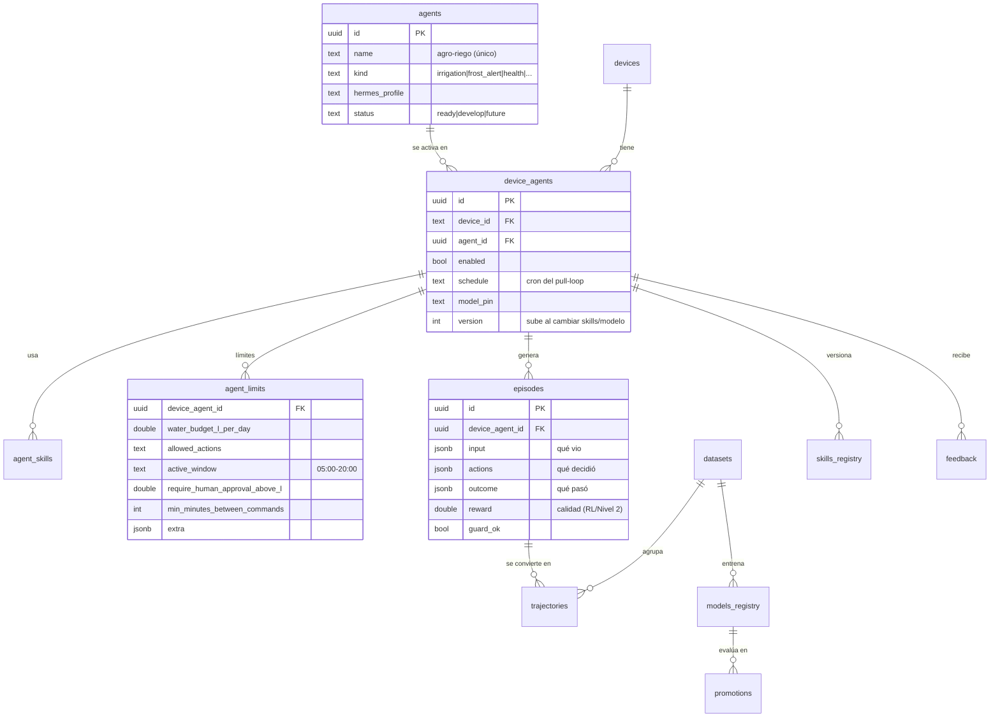

# 04 — Base de datos del piloto

> Esquema **simple**: una hipertable de lecturas, las tablas de configuración que el
> usuario toca, las tablas de trazabilidad (tareas y decisiones) y las tablas de
> **agentes, límites y auto-mejora** (§6). El esquema multiusuario completo (usuarios,
> roles) está en `docs/04-base-de-datos.md`.

**Motor:** PostgreSQL 18 + **TimescaleDB** (hipertable `readings`); opcional PostGIS y
pgvector. Todo en UTC. Hermes conserva su SQLite interna (`~/.hermes/state.db`) sin tocar.

---

## 1. Diagrama general

```mermaid
erDiagram
    devices ||--o{ sensors : "tiene"
    sensors ||--o{ sensor_variables : "mide"
    variables ||--o{ sensor_variables : "referencia"
    devices ||--o{ readings : "genera"
    sensors ||--o{ sensor_variables : "instancia con rangos"
    zones ||--o{ actuators : "tiene"
    zones ||--o{ zone_policies : "límites"
    devices ||--o{ tasks : "crea"
    tasks ||--o{ task_acks : "confirma"
    devices ||--o{ irrigation_decisions : "origina"
    irrigation_decisions }o--|| field_config : "usa umbrales"
    irrigation_decisions }o--o{ decision_inputs : "insumos"

    devices {
      text device_id PK
      text label
      text kind "esp32|rpi|sim7000"
      text auth_key_hmac
      int config_version
      timestamptz last_seen_at
      timestamptz created_at
    }
    sensors {
      text sensor_id PK
      text device_id FK
      text kind "soil_probe|dht22|flowmeter|pressure|valve_contact"
      text model
      text port "i2c:0x77|adc:1|gpio:26"
      int depth_cm "si aplica"
      timestamptz installed_at
      text status "active|maintenance|faulty"
    }
    variables {
      text key PK
      text label
      text unit
      text value_type "double|int|bool|string"
      text role "soil_moisture|air_temp|valve_state|..."
      int depth_cm
      text sensor_hint
    }
    sensor_variables {
      text sensor_id FK
      text key FK
      int interval_seconds
      bool enabled
      double precision range_min
      double precision range_max
      double precision warn_min
      double precision warn_max
      PK(sensor_id,key)
    }
    readings {
      timestamptz ts
      text device_id
      text sensor_id FK
      text key
      double precision value
      text quality "ok|suspect|stale"
    }
    tasks {
      uuid tracking_id PK
      text device_id FK
      text kind "irrigation_analysis|alert_check|..."
      text status "pending|ready|delivered|done|expired"
      jsonb payload
      timestamptz created_at
      timestamptz ready_at
    }
    irrigation_decisions {
      uuid decision_id PK
      text zone_id
      text action "irrigate|skip|defer"
      int seconds
      double precision reason
      text fenology_phase
      text status "proposed|approved|executed|rejected"
      timestamptz created_at
    }
    decision_inputs {
      uuid decision_id FK
      text source "sensor|agrisignal|config"
      text key
      jsonb value
    }
    field_config {
      text zone_id PK
      date sowing_date
      double precision mad_fraction
      double precision fc_percent
      double precision pmp_percent
      int max_seconds_per_event
      int max_events_per_day
      text llm_provider
    }
```

---

## 2. Las tablas y para qué sirve

| Tabla | Propósito | Quién escribe | Quién lee |
|---|---|---|---|
| `devices` | El equipo piloto: id, clave HMAC, versión de config, último avistamiento | API (registro) | API (auth), monitoreo |
| `sensors` | **Inventario de sensores** del equipo: tipo, modelo, puerto, profundidad, estado (`active/maintenance/faulty`) | Usuario vía API (doc 12) | API (config), reportes |
| `variables` | Catálogo global de variables (key, unidad, rol, profundidad) | Usuario vía API | MCU (config), agente |
| `sensor_variables` | Qué variable mide **cada sensor**, su `interval_seconds`, `enabled` y sus **rangos** (`range_min/max`, `warn_min/max`) | Usuario vía API | MCU (config), API (validación), agente (alertas) |
| `readings` | **Hipertable Timescale**: todas las lecturas (`ts, device_id, sensor_id, key, value, quality`) | API (lotes firmados) | Agente, panel, métricas |
| `zones` / `actuators` / `zone_policies` | Zonas de riego, relés asociados, límites duros | Usuario vía API | API (guardas), agente |
| `field_config` | Umbrales agronómicos por zona: fecha siembra, MAD, CC/PMP, duración máx. | Usuario vía API | Agente, guardas API |
| `tasks` | Tareas asíncronas con `tracking_id` y su estado | API (al recibir `POST .../tasks`) | MCU (sondeo), agente (cola) |
| `task_acks` | Confirmación del MCU de lo ejecutado (duración real, resultado) | MCU | Auto-mejora, auditoría |
| `irrigation_decisions` | Decisión del agente: acción, zona, duración, fase fenológica, estado | Agente (vía `agro-control`) | Panel, auditoría |
| `decision_inputs` | **Insumos exactos** de cada decisión (lecturas, clima Agrisignal, umbrales) | Agente | Auditoría, reentrenamiento |
| `alerts` | Avisos (helada, calor, sequía, tanque bajo, sonda fuera de rango) | Agente / API (rangos) | Panel, usuario (correo/SMS futuro) |

---

## 3. Decisiones de diseño

### 3.1 Lecturas en formato largo (key–value), no columnas anchas

`readings(ts, device_id, key, value)` en vez de una columna por variable:

- **El usuario agrega variables sin migrar esquemas** — solo una fila nueva en `variables`
  y su instancia en `sensor_variables`.
- Timescale segmenta por `ts`; consultas típicas (`última humedad de device X`) usan
  índice parcial `(device_id, key) DESC`.
- El esquema multiusuario completo usa JSONB para lecturas (`docs/04`); en el piloto la
  forma larga es más simple de indexar y graficar.

### 3.2 Inventario jerárquico y rangos (personalización + seguimiento)

La jerarquía `devices → sensors → sensor_variables` existe para que **reportes y APIs** puedan
responder sin procesamiento extra:

- "¿Cuántos sensores tiene el equipo?" → `COUNT(*) FROM sensors WHERE device_id=…`
- "¿Cuántas variables mide ese sensor y con qué rangos?" → `SELECT * FROM sensor_variables WHERE sensor_id=…`
- Los rangos viven **en la instancia** (por sensor), no en el catálogo global: dos sondas
  del mismo modelo pueden tener rangos de aviso distintos tras calibración.

Validación en ingestión: `value` fuera de `range_min..range_max` → `quality='suspect'` (no
se descarta: es evidencia de falla) + alerta si cruza `warn_min`/`warn_max`. El MCU no
valida rangos (es solo transporte); **la API valida al recibir** — así un cambio de rango
surte efecto inmediato sin tocar el equipo.

### 3.3 Hipertable con retención y agregados

- `readings` como hipertable: compresión a partir de ~7 días, retención configurable
  (ej. detalle 90 días, agregados horarios diarios indefinidos).
- Vista `readings_hourly` (promedio/mín/máx por key y hora) para el panel y el agente,
  que casi siempre mira ventanas de horas/días.

### 3.4 Trazabilidad de cada decisión

Toda decisión guarda **qué vio el agente** (`decision_inputs`), **qué umbral aplicó**
(`field_config` al momento de decidir) y **qué pasó después** (`task_acks`). Esto permite:

1. auditar "¿por qué regaron el martes?";
2. detectar reglas erróneas (decisión + resultado negativo = candidata a ajuste);
3. reentrenar el modelo futuro con pares (situación → decisión → resultado).

### 3.5 Seguridad mínima

- Clave HMAC por dispositivo en `devices` (nunca en la BD del MCU).
- Usuario de PostgreSQL con permisos solo CRUD sobre estas tablas.
- Los `ack` y decisiones inmutables: correcciones como nuevas filas, no UPDATE silenciosos.

---

## 4. Retención y volumen estimado

Con el piloto (1 dispositivo, 8 variables, cada 30 min):

| Concepto | Cálculo | Resultado |
|---|---|---|
| Lecturas/día | 8 vars × 48/día | ~384 filas/día |
| Año | 384 × 365 | ~140 mil filas/año |
| Con 4 dispositivos y 1 min de noche/día | orden de | ~1–3 millones/año |

Irrelevante para disco; el cuidado va a la **retención** (no acumular detalle eterno) y a
**respaldos probados** (ver [02](02-despliegue-ubuntu.md) paso 8).

---

## 5. Vistas útiles para el piloto

| Vista | Uso |
|---|---|
| `v_latest_readings` | Último valor por `device_id + key` (salud del campo) |
| `v_sensor_inventory` | Equipo → sensores → variables con rangos (reporte de inventario) |
| `v_daily_water_balance` | Lluvia (Agrisignal) + riego aplicado (`ack`) − ETc (agente) por día |
| `v_irrigation_events` | Eventos ejecutados: zona, duración, volumen estimado (`caudal × tiempo`) |
| `v_decision_quality` | Decisiones vs. resultado: ¿hubo estrés después? ¿riego en exceso? |
| `v_out_of_range` | Lecturas `quality='suspect'` por sensor (mantenimiento de sondas) |

---

## 6. Agentes, límites y auto-mejora (registro de los agentes)

Los agentes también se **registran en la BD** (no solo en Hermes): qué agentes existen
(catálogo), cuáles están **activados en el equipo**, con qué skills, con qué **límites** y
qué **episodios** dejan para aprender. Diseño simple (un solo equipo; sin `users`):



| Tabla | Propósito | Quién escribe | Quién lee |
|---|---|---|---|
| `agents` | **Catálogo** (doc 18): nombre único, misión (`kind`), perfil Hermes, estado (`ready/develop/future`) | Plataforma (el catálogo) | Wizard, API de activación |
| `device_agents` | **Activación**: qué agente está "contratado" en qué equipo, con su cron, modelo y `version` | Usuario vía API (`POST /v1/devices/{id}/agents`, doc 12 §6) | Backend (provisioning), panel |
| `agent_skills` | Skills activas de cada agente activado (`skill_name`, `source_path`, `enabled`) | API / wizard | Hermes (kit), auditoría |
| `agent_limits` | **Límites por agente** (doc 19 §6): presupuesto de agua, acciones permitidas, ventana, aprobación humana | Usuario vía API (auditado) | Contexto del agente **y** guarda determinista (doble ley) |
| `episodes` | Unidad de aprendizaje: entrada + acción + resultado + `reward` + `guard_ok` | Agente (tras cada ejecución) | Nivel 1 (entrenamiento, doc 19 §3) |
| `trajectories` | Episodio convertido a trayectoria ShareGPT con `quality` (filtro) | `batch_runner` | Entrenamiento SFT/LoRA |
| `datasets` | Ventana curada de episodios con la que se entrena un modelo | `agro-trainer` | Entrenamiento |
| `models_registry` | Modelos entrenados: base, `weights_hash`, `endpoint` (Ollama), `is_active` | Pipeline de entrenamiento | Hermes (provider) |
| `promotions` | Veredicto del promotion gate: `before_val` → `after_val`, `promoted/rejected` | Eval suite | Auditoría de mejora |
| `skills_registry` | Hash y versión del `SKILL.md` activo por agente (para **atribuir** mejoras) | API / Curator | `v_skill_impact` (doc 17) |
| `feedback` | Veto/corrección/aprobación del humano (`approve/veto/correct` + comentario) | Usuario vía API (doc 19 §7) | Curator (parche mismo día) |

> **Trazabilidad por ejecución** (unidad de tracking del piloto): las tablas
> **`agent_executions`**, **`agent_metrics_daily`** y **`skill_versions`** están definidas
> en [17](17-simulacion-y-mejora.md) §4–5; se registran aquí junto a las de auto-mejora
> para tener el esquema completo en un solo lugar. La vista **`v_agent_performance`**
> resume las métricas por agente y versión (doc 19 §9).

El diseño completo de **APIs CRUD con paginación, filtros, inventario y reportes** sigue en
[12-api-crud-completa.md](12-api-crud-completa.md).

Continúa: [05-api.md](05-api.md) (protocolo de campo) → … → [12-api-crud-completa.md](12-api-crud-completa.md).
