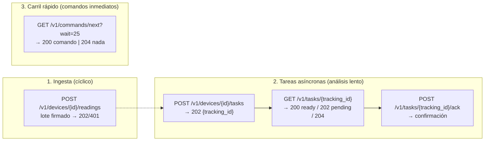

# 05 — API del piloto (endpoints mínimos)

> Solo lo necesario para el piloto: ingestión de lotes firmados, el **protocolo asíncrono
> con `tracking_id`**, el carril rápido de comandos y los endpoints de configuración que
> usa el usuario. El catálogo completo (usuarios, límites, ops) está en `docs/05-api-fastapi.md`.

**Convenciones:** prefijo `/v1/`; todo cuerpo del MCU firmado con **HMAC-SHA256**
(cabeceras `X-Device-Id`, `X-Timestamp`, `X-Signature`); fechas ISO-8601 en UTC; HTTPS
obligatorio. Firmas con más de ±5 min de reloj se rechazan (replay).

---

## 1. Los 3 protocolos del campo



| Protocolo | Cuándo lo usa el MCU | Latencia típica |
|---|---|---|
| Ingesta de lotes | Cada `interval_seconds` | Instantánea |
| Tareas con `tracking_id` | Tras cada lote (quiere decisión de riego) | Segundos a minutos (el LLM tarda) |
| Carril rápido | `commands/next` con espera larga (25 s) cuando no hay tareas | Inmediato si hay comando manual |

---

## 2. Ingesta de lecturas

### `POST /v1/devices/{device_id}/readings`

```json
{
  "seq": 1842,
  "sent_at": "2026-10-22T14:30:00Z",
  "readings": [
    {"key": "humedad_suelo_20cm", "ts": "2026-10-22T14:28:00Z", "value": 22.4},
    {"key": "temp_aire", "ts": "2026-10-22T14:28:00Z", "value": 14.7}
  ]
}
```

| Respuesta | Significado |
|---|---|
| `202 {accepted: N, config_version: 7}` | Lote aceptado; cabecera indica si hay config nueva |
| `401` | HMAC inválido o secreto desconocido |
| `409 {duplicate_seq}` | Reintento de un lote ya aceptado (idempotencia por `seq`) |
| `422` | Llave no configurada en ese dispositivo / valor fuera de rango lógico |

Reglas: máximo ~200 lecturas por lote; `ts` no puede adelantar >5 min al reloj del
servidor; las llaves desconocidas se rechazan con detalle (así se detectan cables mal).

---

## 3. Tareas asíncronas (el núcleo del piloto)

### `POST /v1/devices/{device_id}/tasks`

```json
{ "kind": "irrigation_analysis", "payload": {"reason": "scheduled"} }
```

→ `202 Created`:

```json
{ "tracking_id": "7f3b2c9e-...", "status": "pending", "poll_after_s": 10 }
```

El servidor **no espera al agente**: registra la tarea, despacha al agente (webhook/cola)
y responde de inmediato. El MCU guarda el `tracking_id`.

### `GET /v1/tasks/{tracking_id}`

| Estado | Respuesta | Qué hace el MCU |
|---|---|---|
| Agente aún analiza | `202 {status: "pending", eta_s: 20}` | Espera y vuelve a sondear |
| Decisión lista | `200 {status: "ready", command: {...}}` | Ejecuta `command` |
| Sin riego (decisión "skip") | `200 {status: "ready", command: {"action": "noop", "reason": "..."}}` | No hace nada, manda `ack` |
| Tarea vieja | `410 {status: "expired"}` | Descarta, reporta en el siguiente lote |

Comando `ready` (ejemplo real de salida):

```json
{
  "status": "ready",
  "command": {
    "action": "irrigate",
    "zone": "zona_surcos_a",
    "relay": 1,
    "seconds": 1200,
    "decision_id": "d1c4..."
  },
  "note": "Humedad 22.4% < umbral 25.1% (MAD 0.5); sin helada 48h; tanque 81%."
}
```

### `POST /v1/tasks/{tracking_id}/ack`

```json
{ "result": "executed", "seconds_applied": 1200, "flow_m3": 120, "finished_at": "..." }
```

| `result` | Uso posterior |
|---|---|
| `executed` | Cierra la tarea; alimenta `v_irrigation_events` |
| `executed_partial` (red cortada a mitad) | El agente calcula el volumen real |
| `skipped_local` (fallback local actuó) | Caso de auditoría: comparar contra decisión |
| `failed` (relé atascado, tanque vacío) | Alerta de mantenimiento |

**Caducidad:** las tareas vencen (ej. 15 min). Una decisión tardía no se ejecuta — el
riego se decide con datos frescos, no con datos de hace media hora.

---

## 4. Carril rápido

### `GET /v1/commands/next?wait=25`

Long-poll para comandos **inmediatos** (cambios manuales de config, pruebas, parada de
emergencia) que no pasan por el agente:

| Respuesta | Significado |
|---|---|
| `200 {command: {...}}` | Comando pendiente; ejecutar y mandar `ack` al endpoint del comando |
| `204 No Content` | Nada pendiente (normal; repetir tras ~25 s) |

---

## 5. Configuración (el usuario)

| Método y ruta | Para qué |
|---|---|
| `GET/POST /v1/variables` | Catálogo de variables (crear `humedad_suelo_20cm`, etc.) |
| `PUT /v1/devices/{id}/variables/{key}` | Activar/desactivar, **cambiar `interval_seconds`** |
| `GET /v1/devices/{id}/config` | La config que verá el MCU (con `config_version`) |
| `GET/POST /v1/zones` | Zonas de riego y relés |
| `PUT /v1/zones/{id}/policies` | Guardas: duración máx., eventos/día |
| `PUT /v1/zones/{id}/field-config` | Umbrales agronómicos: MAD, CC/PMP, fecha siembra |
| `GET /v1/decisions?zone=...&since=...` | Historial de decisiones + insumos |
| `GET /v1/metrics/latest` | Últimas lecturas, edad de datos, salud del equipo |

Autenticación de usuario: token de sesión/panel (no HMAC de dispositivo). El rol determina
si puede modificar umbrales agronómicos (guardados como `field_config`, auditados).

---

## 6. Guardas deterministas en la API (antes del agente)

Antes de entregar cualquier `command` de riego, la API valida —sin LLM—:

1. **Duración** ≤ `max_seconds_per_event` de la zona.
2. **Eventos hoy** < `max_events_per_day`.
3. **Tanque**: si existe `nivel_tanque` y está bajo el mínimo configurado → `409` con motivo.
4. **Ventana de helada**: si `alerts` tiene helada activa/proyectada para la ventana → rechazo.

Una orden rechazada queda registrada con motivo: es insumo de mejora del agente.

---

## 7. Errores (forma común)

```json
{ "error": {"code": "guard_max_duration", "message": "1500s > máximo 1200s (zona A)",
             "retryable": false, "hint": "Ajustar zone_policies o partir el riego"}}
```

Códigos del piloto: `unauthorized`, `bad_signature`, `unknown_key`, `duplicate_seq`,
`guard_max_duration`, `guard_max_events`, `guard_tank_low`, `guard_frost_window`,
`task_expired`, `rate_limited`.
