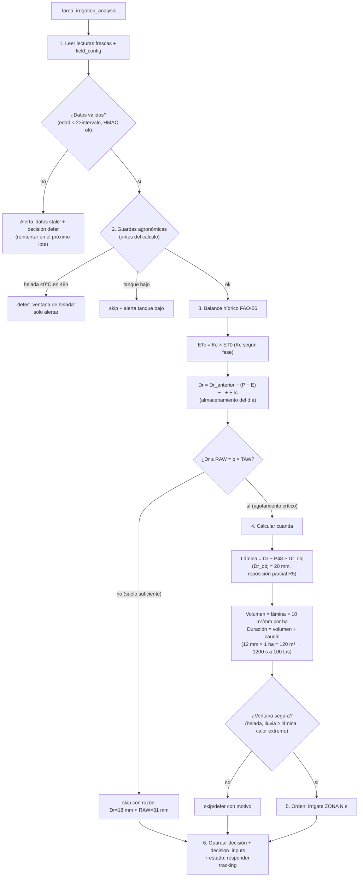

# 06 — Agentes de riego (completos)

> Los agentes que viven en el servidor, sus skills, su flujo de decisión y el formato
> exacto de las órdenes a los relés. Todas las reglas agronómicas citadas provienen de
> [09-conocimiento-agronomico.md](09-conocimiento-agronomico.md) (base verificada con fuentes).

---

## 1. Los agentes del piloto

| Perfil | Rol principal | Cadencia | Kit de herramientas |
|---|---|---|---|
| ⭐ `agro-riego` | **Decide riego**: ¿regar?, ¿cuánto?, ¿cuándo? | Tras cada `irrigation_analysis` + cron horario | Lecturas + `agro-control` + Agrisignal (riego/suelo/condiciones/GDD) |
| `agro-alertas` | **Vigila helada, calor y sequía**; emite alertas | Cron 2×/day + evento | Agrisignal (`frost_and_heat_risk`, `dry_spell_status`) + `agro-control` |
| `agro-supervisor` (fase 2) | **Revisa y ajusta** umbrales/estrategia | Cron semanal | Métricas BD, historial de decisiones y acks |

Cada agente es un **perfil Hermes** (SOUL.md + memoria + skills) con su **kit de
servidores MCP filtrado** (`tools.include/exclude`): mismas reglas de plataforma de
`docs/12-agentes-creacion-y-autoentrenamiento.md`, versión piloto.

---

## 2. `agro-riego` — el agente principal

### 2.1 Perfil (resumen)

| Elemento | Contenido |
|---|---|
| **Nombre** | `agro-riego` |
| **Misión** | Mantener la humedad de la zona de quinua entre PMP y CC, evitando riego en exceso, heladas y eventos en vano; toda decisión con insumos citados |
| **No hace** | Nunca ordena fuera de `zone_policies`; nunca salta las guardas de la API; nunca inventa lecturas |
| **Tono** | Decisiones cortas: acción + razón + números |

### 2.2 Entradas (qué lee en cada decisión)

| Fuente | Vía | Datos |
|---|---|---|
| Sensores del campo | BD (`readings`) | `humedad_suelo_20cm/40cm`, `temp_aire`, `nivel_tanque`, `caudal` |
| Configuración | `field_config` | Fecha siembra, MAD (p), CC/PMP, duración máx. |
| Clima actual y pronóstico | Agrisignal `get_growing_conditions` | Temperatura, suelo, pronóstico 3 días |
| Suelo | Agrisignal `get_soil_profile` | Textura, pH, carbono orgánico, **capacidad de agua** por profundidad |
| Balance recomendado | Agrisignal `get_irrigation_advice` | Estimación riego/no + **todos sus números** (lluvia, ET0, humedad, capacidad) |
| Heladas/calor | Agrisignal `get_frost_and_heat_risk` | Días con riesgo en los próximos 16 días |
| GDD/fenología | Agrisignal `get_growing_degree_days` | Acumulado desde fecha de siembra → fase estimada |
| Sequía | Agrisignal `get_dry_spell_status` | Días secos consecutivos y lluvia acumulada |
| Conocimiento | Skill FAO-56 + doc 09 | Kc, TAW/RAW, umbral, criticidad por fase |

### 2.3 Flujo de decisión



### 2.4 Reglas concretas (con fuente → ver doc 09)

| # | Regla | Base |
|---|---|---|
| R1 | Disparar riego cuando el agotamiento `Dr ≥ RAW`, con `RAW = p × TAW` y **p ≈ 0.5** (MAD 50 %; ajustable 0.4–0.6) | FAO-56 §§8.2–8.5 (TAW/RAW) |
| R2 | `TAW = 1000 × (θFC − θWP) × Zr` con Zr según fase (0.3 m inicial → 0.6–0.8 m, hasta 1.8 m en sequía) | FAO-56; raíz quinua (IRD 2012) |
| R3 | ETc diaria = **Kc × ET0**; Kc por fase: **0.5 (inicial) → 1.0 (media) → 0.7 (final)** | Lisímetro altiplano: García et al. 2003 |
| R4 | **Floración y llenado = fases críticas**: no permitir estrés ni helada < −1 °C; ramificación tolera −8 °C | Mujica et al. 2001; Lescano 1994 |
| R5 | Riego deficitario permitido hasta ~**75 % de ETc** sin pérdida significativa; **55 % ETc** es el umbral mínimo de respuesta útil | Geerts et al. 2008 (Altiplano); revisión 2022 |
| R6 | Umbral de humedad del sensor ≈ **CC − p×(CC − PMP)** (ej.: si CC=30.3 %, PMP≈20 %, p=0.5 → umbral ≈ 25.1 %) | FAO-56 + método PRISMAB/Cenicaña |
| R7 | **No regar si** lluvia pronosticada ≥ lámina pendiente, helada ≤0 °C, o tanque bajo | Guardas doc 05 §6 |
| R8 | Ciclo de quinua ~**150–180 días**; GDD base 3 °C para fenología | PROINPA; Jacobsen & Bach 1996 |
| R9 | Duración por zona ≤ `max_seconds_per_event`; reportar volumen con `caudal × tiempo` | Configuración usuario |

### 2.5 Salida: orden y justificación

Respuesta al `tracking_id` (campo `command`, ver doc 05 §3) + registro `irrigation_decisions`:

```json
{
  "action": "irrigate",
  "zone": "zona_surcos_a",
  "relay": 1,
  "seconds": 1200,
  "expected_mm": 12,
  "decision_id": "d1c4..."
}
```

Justificación guardada en `decision_inputs` (siempre con números, nunca opinión sola):

```text
Dr = 34 mm ≥ RAW = 31 mm (p=0.5, TAW=62 mm, Zr=0.6 m fase 'ramificación',
GDD acum. 412 base 3°C). ETc hoy = 4.8 mm (Kc 1.0 × ET0 4.8). Pronóstico
lluvia 48h = 2 mm (Agrisignal). Helada mín. 48h = 2.1°C (sin riesgo).
Tanque 81%. Lámina = Dr 34 − P48 2 − Dr_obj 20 = 12 mm → 1200 s @ 100 L/s (120 m³, 1.0 ha).
```

### 2.6 Tono de respuesta (SOUL.md, resumen)

- Siempre: **acción + razón + números + fase fenológica**.
- Nunca: "recomiendo regar" sin decidir; el agente **decide y emite la orden** o el skip.
- Ante duda de datos (sensor caído, lote viejo): **defer + alerta**, no adivinar.

---

## 3. `agro-alertas`

| Entrada | Herramienta Agrisignal | Salida |
|---|---|---|
| Helada próxima (≤0 °C, dura ≤ −2 °C) | `get_frost_and_heat_risk` (16 días) | Alerta con día(s), mínima esperada, zona afectada |
| Calor extremo (≥32 °C / ≥38 °C) | ídem | Alerta de estrés térmico (quinua aborta flores >38 °C) |
| Sequía (días secos, lluvia acumulada baja) | `get_dry_spell_status` (92 días) | Alerta de déficit vs. normal de temporada |
| Publicación | `agro-control` → tabla `alerts` | Panel + (futuro) correo/SMS |

**Prioridad de canales:** helada > tanque bajo > calor > sequía. Una helada en floración
(−1 °C) es alarma roja; en ramificación, amarilla (R4).

---

## 4. `agro-supervisor` (fase 2, semanal)

Revisa: decisiones vs. resultados (`v_decision_quality`), riegos en vano (lluvia posterior
≥ lámina), excesos (humedad > CC tras riego), órdenes rechazadas por guardas y
`ack failed`. Propone ajustes de `field_config` (MAD, duración máx.) como **cambios
auditables** que el usuario aprueba — el supervisor no edita umbrales solo.

---

## 5. Auto-mejora (versión piloto)

1. **Cada `ack`** cierra el ciclo: decisión → ejecución → estado del suelo posterior.
2. **Errores etiquetados** (estrés detectado tras "skip"; humedad > CC tras "irrigate";
   orden rechazada por guarda) se acumulan en `decision_inputs`/`alerts`.
3. **Skills refinas** con Hermes Curator: el agente ajusta sus notas de procedimiento
   (p. ej., p por textura local, corrección Kc a >3000 m — ver doc 09 §7).
4. **Entrenamiento futuro** (LoRA `agro-*`): los pares (estado → decisión → resultado)
   alimentan el modelo propio; hasta entonces, el LLM base + skills FAO-56.

Detalle del protocolo completo (3 niveles, helpers, límites): [19](19-entrenamiento-y-limites-agentes.md).

---

## 6. Prueba rápida del agente

1. Insertar lectura sintética: `humedad_suelo_20cm = 20 %` (bajo umbral típico).
2. Crear tarea `irrigation_analysis` → esperar `ready`.
3. Verificar: acción `irrigate`, duración coherente con caudal, **fase citada**,
   insumos Agrisignal presentes en `decision_inputs`.
4. Repetir con `humedad = 40 %` (sobre CC) → debe responder **skip** con razón.
5. Repetir con helada activa simulada → debe responder **defer** por ventana de helada.

Continúa: [07-herramientas-agrisignal-multitool.md](07-herramientas-agrisignal-multitool.md).
