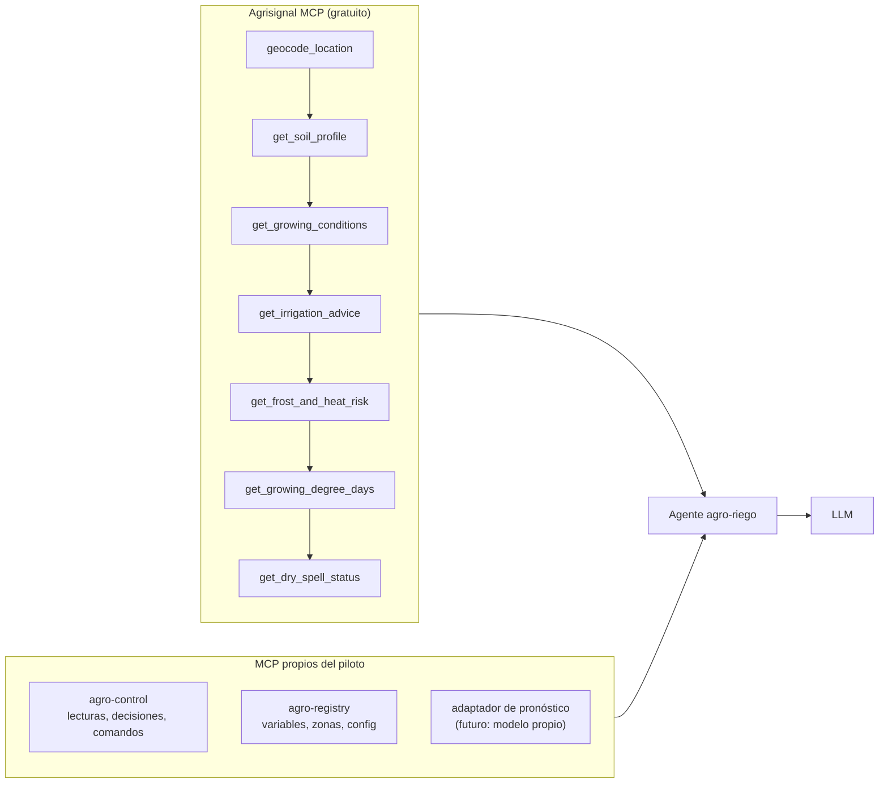

# 07 — Herramientas: Agrisignal (MCP central) y multi-tool por agente

> **Agrisignal es la columna vertebral externa** del piloto: clima, suelo y estimaciones de
> riego en herramientas MCP **gratuitas y sin llaves**. A su lado, nuestros MCP propios
> (`agro-control`, `agro-registry`) dan al agente acceso a la BD del piloto, y el kit de
> herramientas **por agente** decide qué ve cada uno.

---

## 1. Agrisignal — qué es y por qué es central

| Aspecto | Detalle |
|---|---|
| Qué es | Servidor MCP (`agrisignal-mcp`, npm) de soporte a decisiones agrícolas con **datos públicos y gratuitos**: Open-Meteo (clima, pronóstico, ET0) + SoilGrids/ISRIC (suelo global 250 m) |
| Costo | **Gratis, sin API keys** (funciona out-of-the-box) |
| Instalación | Se registra como servidor MCP en el kit del agente (ver §4) |
| Alcance | Estimaciones para **triage y planificación** — no consejo agronómico certificado: **siempre mostrar los números** junto a la recomendación |
| Coordenadas | Primero `geocode_location` (nombre → lat/lon), luego el resto con lat/lon |

> ### ⚠️ Regla de uso en el agente
> Toda respuesta de Agrisignal que aporte a una decisión se **transcribe con sus números**
> en `decision_inputs` (ej. "lluvia pronóstico 48 h = 2 mm; ET0 = 4.8 mm"). El agente
> **nunca** cita la herramienta sin citar sus valores.

---

## 2. Las 7 herramientas y su papel en el piloto

| # | Tool | Qué devuelve | Uso en `agro-riego` | Uso en `agro-alertas` |
|---|---|---|---|---|
| 1 | `geocode_location` | Lat/lon del lote | Una vez: fijar coordenadas del campo | Ídem |
| 2 | `get_soil_profile` | Textura, pH, CO, **agua por profundidad** (0–5 … 30–60 cm) | **TAW/FC/PMP** del perfil → umbral R6 | — |
| 3 | `get_growing_conditions` | Snapshot: clima actual + humedad/temp. suelo + pronóstico diario | Insumo principal de contexto | Contexto |
| 4 | `get_irrigation_advice` | Estimación **¿riego necesario?** con todos los insumos (cap. suelo, humedad, P vs ET0) | **Cruzada** con el balance FAO-56 propio (no la reemplaza: aporta números) | — |
| 5 | `get_frost_and_heat_risk` | Días con helada (≤0 °C / ≤ −2 °C) o calor (≥32 / ≥38 °C) en 16 días | Guarda de ventana (R7) | ⭐ Alertas |
| 6 | `get_growing_degree_days` | GDD acumulado rango (base configurable, ej. 3 °C) | **Fenología** (fase → Kc R3, criticidad R4) | — |
| 7 | `get_dry_spell_status` | Días secos consecutivos + lluvia acumulada (ventana ≤92 días) | Contexto de déficit | ⭐ Alertas sequía |

---

## 3. MCP propios

| MCP | Tools (ejemplo) | Quién lo usa |
|---|---|---|
| `agro-control` | `read_latest(device,key)`, `read_series(...)`, `record_decision(...)`, `publish_command(...)`, `get_field_config(...)` | `agro-riego`, `agro-alertas`, `agro-supervisor` |
| `agro-registry` | `list_variables()`, `list_zones()`, `set_interval(device,key,seconds)`, `list_sensors_health()` | Supervisor y operación |
| **Adaptador de pronóstico** (futuro) | `get_forecast_point(date, var)` — traduce el **modelo de pronóstico propio del usuario** a una tool más del kit | `agro-riego` (cuando el usuario lo entregue) |

El adaptador **no rompe nada** cuando llega: es una tool nueva en el kit (§4). El usuario
definirá después su formato (CSV/API/JSON); hasta entonces, el pronóstico lo cubre
Open-Meteo vía Agrisignal.

---

## 4. Kit de herramientas por agente (multi-tool)

Cada agente = **perfil Hermes + skills + kit de servidores MCP filtrado**
(`tools.include` / `tools.exclude` en su configuración). Añadir o quitar capacidades =
**tocar configuración, no código**.

| Agente | Incluye (`include`) | Excluye (`exclude`) |
|---|---|---|
| `agro-riego` | `agrisignal:*` (las 7), `agro-control:*`, `agro-registry:read*` | `agro-registry:set_*` (no reconfigura solo), tools de escritura arbitraria |
| `agro-alertas` | `agrisignal:get_frost_and_heat_risk`, `get_dry_spell_status`, `geocode_location`, `agro-control:record_alert` | Edición de `field_config` |
| `agro-supervisor` | `agro-control:*` (lectura), `agro-registry:*`, métricas | `publish_command` (propone, no ejecuta) |

**Principio:** permiso mínimo por agente; el MCU jamás ve MCP — solo HTTP de su API.

---

## 5. Decisiones que nacen de combinar herramientas

| Escenario | Combinación | Resultado |
|---|---|---|
| ¿Regar hoy? | `readings` (sensor) + `get_soil_profile` (TAW) + `get_growing_conditions` (P/ET0) + `get_growing_degree_days` (fase→Kc) | Balance FAO-56 con Kc correcto y umbral según textura real |
| ¿Regar si llueve mañana? | `get_irrigation_advice` (P 48 h) vs. lámina pendiente | Skip si lluvia ≥ lámina (R7) |
| ¿Es seguro regar? | `get_frost_and_heat_risk` + `nivel_tanque` | Defer por helada / skip por tanque |
| ¿En qué fase está? | `get_growing_degree_days` desde `sowing_date` (base 3 °C) + fecha siembra | Fase → Kc (0.5/1.0/0.7) y criticidad (floración) |

---

## 6. Cómo registrar Agrisignal (conceptual)

1. Instalar el paquete npm `agrisignal-mcp` en el servidor.
2. Declararlo como servidor MCP en la configuración de Hermes — **sin llaves ni tokens**.
3. Asignarlo al kit de `agro-riego` y `agro-alertas` (§4).
4. Probar `geocode_location("<localidad del lote>")` y luego
   `get_irrigation_advice(lat, lon)` — si devuelve números, está listo.

Verificación completa y personalización: [08-prueba-y-personalizacion.md](08-prueba-y-personalizacion.md);
datos agronómicos que sustentan estas decisiones: [09-conocimiento-agronomico.md](09-conocimiento-agronomico.md).
