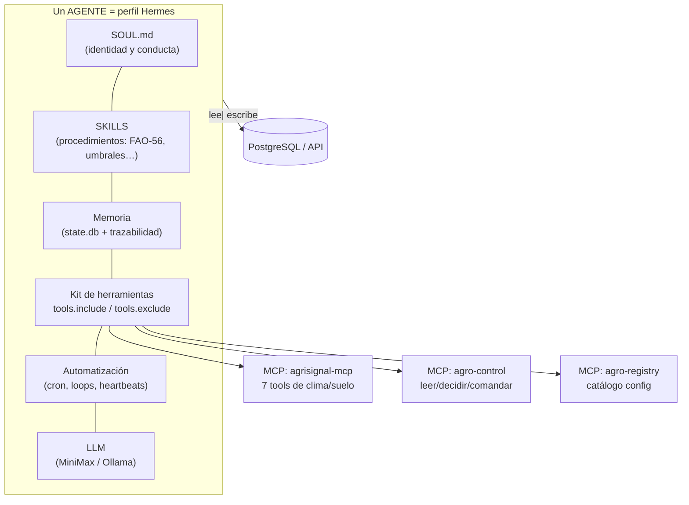
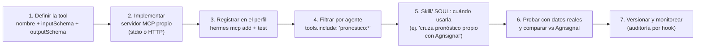
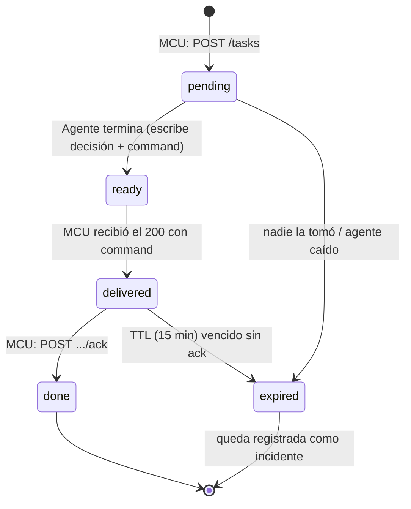

# 10 — Agente, skill y herramienta: definiciones, ampliación y seguimiento

> Responde tres preguntas del piloto: **¿qué es exactamente un agente, un skill y una
> herramienta?**, **¿se pueden agregar más herramientas (y personalizadas)?** y **¿cómo
> hacemos seguimiento** de lo que el agente decide y el equipo ejecuta.

---

## 1. Definiciones (bien claras)

| Concepto | Definición | Analogía | Ejemplo en el piloto |
|---|---|---|---|
| **Agente** | Un **"empleado virtual" completo**: perfil Hermes con identidad (`SOUL.md`), memoria persistente, kit de herramientas, automatización (cron) y un LLM detrás. **Decide y actúa.** | Un técnico de riego contratado | `agro-riego`, `agro-alertas` |
| **Skill** | Un **manual de procedimiento en Markdown** (`SKILL.md`) que el agente **lee** cuando le toca aplicarlo. Es **conocimiento/pasos**, no código que se ejecuta. El agente (y Curator) puede **refinarla** con el tiempo. | El manual de buenas prácticas del técnico | `fao-56-balance`, `umbral-riego-quinua` |
| **Herramienta (tool)** | Una **función concreta e invocable** con esquema de entrada/salida, registrada en un servidor **MCP**. Cuando el agente la llama, **algo real ocurre** (se consulta, se escribe, se calcula). | El instrumental del técnico: sonda, teléfono, válvula remota | `get_irrigation_advice` (Agrisignal), `publish_command` (`agro-control`) |
| **Servidor MCP** | Contenedor que **expone un grupo de tools** (stdio o HTTP). Se registra una vez y muchas herramientas. | Una "caja de herramientas" completa | `agrisignal-mcp`, `agro-control`, `agro-registry` |
| **Perfil (de Hermes)** | La carpeta/identidad de un agente (`~/.hermes/profiles/<nombre>/`): su SOUL.md, su config de MCP con **`tools.include/exclude`**, su cron. | El puesto de trabajo del empleado | `agro-riego` |
| **Memoria** | El "cuaderno" persistente del agente (SQLite interna `~/.hermes/state.db`, sin tocar por la plataforma) + nuestras tablas de trazabilidad. | El cuaderno de notas | recuerda que "la sonda B se descalibró" |
| **Tarea / `tracking_id`** | La unidad de **seguimiento** del trabajo pedido al agente (ver §4). | El tique de una solicitud | `irrigation_analysis` → `7f3b2c9e…` |
| **MCU** | El equipo de campo: **no es un agente**, no tiene skills ni LLM; solo mide, envía lotes, sondea tareas y ejecuta relés. | El obrero que obedece y reporta | ESP32 / RPi / SIM7000 |

### 1.1 Cómo se componen

> **Regla de oro de las definiciones:** el agente **decide**, la skill le **dice cómo**,
> la herramienta **hace** lo que decidió. Si falta una: sin skill el agente improvisa;
> sin tool no puede hacer nada en el mundo real.

---

## 2. ¿Se pueden agregar más herramientas? — Sí, por 4 vías

| # | Vía | Qué agrega | Costo de agregarla | ¿Toca el MCU? |
|---|---|---|---|---|
| 1 | **MCP externo** (paquete npm/pip o servidor HTTP) | Tools de terceros (clima, visión, ERP…) | Registrar + `hermes mcp test` | No |
| 2 | **MCP propio** (nuestro código, ej. `agro-control`) | Tools sobre nuestra API/BD | Desarrollar el servidor una vez; exponer N tools | No |
| 3 | **Plugins/hooks de Hermes** | Lógica en puntos de vida del agente (auditoría, post-tool) | Código empaquetado como plugin | No |
| 4 | **Skill nueva sin tool** | Procedimiento puro (ej. "checklist de calibración de sonda") | Un `SKILL.md` | No |

**Límite real:** no hay límite de tools por plataforma; sí un **límite por agente** de
principio: cada agente solo ve su kit (`include/exclude` por glob) — permiso mínimo.

### 2.1 Lógica de integración de una herramienta personalizada (paso a paso)

Caso real pendiente: **el modelo de pronóstico propio del usuario** (su formato lo definirá
él después). Mientras llega, lo cubre Open-Meteo vía Agrisignal. El camino es exactamente
este — misma lógica para cualquier tool nueva:

1. **Definir la interfaz:** nombre (`get_forecast_point`), entrada (`date, variable, lote`),
   salida (`{value, unit, issued_at, model_version}`) — estilo MCP con `outputSchema`.
2. **Implementar el servidor** propio (una vez): traduce el formato del usuario
   (CSV/API/JSON que él entregue) al estándar MCP. Es **una tool más del kit** — no cambia
   la API, ni la BD, ni el firmware.
3. **Registrar y probar:** alta en el perfil con la CLI de Hermes (`hermes mcp add` +
   `hermes mcp test`) — verificado en `docs/02` §7.
4. **Filtrar por agente:** solo `agro-riego` la incluye (`tools.include: "pronostico:*"`);
   `agro-alertas` no la ve.
5. **Enseñarle a usarla:** actualizar la skill de decisión (paso "comparar pronósticos") y
   el SOUL si aplica.
6. **Prueba A/B:** durante una semana, registrar ambas previsiones y elegir la más fiable
   (tabla de aciertos en `decision_inputs`).
7. **Versionar y auditar:** hook `post-tool` que loguea cada invocación; si la tool falla,
   el agente debe **caer a Agrisignal** (nunca dejar de decidir) y marcar `defer` si tampoco.

---

## 3. ¿Qué es dinámico y qué no?

| Elemento | ¿Dinámico? | Cómo se cambia | Quién |
|---|---|---|---|
| **Skills** (procedimientos) | ✅ Total | Editar `SKILL.md` / Curator lo refina; el agente lo usa en la siguiente ejecución | Agente + humano |
| **Kit de tools** (`include/exclude`) | ✅ Total | Config del perfil + `hermes mcp add/test` | Operador |
| **Agentes nuevos** | ✅ Total | Crear perfil nuevo (6 pasos, `docs/12` §B.1) | Operador |
| **Variables y intervalos de medición** | ✅ Total | API (`PUT .../variables/{key}`) → MCU lo toma en el siguiente sondeo; **cero firmware** | Usuario |
| **Umbrales agronómicos** (`field_config`) | ✅ Total | API + auditoría de cambios | Usuario/agronómico |
| **Proveedor LLM** | ✅ Total | Config de Hermes (MiniMax ↔ Ollama ↔ …) | Operador |
| **MCP server nuevo** (paquete externo) | ⚠️ Semi | Instalar paquete + registrar + reiniciar el perfil (minutos, sin despliegue nuevo) | Operador |
| **Tool nueva en MCP propio** | ⚠️ Semi | Código del servidor MCP + `test` (no toca API core ni MCU) | Desarrollador |
| **Protocolo HTTP del MCU / API v1** | ❌ No | Solo con versión (`/v2/`) y firmware coordinado | Desarrollador |
| **Esquema de BD core** | ❌ No | Migración versionada | Desarrollador |

**Conclusión:** todo lo que el piloto necesita cambiar en operación (variables, intervalos,
umbrales, reglas, herramientas, hasta el cerebro) es **dinámico o semi-dinámico**; lo estático
es el protocolo base que MCU y servidor ya comparten.

---

## 4. Seguimiento: el ciclo completo de `tracking_id`

### 4.1 Máquina de estados de una tarea

| Estado | Quién lo escribe | Qué se registra | Si se "atasca" |
|---|---|---|---|
| `pending` | API (al recibir `POST /tasks`) | `created_at`, `payload` | Si > 10 min → alerta "agente no responde" |
| `ready` | **Agente** (vía `agro-control`) | `irrigation_decisions` + `decision_inputs` + `command` | Si > TTL → `expired` |
| `delivered` | API (al servir el `GET` con command) | `delivered_at` | — |
| `done` | MCU (`ack`) | `result`, `seconds_applied`, `flow_m3` | `failed`/`skipped_local` → alerta de operación |
| `expired` | API (reloj) | motivo | Auditoría: decisión tardía **no se ejecuta** |

### 4.2 Qué mira cada quien (seguimiento operativo)

| Panel / consulta | Pregunta que responde | Umbral de alerta |
|---|---|---|
| `v_latest_readings` | ¿El campo está hablando? | > 3× `interval_seconds` sin lote → alerta |
| `tasks` en `pending`/`ready` viejas | ¿El agente está respondiendo? | > 10 min → alerta (cron incidents de Hermes) |
| `v_irrigation_events` | ¿Cuánto se regó y cuándo? | — |
| `v_decision_quality` | ¿Las decisiones acertaron? (skip→estrés, irrigate→exceso) | > 20 % de fallos → revisar skill/umbrales |
| `task_acks` con `failed`/`skipped_local` | ¿El equipo ejecutó lo pedido? | 1 falla → aviso; 2 seguidas → mantenimiento |
| Guardas (`guard_*`) | ¿El agente propone fuera de política? | Cada una se revisa semanalmente (`agro-supervisor`) |
| `decision_inputs` | **¿Por qué se decidió esto?** (auditoría) | — |

**Canales:** Hermes entrega los avisos donde ya está el usuario (WhatsApp/Telegram vía
canales de mensajería, `docs/02` §8) — sin app nueva. El admin recibe incidentes de
operación; el productor, alertas agrícolas (helada, riego ejecutado, tanque bajo).

---

## 5. Crear un agente nuevo (resumen — detalle en el doc 16)

1. **Perfil:** crear `~/.hermes/profiles/<nombre>/`.
2. **SOUL.md:** misión, límites, tono (nunca saltar guardas, siempre citar números).
3. **Skills:** crear `SKILL.md` con el procedimiento y **sus fuentes** (doc 09).
4. **Kit de tools:** `tools.include/exclude` — permiso mínimo para su rol.
5. **Automatización:** cron de pull-loop (p. ej. `GET /v1/agent/tasks/next`; 204 → `NO_REPLY`,
   cero costo) + webhooks para eventos.
6. **Probar:** tarea sintética (checklist del doc 08) y verificar trazabilidad completa.

Continúa: [11-dia-tipo-y-escenarios.md](11-dia-tipo-y-escenarios.md) — un día completo
hora por hora con cadencias de envío y consulta de tareas.
