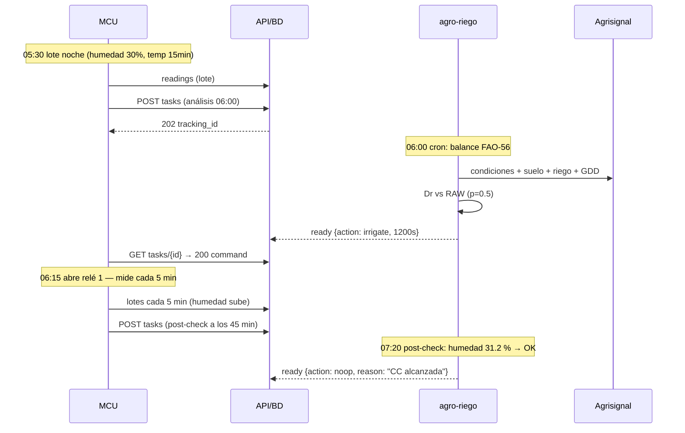
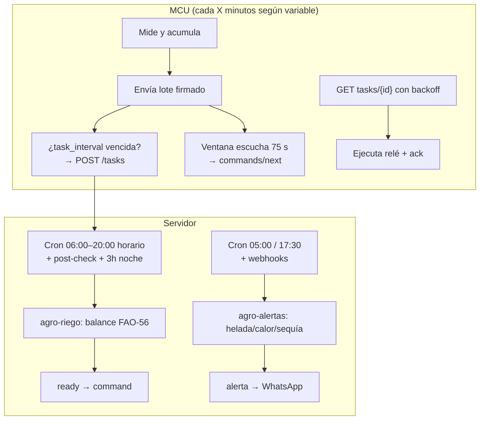

# 11 — Día tipo en el campo: cadencias de envío, tareas y escenarios

> **Cuándo mide, cuándo envía, cuándo pregunta por tareas y qué decide el agente**, hora
> por hora, en un día normal del piloto (quinua, altiplano, equipo con red) y en los
> escenarios que lo cambian todo (helada, lluvia, riego, caída de red, tanque vacío).

---

## 1. Las 3 cadencias (independientes entre sí)

El MCU maneja **tres relojes distintos** — no confundirlos:

| Cadencia | Quién la define | Qué controla | Ejemplo |
|---|---|---|---|
| **1. Medición** (`interval_seconds` por variable) | Usuario vía API (doc 03) | Cada cuánto **lee** un sensor | Humedad cada 10 min |
| **2. Envío** (modo de red) | Config del dispositivo | Cada cuánto **arma y manda un lote** (puede coalescer varias lecturas) | WiFi: cada ≤1 min; celular: cada 20 min o N=20 |
| **3. Consulta de tareas** (`task_interval_seconds` + sondeos) | Config + protocolo (doc 05) | Cada cuánto **pregunta "¿hay trabajo?"** y con qué persistencia | Análisis cada 60 min + sonda con backoff |

Además, el **carril rápido** (`GET /commands/next?wait=25`) se sondea en la **ventana de
escucha** que el MCU abre tras cada lote (≈3 sondeos de 25 s ≈ 75 s) — así recibe comandos
manuales sin quemar batería con long-poll continuo.

### 1.1 Tabla de medición recomendada (piloto con WiFi/fuente)

| Variable | Día (06–18 h) | Noche (18–06 h) | Ventana de helada | Durante riego activo | Con batería/solar |
|---|---|---|---|---|---|
| `humedad_suelo_20cm` | **10 min** | 30 min | 30 min | **5 min** (ver respuesta) | ×2 (día 30) |
| `humedad_suelo_40cm` | 10 min | 60 min | 60 min | 5 min | ×2 |
| `temp_aire` / `humedad_aire` | 10 min | **15 min** | **10 min** | 10 min | ×2 |
| `nivel_tanque` | 30 min | 60 min | 60 min | 5 min (baja durante riego) | ×2 |
| `caudal_riego` | Solo durante riego (5 min) | — | — | 5 min | evento |

> **¿5 o 10 minutos?** — 10 min es el estándar del día (basta para seguir una curva de
> agotamiento de 4–5 mm/día); **5 min solo mientras riega** (para ver cómo sube la humedad
> y cortar a tiempo); **10–15 min de noche** solo para temperatura en ventana de helada.
> En batería se duplican los intervalos y el lote coalesce.

### 1.2 Tabla de consulta de tareas

| Momento | Qué pregunta | Cadencia |
|---|---|---|
| Tras cada lote (ventana de escucha) | `commands/next` (comandos manuales) | 3 × 25 s, luego duerme |
| Programación de análisis | `POST /tasks (irrigation_analysis)` | **Cada 60 min entre 06:00–20:00**; cada 3 h entre 20:00–06:00 |
| Post-riego | `POST /tasks (post_irrigation_check)` | 45 min después de cerrar cada válvula |
| Sondeo de su `tracking_id` | `GET /tasks/{id}` | A los 10 s, ×2 de backoff (10→20→40 s máx 40), hasta `ready` o TTL 15 min |
| Sincronización de config | `GET /devices/{id}/config` | Al arrancar y tras cada lote (cabecera `X-Config-Version`) |

---

## 2. Día tipo completo (hora por hora)

**Contexto:** verano, quinua en fase vegetativa→ramificación, sin helada, lote 1 ha,
Zona A (relé 1). *Agente = `agro-riego`; Alertas = `agro-alertas` (solo si algo ocurre —
si no, `NO_REPLY`, cero costo).*

| Hora | El MCU (campo) | El servidor / agente | Por qué |
|---|---|---|---|
| 00:00–05:00 | Duerme entre lecturas: humedad c/30 min, temp c/15 min; tras cada lote, ventana de escucha 75 s | `pending`/`ready` si quedó algo; nada que hacer = 204 | Ahorro; solo vigilar frío |
| 05:00 | — | **Cron `agro-alertas`**: helada/calor 16 d + sequía. Sin riesgo → `NO_REPLY` | Aviso temprano antes del riego |
| 05:30 | Lote nocturno → sondeo normal | Lecturas quedan registradas | Último estado pre-análisis |
| **06:00** | — | **Cron `agro-riego`** (pull-loop): balance = Dr 34 mm ≥ RAW 31 mm, sin lluvia 48 h → **irrigate 1 200 s** | Riego temprano: menos viento/ET, agua aprovechada |
| 06:15 | Recibe `command` en sondeo → **abre relé 1**; **mide humedad c/5 min** y envía lotes | API valida guardas (duración, eventos/día, tanque 81 %) → `delivered` | Ver cómo sube la humedad en tiempo real |
| 06:35 | Cierra relé (1 200 s), manda `ack {executed, flow 120 m³}` | `tasks → done`; evento en `v_irrigation_events` | Volumen real para la auditoría |
| 07:20 | — | **`post_irrigation_check`** (+45 min tras el cierre de las 06:35): 20 cm = 31.2 % (subió de 22.4→31.2), 40 cm = sin pico → **noop OK** | Verificación de eficiencia: ni de más ni de menos |
| 07:00–12:00 | Humedad **c/10 min**, temp c/10 min; lote WiFi casi inmediato; tras cada lote, escucha 75 s | **Análisis horario 07–12**: 08:00 noop, 09:00 noop, 10:00 noop, 11:00 noop (Dr < RAW tras riego) — respuestas **baratas** (skip = 1 llamada corta) | ET de la mañana consumiendo el reposo |
| 12:00–14:00 | Ídem 10 min (pico de calor) | **12:00 y 13:00**: análisis horario; si temp ≥ 38 °C → `agro-alertas` emite alerta de aborto floral | Techo térmico de la quinua |
| 14:00–14:10 | — | **14:00 análisis**: suelo ligero, Dr ≥ RAW otra vez → segunda orden (si `max_events_per_day ≥ 2`) o **skip con "agua hasta mañana"** según `field_config` | Decisiones 2 del día en suelo areno |
| 14:15–17:00 | Medición c/10 min; riego si procedió, con sus 5 min + `ack` + post-check | Análisis horario 15:00, 16:00, 17:00 (mayoría `noop`) | Seguir la curva de la tarde |
| 17:30 | — | **Cron `agro-alertas` (17:30)**: helada nocturna pre-helada (solo invierno). Verano: `NO_REPLY` | Decidir si se suspende riego nocturno |
| 18:00–20:00 | Medición c/10 min hasta 18:00, luego **transición a noche (30 min)** | **18:00 y 20:00 análisis**; 20:00 = último del día: decide riego nocturno (normalmente **skip**; helada → `defer`) | Cierre del día |
| 20:00–05:00 | Ritmo noche: humedad 30–60 min, temp 15 min; análisis cada **3 h** (23:00, 02:00, 05:00) → casi todos `noop` | Pull-loop con `NO_REPLY` = 0 costo LLM | Respetar el ciclo nocturno |
| 23:00 | **Flush de buffer + health report** (rssi, batería, secuencia) | `last_seen_at`, alerta si hubo huecos | Higiene de datos |

**Totales de un día "tranquilo":** ~145 lotes de lectura (8 variables), **~12 análisis** del
agente (≈10 `noop` baratos + 1–2 `irrigate` reales), 2 cron de alertas (casi siempre
`NO_REPLY`), 0 guardas violadas.

---

## 3. Escenarios que cambian el día

### 3.1 Noche de helada (invierno — el escenario rojo)

| Momento | Qué cambia | Resultado |
|---|---|---|
| 17:30 cron alertas | `get_frost_and_heat_risk`: mínima −1.5 °C mañana | **Alerta roja** (WhatsApp) + banda activada |
| 18:00 en adelante | Temp de noche pasa a **c/10 min** | Detectar el descenso antes del mínimo |
| 20:00 análisis | Si estaba planeado riego → **`defer` por ventana de helada** (R7) | No mojar antes del frío |
| 05:00 cron | Confirma si hubo helada; registra evento | Alimenta `decision_inputs` y la auto-mejora |
| Fase floración | −1 °C ya es daño (doc 09 §5) → la alerta sube a **alarma roja** con instrucciones | Protección priorizada |

### 3.2 Día con lluvia pronosticada

- **12:00 análisis:** Agrisignal da 14 mm en 48 h ≥ lámina pendiente (12 mm) → **skip
  con razón "lluvia ≥ lámina"** (R7). Se ahorra un riego completo.
- Mediciones siguen cada 10 min; si la lluvia llega, el agente **descuenta P del balance**
  en el análisis posterior (`Dr − (P − E)`); si el registro de lluvia cae sobre umbral →
  `post_rain_check` extra.
- Durante lluvia intensa: alerta de escorrentía posible (suelo franco-arenoso infiltra bien,
  pero vigilar 40 cm).

### 3.3 Riego con respuesta verificada (el día "perfecto")

1. 06:00 decide `irrigate 1200 s` con insumos citados.
2. 06:15 relé abre; la humedad sube por la **curva canónica** (doc 13): 22.4 → 23.1 → 25.1 → 27.8 → 29.9 → **31.2 %** (alcanzada a las 07:10).
3. El MCU **corta al volumen pedido** (no por "tiempo redondo": si `caudal` marca el
   volumen objetivo, puede cerrar y reportar `executed_partial`).
4. 40 cm sube ≤ 2 puntos → **sin percolación** (riego bien dosificado).
5. 07:20 post-check (+45 min tras el cierre de las 06:35) → `noop "CC alcanzada"`. Todo queda en `v_decision_quality` como acierto.

### 3.4 Sin red (mediodía, 40 min caído)

| Fase | Comportamiento |
|---|---|
| Detecta caída | Sigue **midiendo y acumulando en buffer** (N=20 o 40 min) |
| Tarea creada antes de caer | Sondeo falla → reintenta al reconectar; si venció TTL → `expired`, se **crea una nueva** con datos frescos (nunca ejecutar decisión vieja) |
| ¿Riego pendiente? | Si había `ready` y no llegó → **no queda colgado**: al reconectar, el primer `GET` lo resuelve o expira; el análisis se repite |
| Buffer | Reenvío idempotente por `seq` (`409 duplicate_seq` manejado) |
| > 6 h sin red | Fallback local (última política firmada) + alerta de operación |

### 3.5 Tanque vacío / bomba rota

- `nivel_tanque` < 20 % en el análisis → **skip + alerta "tanque bajo"** (aunque el suelo
  pida riego) — guard API, no del LLM.
- `ack {result: failed}` tras orden enviada → alerta de **mantenimiento**; 2 fallos
  seguidos → el agente deja de ordenar esa zona (marca `zona en mantenimiento`).

### 3.6 Viento fuerte/por la tarde (aspersión)

- Si el equipo usa aspersión con viento > 25 km/h, la evapotranspiración efectiva sube y el
  agua se desvía: regar **temprano (06:00) o tarde (18:00)**, nunca 12:00–16:00. El agente
  lo refleja eligiendo la ventana del análisis de la mañana (por eso el cron está en 06:00).

---

## 4. Resumen de "¿quién hace qué, cuándo?"

| Pregunta | Respuesta corta |
|---|---|
| ¿Cada cuánto mide? | **10 min** de día, 30–60 min de noche, **5 min durante riego**, 10–15 min temp en helada |
| ¿Cada cuánto envía lotes? | WiFi casi inmediato; celular coalesce (20 min/N=20) |
| ¿Cuándo pregunta por tareas? | Tras cada lote (escucha 75 s) + cada 60 min de día / 3 h de noche + 45 min post-riego, con sondeo 10→40 s |
| ¿Cuándo decide el agente? | Cron horario 06:00–20:00, 3×/noche, post-riego y por alerta |
| ¿Cuándo **no** gasta LLM? | Cuando no hay novedad: `204`/`NO_REPLY` (la mayoría del día) |
