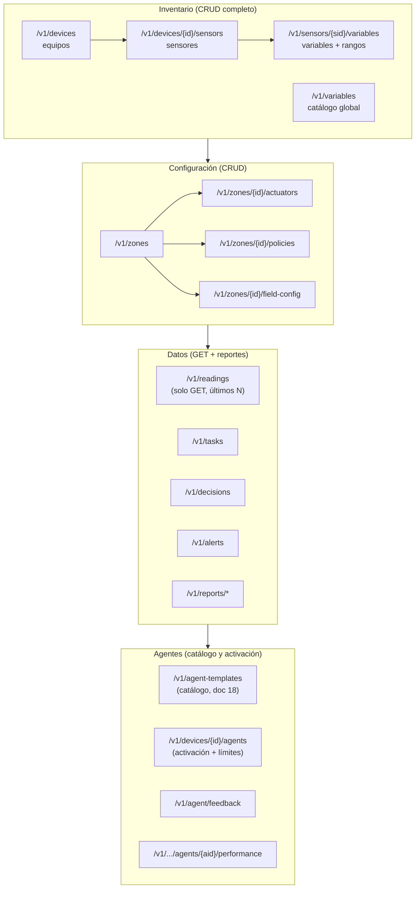
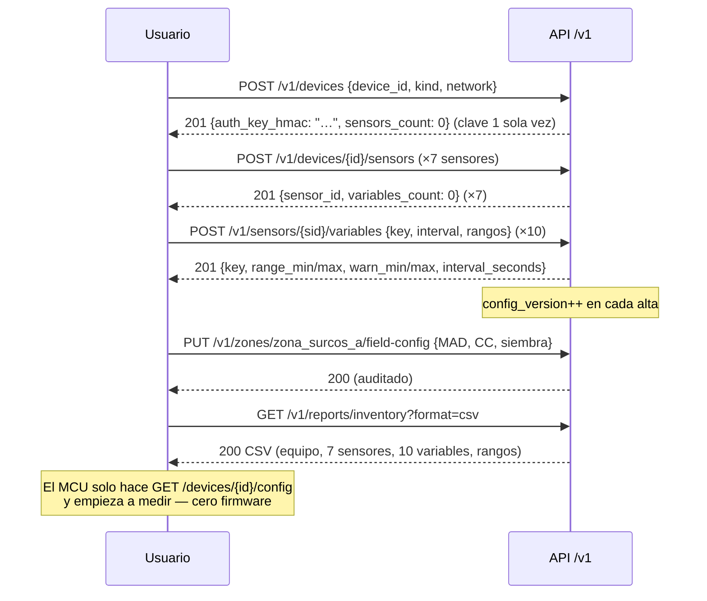

# 12 — API CRUD completa: diseño de recursos, inventario y reportes

> **Solo diseño** (qué responde, no cómo se implementa). Cubre todo lo que la plataforma
> debe poder hacer por API: registrar el **equipo**, sus **sensores**, las **variables de
> cada sensor con sus rangos**, personalizar y hacer **seguimiento** de todo, y servir
> **reportes** con paginación y filtros completos. El protocolo de campo (ingesta firmada,
> `tracking_id`, carril rápido) está en [05-api.md](05-api.md) — este documento lo **complementa**
> con la API de recursos del usuario.

---

## 1. Convenciones globales

| Regla | Detalle |
|---|---|
| **POST = crear una sola vez** | `POST` con cuerpo → `201 Created` + `Location`. Si el recurso ya existe (mismo `id`/`key`) → `409 Conflict`. Nunca actualiza. |
| **PUT = modificar** | `PUT /recurso/{id}` con el cuerpo completo → `200 OK` (o `204`). Crea si no existe (`upsert`) → `201`. Es el único que cambia estado. |
| **GET = consulta, últimos N por defecto** | Sin parámetros, devuelve los **últimos `limit` registros orden descendente** (`ts DESC`), `limit` por defecto **50** (máx 500). |
| **Paginación completa** | `?limit=&offset=` (offset total) o `?page=&page_size=` (páginas). Respuesta siempre con `pagination`. |
| **Filtros sobre cualquier recurso** | `?from=`, `?to=` (ISO-8601), `?q=` (búsqueda textual), filtros por campo (`?device_id=`, `?status=`, `?key=`…), `?sort=ts.desc`, `?fields=key,value`. |
| **DELETE** | `DELETE /recurso/{id}` → `204` (borrado lógico: `deleted_at`; los sensores con lecturas **nunca** se borran, solo `status=maintenance`). |
| **Errores** | Forma estándar del doc 05 §7 en todos los endpoints. |
| **Auth** | Token de usuario para todo lo de este doc; HMAC de dispositivo solo para los endpoints de campo (doc 05). |

### 1.1 Envoltura estándar de respuesta (lista)

```json
{
  "data": [ { "...": "registros" } ],
  "pagination": {
    "total": 1240,
    "limit": 50,
    "offset": 100,
    "page": 3,
    "page_size": 50,
    "has_more": true
  }
}
```

Un recurso individual responde **plano** (`200 {…}`), sin envoltura. `POST` responde con
el recurso creado (`201`). `PUT` responde con el recurso ya actualizado (`200`).

### 1.2 Parámetros de consulta comunes (aplican a todos los GET de lista)

| Parámetro | Tipo | Defecto | Efecto |
|---|---|---|---|
| `limit` | int ≤ 500 | 50 | **Últimos N** registros (`ts DESC`) |
| `offset` / `page`+`page_size` | int | 0 / 1 | Paginación completa (mutuamente excluyentes) |
| `from`, `to` | ISO-8601 | — | Ventana temporal inclusiva |
| `sort` | `ts.desc` \| `ts.asc` \| `created_at.desc` | `ts.desc` | Orden |
| `fields` | lista | todos | Proyección de columnas (menos peso en reportes) |
| `q` | texto | — | Búsqueda en `label`, `reason`, `note`… |
| `format` | `json` \| `csv` \| `ndjson` | `json` | Exportación de reportes |

---

## 2. Mapa maestro de recursos (árbol)



| Recurso | POST (crear 1×) | PUT (modificar) | GET (consultar) | DELETE |
|---|---|---|---|---|
| `/v1/devices` | ✔ alta de equipo (genera clave HMAC **una vez**) | ✔ editar label/red/notas | ✔ lista (últ. N) + `/{id}` detallado **con conteo de sensores** | ✔ lógico |
| `/v1/devices/{id}/sensors` | ✔ registrar sensor en el equipo | — | ✔ lista **con conteo de variables** | — |
| `/v1/sensors/{sid}` | — | ✔ editar modelo/puerto/estado | ✔ `/{sid}` con sus variables y rangos | ✔ (si sin lecturas) |
| `/v1/sensors/{sid}/variables` | ✔ instanciar variable **con rangos** | ✔ rangos, intervalo, `enabled` | ✔ lista con rangos | ✔ (desinstalar) |
| `/v1/variables` | ✔ catálogo global | ✔ | ✔ lista/`/{key}` | ✔ si sin instancias |
| `/v1/zones` | ✔ | ✔ | ✔ con `policies` y `field-config` anidados | ✔ |
| `/v1/zones/{id}/policies` | — | ✔ (upsert) | ✔ | — |
| `/v1/zones/{id}/field-config` | — | ✔ (upsert) | ✔ | — |
| `/v1/readings` | ✖ (solo MCU, doc 05) | ✖ (inmutable) | ✔ **GET puro**: últimos N, ventana, filtros, agregados | ✖ |
| `/v1/tasks` | ✔ (MCU/agente) | — | ✔ por `tracking_id` o lista con filtros `status/device_id/kind` | — |
| `/v1/decisions` | — (las escribe el agente) | — | ✔ lista + `/{decision_id}` con `decision_inputs` | — |
| `/v1/alerts` | ✔ (agente/sistema) | ✔ `ack`/`resolve` | ✔ lista con `severity`, `state`, `from/to` | — |
| `/v1/reports/*` | — | — | ✔ solo GET, con filtros + `format=csv` | — |
| `/v1/metrics/latest` | — | — | ✔ última lectura por variable + edad de datos | — |
| `/v1/agent-templates` | — | — | ✔ **catálogo de agentes** (doc 18): estado y variables requeridas | — |
| `/v1/devices/{id}/agents` | ✔ activar agente (**provisioning** del perfil) | ✔ editar schedule/modelo/estado | ✔ activados con estado y última métrica | ✔ desactivar (lógico) |
| `/v1/devices/{id}/agents/{aid}/limits` | — | ✔ upsert auditado (doc 19 §6) | ✔ | — |
| `/v1/agent/feedback` | ✔ veto/corrección/aprobación (doc 19 §7) | — | ✔ lista por agente | — |
| `/v1/devices/{id}/agents/{aid}/performance` | — | — | ✔ tendencia por agente `?window=30d` (docs 17/19) | — |

---

## 3. Registro completo: equipo → sensores → variables → rangos

### 3.1 `POST /v1/devices` — alta del equipo (una sola vez)

```json
{
  "device_id": "altiplano-lote-a",
  "label": "Equipo quinua — Surcos A",
  "kind": "esp32",
  "network": "wifi",
  "notes": "instalado 2026-10-20, canal norte"
}
```

→ `201`:

```json
{
  "device_id": "altiplano-lote-a",
  "auth_key_hmac": "SOLO-SE-DEVUELVE-UNA-VEZ-…",
  "config_version": 1,
  "created_at": "2026-10-20T14:00:00Z",
  "sensors_count": 0
}
```

Si `device_id` ya existe → `409 {error: {code: "already_exists"}}`. **La clave HMAC no
se vuelve a mostrar** (se guarda hasheada; rotación por `PUT /v1/devices/{id}/rotate-key`).

### 3.2 `POST /v1/devices/altiplano-lote-a/sensors` — los sensores del equipo

Se repite una vez por sensor (7 en el piloto):

```json
{ "sensor_id": "sonda_fdr_a", "kind": "soil_probe", "model": "FDR SMD500",
  "port": "i2c:0x77", "installed_at": "2026-10-20", "depth_cm": null }
```

→ `201 {…, "variables_count": 0}`.

| `sensor_id` | `kind` | `model` | `port` | Mide |
|---|---|---|---|---|
| `sonda_fdr_a` | `soil_probe` | FDR SMD500 | `i2c:0x77` | 2 variables (20/40 cm) |
| `sht31_abrigo` | `air_th` | SHT31 | `i2c:0x44` | 2 variables (temp + humedad) |
| `caudal_1pulg` | `flowmeter` | Turbina 1" | `pulse:GPIO27` | 1 variable |
| `presion_linea` | `pressure` | Transductor 0–10 bar | `adc:1` | 1 variable |
| `valvula_zona_a` | `valve_contact` | Limit switch válvula | `gpio:32` | 1 variable |
| `flotador_tanque` | `tank_level` | Analógico 4–20 mA | `adc:2` | 1 variable |
| `dht22_diag` | `air_th` | DHT22 | `gpio:4` | 2 variables (diag. batería) |

`GET /v1/devices/altiplano-lote-a` → `201` detalle incluye `"sensors_count": 7` y
`GET /v1/devices/…?include=sensors` devuelve el resumen anidado.

### 3.3 `POST /v1/sensors/sonda_fdr_a/variables` — variables y **rangos**

```json
{
  "key": "humedad_suelo_20cm",
  "interval_seconds": 600,
  "range_min": 0,
  "range_max": 60,
  "warn_min": 15,
  "warn_max": 45,
  "enabled": true
}
```

→ `201 {sensor_id, key, interval_seconds, range_min, range_max, warn_min, warn_max, enabled}`.

| Sensor | Variable (`key`) | Unidad | `range_min..max` (físico) | `warn_min..warn_max` | Intervalo día/noche |
|---|---|---|---|---|---|
| `sonda_fdr_a` | `humedad_suelo_20cm` | % | 0..60 | 15..45 | 600 / 1800 s |
| `sonda_fdr_a` | `humedad_suelo_40cm` | % | 0..60 | 15..45 | 600 / 3600 s |
| `sht31_abrigo` | `temp_aire` | °C | −40..60 | −2..38 | 600 / 900 s |
| `sht31_abrigo` | `humedad_aire` | % | 0..100 | 20..95 | 600 / 900 s |
| `caudal_1pulg` | `caudal_riego` | L/s | 0..5 | 0.05..4.5 | solo riego (300 s) |
| `presion_linea` | `presion_linea` | bar | 0..10 | 1.5..8 | 600 s |
| `valvula_zona_a` | `estado_valvula` | 0/1 | 0..1 | — | 300 s (solo riego) |
| `flotador_tanque` | `nivel_tanque` | % | 0..100 | 20..95 | 1800 / 3600 s |

**Efecto de los rangos (sin tocar firmware):**
- Llega `value` fuera de `range_min..range_max` → se guarda igual con `quality='suspect'`
  y se crea alerta `out_of_range` (sonda suelta/cableado).
- Cruza `warn_min`/`warn_max` → alerta `warn` (tanque bajo, línea sin presión…).
- `PUT /v1/sensors/sonda_fdr_a/variables/humedad_suelo_20cm {"warn_min": 12}` modifica sin
  crear recurso nuevo → `200`, `config_version++`, el MCU lo toma en el próximo sondeo.

### 3.4 Consultas de inventario que responden los reportes

| Pregunta | Endpoint | Respuesta |
|---|---|---|
| ¿Cuántos sensores tiene el equipo? | `GET /v1/devices/{id}` | `{…, "sensors_count": 7}` |
| ¿Cuántas variables mide ese sensor? | `GET /v1/sensors/{sid}` | `{…, "variables_count": 2}` |
| ¿Con qué rangos? | `GET /v1/sensors/{sid}/variables` | lista con `range_*`/`warn_*` |
| Inventario completo para acta | `GET /v1/reports/inventory?format=csv` | equipo→sensor→variable→rangos aplanado |

---

## 4. Datos y seguimiento (GET con últimos N, paginación y filtros)

### 4.1 `GET /v1/readings` — el corazón del reporte

| Ejemplo | Qué devuelve |
|---|---|
| `GET /v1/readings` | **Últimos 50** (todas las variables, `ts DESC`) |
| `GET /v1/readings?limit=10&key=humedad_suelo_20cm` | Últimas 10 lecturas de esa variable |
| `GET /v1/readings?device_id=altiplano-lote-a&from=2026-10-21T00:00Z&to=2026-10-22T00:00Z&limit=500&offset=0` | Paginado por ventana (siguiente: `offset=500`) |
| `GET /v1/readings?quality=suspect&format=csv` | Exporta solo lecturas fuera de rango |
| `GET /v1/readings?agg=1h&fields=key,value,ts` | Serie agregada horaria (via vista `readings_hourly`) |

Además: `GET /v1/metrics/latest` → `[{key, value, ts, age_s, quality}]` por equipo (salud),
y `GET /v1/sensors/{sid}/readings` (mismo contrato, pre-filtrado por sensor).

### 4.2 Tareas, decisiones y alertas (seguimiento de todo)

| Endpoint | Filtros soportados | Uso |
|---|---|---|
| `GET /v1/tasks?status=ready&device_id=&kind=&from=&to=` | estado, equipo, tipo, ventana | "¿qué está colgado?" |
| `GET /v1/tasks/{tracking_id}` | — | estado + `command` + `ack` (máquina de estados doc 10 §4) |
| `GET /v1/decisions?action=irrigate&status=executed&from=&to=` | acción, estado, zona, ventana | "¿cuántos riegos esta semana?" |
| `GET /v1/decisions/{id}` | — | decisión + **`decision_inputs`** (auditoría completa) |
| `GET /v1/alerts?state=open&severity=critical` | severidad, estado, tipo | bandeja de avisos |
| `GET /v1/events/irrigation?zone=&from=&to=` (vista) | zona, ventana | historial de riegos ejecutados |

### 4.3 `PUT` como única vía de modificación (seguimiento de cambios)

Todo cambio de configuración pasa por `PUT` y queda auditado (`updated_at`,
`updated_by`, valor anterior). Ejemplos: rangos, intervalos, `field-config`,
`policies`, `status` de sensor, `ack`/`resolve` de alerta. **No hay PATCH**: el cuerpo del
`PUT` es completo y su ausencia significa "sin cambio".

---

## 5. Reportes (`GET` puro, paginable y exportable)

| Endpoint | Contenido | Filtros típicos |
|---|---|---|
| `/v1/reports/inventory` | Equipo → sensores → variables → rangos (acta de instalación) | `device_id`, `format=csv` |
| `/v1/reports/health` | Última lectura, edad, `quality`, batería/RSSI, tasa de lotes | `device_id`, `from/to` |
| `/v1/reports/daily-water-balance` | P (Agrisignal) + I (ack) − ETc → Dr por día (vista) | `zone_id`, `from/to` |
| `/v1/reports/irrigation` | Eventos: zona, inicio, duración, m³ (`caudal×tiempo`), mm, `result` | `zone_id`, `from/to` |
| `/v1/reports/decision-quality` | Acierdos/errores: skip→estrés, irrigate→exceso (vista) | `from/to`, `action` |
| `/v1/reports/out-of-range` | Lecturas `suspect` + cruces de `warn_*` por sensor | `sensor_id`, `from/to` |
| `/v1/reports/tasks` | Tiempos `pending→ready→done`, expiradas, guardas violadas | `status`, `from/to` |

Todos aceptan la tabla §1.2 completa (`limit/offset/from/to/sort/fields/format`) — un
"reporte" es solo un `GET` con filtros guardados como favorito en el panel.

---

## 6. Agentes: catálogo, activación, límites y métricas

Los agentes se manejan por API **igual que el resto de recursos**: catálogo → activación →
límites → métricas. Las tablas están en [04](04-base-de-datos.md) §6 y el catálogo de
agentes en [18](18-catalogo-agentes-agricolas.md).

### 6.1 `GET /v1/agent-templates` — el catálogo (los checkboxes)

| Ejemplo | Qué devuelve |
|---|---|
| `GET /v1/agent-templates` | 16 agentes: `name`, `kind`, `status` (`ready/develop/future`), misión, `required_variables`, cron típico |
| `GET /v1/agent-templates?status=ready` | Solo los listos (los ✅ del doc 18) |
| `GET /v1/agent-templates/agro-riego` | Ficha completa + plantillas de `SOUL.md` y skills que usará |

### 6.2 `POST /v1/devices/{id}/agents` — activar un agente (con provisioning)

```json
{ "agent_name": "agro-riego",
  "schedule": "c/60 min 06-20 h + 3 h noche + 45 min post-riego",
  "model_pin": null,
  "limits": { "water_budget_l_per_day": 240000,
              "allowed_actions": ["irrigate", "skip", "defer"],
              "active_window": "05:00-20:00",
              "max_seconds_per_event": 1200 } }
```

→ `201 {device_agent_id, enabled: true, provisioned: {profile: "agro-riego", cron: "…"}}`.

**Antes de crear, la API valida** (mismo chequeo que el wizard, doc 18 §5):

- que el `agent_name` exista en el catálogo (y que su `status` no sea `future`);
- que el equipo mida las `required_variables` → si falta alguna:
  `422 {error: {code: "missing_variables", missing: ["presion_linea"]}}` con la sugerencia
  de agregarla vía `POST /v1/sensors/{sid}/variables` (cero firmware).

**El provisioning** (backend, en una sola transacción) hace: crea
`~/.hermes/profiles/<perfil>/` con `SOUL.md` + skills de la plantilla → fila
`device_agents` → fila `agent_limits` → cron del pull-loop. `PUT {enabled: false}` o
`DELETE` detiene el cron y retira el perfil; **las métricas y episodios quedan** (auditoría).

| Método y ruta | Uso |
|---|---|
| `GET /v1/devices/{id}/agents` | Agentes activados: estado, cron, versión y última métrica |
| `GET /v1/devices/{id}/agents/{aid}` | Detalle: SOUL, skills, tools (`include/exclude`), cron, límites |
| `PUT /v1/devices/{id}/agents/{aid}` | Cambia schedule/modelo/skills → reescribe archivos + `version++` |
| `PUT /v1/devices/{id}/agents/{aid}/limits` | Límites (upsert auditado: `updated_at` + valor anterior) |
| `DELETE /v1/devices/{id}/agents/{aid}` | Desactiva (lógico; retira el perfil con confirmación) |

### 6.3 `POST /v1/agent/feedback` — la corrección del usuario

```json
{ "device_agent_id": "da-01", "kind": "veto",
  "comment": "llovía: el skip debía ser por lluvia, no por margen" }
```

`kind` ∈ `approve | veto | correct` → el agente/Curator parchea la skill **el mismo día**
(doc 19 §7) y el cambio queda versionado en `skill_versions`.

### 6.4 `GET …/performance` — métricas por agente

`GET /v1/devices/{id}/agents/{aid}/performance?window=30d` → serie de `accuracy`, costo,
latencia y agua ahorrada, más la **comparativa por versión** (skill/modelo). Es la fuente
del tablero del doc 17 §5 y del promotion gate (doc 19 §3).

---

## 7. Diagrama de secuencia: alta completa del equipo



---

## 8. Resumen

1. **POST una sola vez, PUT para modificar** en todos los recursos de configuración;
   `readings`/`decisions` son inmutables (solo GET).
2. **GET siempre devuelve los últimos N** por defecto; paginación y filtros completos
   (`limit/offset/page`, `from/to/q/sort/fields`) en todo recurso de lista.
3. **Inventario en 3 niveles** (equipo → sensores → variables con rangos) con conteos
   anidados: responder "¿cuántos sensores? ¿cuántas variables? ¿con qué rangos?" es un
   `GET`, sin procesamiento.
4. **Reportes = GET con filtros** sobre vistas; exportación `csv` sin endpoints nuevos.
5. El seguimiento (tareas, decisiones, alertas, calidad) usa **el mismo contrato** que el
   resto: últimos N, paginación, filtros.
6. **Los agentes no son excepción:** catálogo (`/v1/agent-templates`), activación con
   provisioning (`POST /v1/devices/{id}/agents`), límites auditados y métricas por agente
   (§6) — todo con el mismo contrato de la tabla §1.

Continúa: [13-flujo-48h-detallado.md](13-flujo-48h-detallado.md) — 48 h de operación
paso a paso con payloads, cadencias y escenarios.
