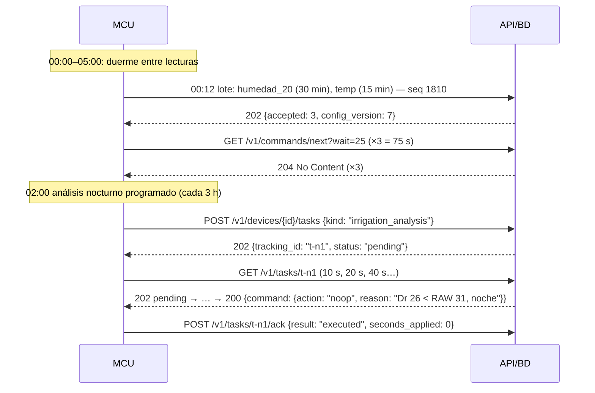
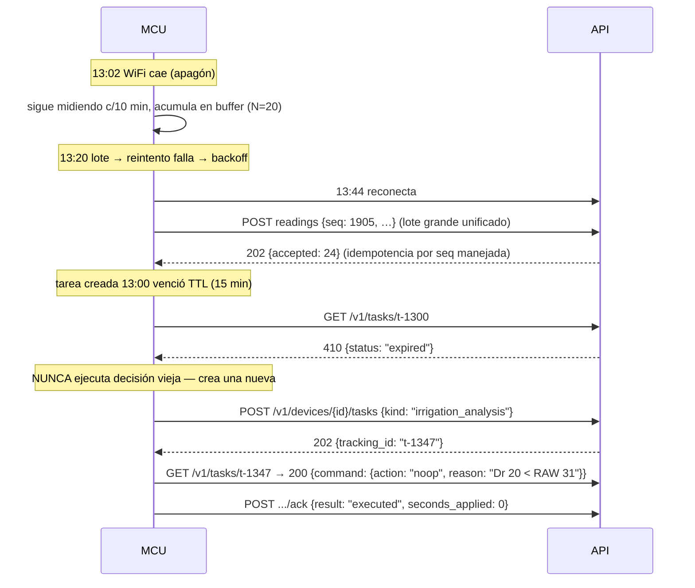
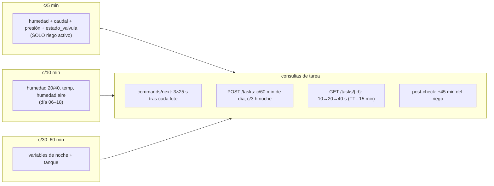

# 13 — 48 h de operación: flujo paso a paso con payloads y escenarios

> Ejemplo **muy detallado** de lo que hace el piloto en dos días completos: quién manda qué
> mensaje, con qué payload, en qué minuto, cada cuánto se envían datos (**5 / 10 / 15 / 30 min**)
> y cuándo se pregunta por tareas. Sirve para verificar la funcionalidad del equipo en los
> distintos escenarios antes de tocar el campo.

**Contexto de los 48 h:** quinua 45 DAS (fase ramificación), 1.0 ha, zona A (relé 1),
7 sensores / 10 variables (doc 12 §3.2–3.3), red WiFi, agente `agro-riego` + `agro-alertas`.
**Dr inicial = 22 mm**, RAW = 31 mm, tanque 81 %, caudal medido 100 L/s.

---

## 1. Las cadencias de envío (rápido vs. lento)

| Tipo de dato | Cadencia | Ventana |
|---|---|---|
| `humedad_suelo_20cm` **durante riego** | **c/5 min** | solo relé abierto |
| `humedad_suelo_20/40cm`, `temp_aire`, `humedad_aire` de día | **c/10 min** | 06:00–18:00 |
| `temp_aire` ventana de helada / alerta | c/10 min (sube de 15→10) | cuando `agro-alertas` lo activa |
| Variables de noche (sin helada) | **c/30–60 min** | 18:00–06:00 |
| `nivel_tanque` | c/30 min (c/5 min durante riego) | siempre |
| `caudal_riego`, `presion_linea`, `estado_valvula` | **c/5 min solo durante riego** | resto del día: sin dato (o c/60 min sonda) |
| **Lote HTTP** (agrupa lecturas) | WiFi: al instante (≤1 min); celular: 20 min o N=20 | siempre |
| **Consulta `commands/next`** | 3 × 25 s tras cada lote (ventana ~75 s) | tras cada lote |
| **Análisis (`POST /tasks`)** | **c/60 min 06:00–20:00**; c/3 h de noche | más: 45 min post-riego |
| **`GET /tasks/{tracking_id}`** | backoff 10→20→40 s hasta `ready` o TTL 15 min | tras crear tarea |

---

## 2. DÍA 1 — operación normal con 1 riego

### 2.1 Madrugada (00:00–05:59) — modo reposo



**Minuto a minuto de 00:00 a 05:30:**

| Hora | Qué mide (c/…) | Qué envía | Qué pregunta |
|---|---|---|---|
| 00:00–05:00 | humedad 20 cm c/30 min; 40 cm c/60; temp c/15; tanque c/60 | lote WiFi inmediato (~10 lotes) | `commands/next` ×3 por lote (204); análisis 02:00 (noop) |
| 05:00 | — | — | **cron `agro-alertas`**: `get_frost_and_heat_risk` 16 d → sin riesgo → `NO_REPLY` |
| 05:30 | último lote nocturno | lote con lectura de las 05:25 | normal (75 s de escucha) |

> **Costo:** la noche entera genera ~10 lotes + 1 análisis `noop` + 1 cron `NO_REPLY` =
> **1 llamada LLM corta** en 6 horas.

### 2.2 06:00 — el análisis que dispara el riego (paso a paso)

| Paso | Quién | Mensaje / payload | Resultado |
|---|---|---|---|
| 1 | cron Hermes | dispara pull-loop de `agro-riego` (06:00) | — |
| 2 | agro-riego → API | `GET /v1/readings?limit=60&from=−24h` | Dr calc: 22→**34 mm** (ETc ayer) |
| 3 | agro-riego → Agrisignal | `get_frost_and_heat_risk`, `get_growing_conditions`, `get_irrigation_advice`, `get_growing_degree_days` | mín 2.1 °C, P48h=2 mm, GDD 412 |
| 4 | agro-riego → agro-registry | `GET field-config zona_surcos_a` | MAD 0.5, CC 30.3 %, máx 1200 s/día… |
| 5 | agro-riego (skill `fao-56-balance`) | Dr 34 ≥ RAW 31 → **sí regar**; lámina = 34−2−20 = **12 mm** | `decision_inputs` guardado |
| 6 | agro-riego → API | `PUT /v1/decisions` → `{action:"irrigate", seconds: 1200, expected_mm: 12}` | tarea pasa a `ready` |
| 7 | API | guardas: duración ≤1200 ✔, 0 eventos hoy ✔, tanque 81 % ✔, sin helada ✔ | `command` liberado |
| 8 | MCU (sondeo 06:0x) | `GET /v1/tasks/t-0600` | `200 {command: {action:"irrigate", relay:1, seconds:1200}}` |
| 9 | MCU | escribe `delivered`; **abre relé 1 a las 06:15**; cambia cadencia → humedad **c/5 min**, caudal/presión/estado_valvula **c/5 min** | — |
| 10 | MCU → API | lotes 06:20, 06:25, 06:30… `{humedad: 23.1, caudal: 98.4, presion: 3.2, estado_valvula: 1}` | subiendo |
| 11 | MCU | a los 1200 s (06:35) **cierra relé**; lee `estado_valvula=0` post-cierre | — |
| 12 | MCU → API | `POST .../ack {result:"executed", seconds_applied:1200, flow_m3:120, valve_state_ok:true}` | tarea `done` |
| 13 | MCU | programa `post_irrigation_check` (+45 min = 07:20); vuelve a cadencia día c/10 min | — |

```json
// Paso 6 — decisión guardada (lo que vería el auditor)
{ "action": "irrigate", "zone": "zona_surcos_a", "relay": 1, "seconds": 1200,
  "expected_mm": 12, "decision_id": "d-8f2a",
  "reason": "Dr 34 ≥ RAW 31 (TAW 62, p 0.5, Zr 0.6 m, ramificación); P48h 2 mm < lámina 12; mín 48h 2.1 °C; tanque 81%" }
```

### 2.3 06:30–12:00 — verificación y análisis horarios

| Hora | MCU | Servidor/agente | Nota |
|---|---|---|---|
| 06:40–07:10 | humedad **c/10 min** tras el cierre (06:35): 27.8 → 29.9 → **31.2 %** (curva canónica: 22.4 → 23.1 → 25.1 → 27.8 → 29.9 → 31.2, de 06:15 a 07:10); 40 cm +1.5 (sin percolación) | lecturas en `readings` | curva de infiltración |
| 07:20 | — | `post_irrigation_check` (+45 min tras el cierre): 20 cm 31.2 % ≥ CC 30.3 → **`noop "CC alcanzada"`** (ack `executed`, 0 s) | eficiencia confirmada |
| 08:00 / 09:00 / 10:00 / 11:00 | lote c/10 min + escucha 75 s | análisis horario → **`noop`** (Dr 26→30 < RAW 31) ×4 | respuestas baratas (skip = 1 llamada corta) |
| 11:50 | — | `agro-alertas` mira `temp_aire` histórico: 31.8 °C < 38 → `NO_REPLY` | techo térmico OK |

### 2.4 12:00–17:00 — segunda decisión del día

| Hora | Evento | Detalle |
|---|---|---|
| 12:00 | análisis | Dr 31.4 ≥ RAW 31 **apenas** → skill decide **`skip`** ("margen insuficiente, próxima ventana 14:00") — no gasta 1200 s por 0.4 mm |
| 13:00 | análisis | Dr 32.8 ≥ 31 → **`irrigate` NO** aún: P48h subió a 6 mm (Agrisignal actualizó) → lámina efectiva 12−(6−2)=8 → pero `skip` con razón "lluvia 6 mm < 12"… **regla R7**: solo salta si P ≥ lámina → 6 < 12 → **sí riega** a las 13:07 (600 s = 6 mm, porque Dr subió menos) |
| 13:07–13:17 | riego 600 s | humedad c/5 min, caudal/presión/estado c/5 min; `ack {seconds_applied:600, flow_m3:60}` |
| 14:00 | análisis | tras riego: Dr ≈ 24 → **`noop`** |
| 15:00 / 16:00 / 17:00 | análisis horario | `noop` ×3 (Dr 25→29) |
| 17:30 | cron `agro-alertas` | verano: sin helada → `NO_REPLY` |

### 2.5 Atardecer y noche del día 1 (18:00–23:59)

| Hora | MCU | Servidor |
|---|---|---|
| 18:00 | transición: humedad **c/30 min**, temp c/15 min | análisis 18:00 → `noop`; 20:00 → último del día → `skip "agua hasta mañana (Dr 29 < 31)"` |
| 21:00–23:00 | lotes nocturnos | — |
| 23:00 | **flush de buffer + health report** (RSSI, batería, seq) | `last_seen_at` actualizado; si hubo huecos → alerta de salud |

**Totales Día 1:** ~140 lotes · **15 análisis** (12 `noop`/`skip` + **2 `irrigate` reales**: 06:15 y 13:07) · 2 cron alertas (`NO_REPLY`) · 2 `ack executed` · 0 guardas violadas · **0 alertas**.

---

## 3. DÍA 2 — escenario con lluvia + caída de red + sensor fuera de rango

### 3.1 Amanecer: la lluvia ahorra un riego

| Hora | Qué pasa | Payload / motivo |
|---|---|---|
| 05:00 | cron alertas | `get_frost_and_heat_risk`: mín 3.4 °C → `NO_REPLY` |
| 06:00 | análisis | Agrisignal: **14 mm en 24 h** ≥ lámina 12 → **`skip "lluvia ≥ lámina (R7)"`** — *se ahorra el riego que el Día 1 sí hizo* |
| 07:00 | la lluvia llega | humedad 20 cm: 28 → 33 → 35.1 % (sobre CC = drenaje esperado); **40 cm +4 puntos** → el agente lo ve en el análisis 08:00 |
| 08:00 | análisis post-lluvia | Dr recalculado con `Dr − (P − E)`: 29 − 12 = **17 mm** → `noop` hasta nueva señal |
| 09:00–12:00 | análisis horario | `noop` ×4 — el día se resuelve solo |

### 3.2 13:00–14:00 — caída de red (40 min)



### 3.3 15:30 — lectura fuera de rango (sonda dañada)

1. 15:30 lote trae `humedad_suelo_40cm: -9.5`.
2. API valida contra `sensor_variables`: rango `0..60` → **`422` NO**; decisión de diseño:
   se **guarda** con `quality='suspect'` + alerta `out_of_range` (doc 04 §3.2) — no se
   pierde el lote entero por una clave.
3. `GET /v1/reports/out-of-range?from=−1h` muestra el evento; alerta al admin.
4. El agente **no usa** la lectura `suspect` en el balance (usa `quality='ok'`), decide con
   la sonda de 20 cm + Agrisignal y marca `decision_inputs` con "40 cm no confiable".
5. El usuario puede `PUT /v1/sensors/sonda_fdr_a {status: "maintenance"}` → el MCU deja de
   enviarla (config en próximo sondeo).

### 3.4 Cierre de los 48 h

| Métrica | Día 1 | Día 2 |
|---|---|---|
| Lotes | ~140 | ~130 (−1 por caída) |
| Análisis agente | 15 (2 riegos) | 15 (0 riegos — lluvia) |
| Riego aplicado | 180 m³ (18 mm) | 0 m³ |
| Alertas | 0 | 2 (`out_of_range`, red caída) |
| Guardas violadas | 0 | 0 |
| Decisiones expiradas | 0 | 1 (`t-1300`, manejada) |

---

## 4. Tabla maestra: "¿quién habla y cuándo?" (48 h)



| Pregunta | Respuesta (con los 48 h de ejemplo) |
|---|---|
| ¿Cuándo envía **5 min**? | Solo mientras riega (06:15–06:35 y 13:07–13:17 Día 1) |
| ¿Cuándo envía **10 min**? | Todo el día (06:00–18:00), humedad/temp/humedad |
| ¿Cuándo **30–60 min**? | Noche (18:00–06:00) y `nivel_tanque` siempre |
| ¿Cuándo pregunta **comandos**? | Tras cada lote: 3 sondeos de 25 s (~75 s), luego duerme |
| ¿Cuándo **crea** tareas? | Cada 60 min de día / 3 h de noche / 45 min post-riego / tras cada lote si pide análisis |
| ¿Cuándo **sondea** su tarea? | 10 s → 20 s → 40 s → … hasta `ready` o `expired` (15 min) |
| ¿Cuándo decide el **agente**? | Cuando hay tarea con trabajo; si no → `NO_REPLY`/`204` (cero LLM) |
| ¿Qué es agente/skill/tool? | Definido en [10](10-agentes-skills-herramientas.md) §1 — acá solo se ve **usado**: agente = `agro-riego`, skill = `fao-56-balance`, tools = Agrisignal + `agro-control` |
| ¿Qué es **dinámico**? | Todo lo que cambia en estos 48 h: cadencias, rangos, umbrales, skills, tools, LLM — ver [10](10-agentes-skills-herramientas.md) §3 |

**Verificación previa al campo:** reproducir los Días 1 y 2 con el checklist del
[08-prueba-y-personalizacion.md](08-prueba-y-personalizacion.md) — si cada fila de §2 y §3
pasa (payload correcto, estado correcto, costo LLM esperado), el piloto está listo.
