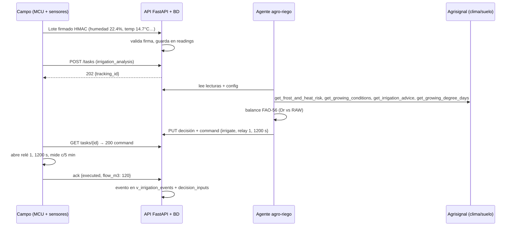
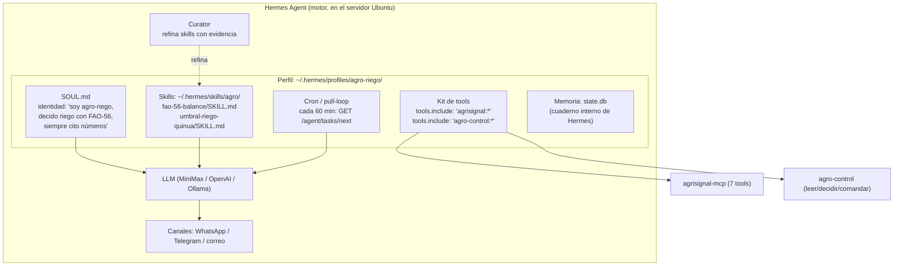

# 14 — Resumen completo del piloto (en lenguaje sencillo)

> **Este documento es el "libro de bolsillo" del piloto.** Compila, en lenguaje sencillo y con
> ejemplos, todo lo que está en `docs_simple/` (01 al 13). Está pensado para que alguien
> que no es programador — un productor, un ingeniero agrónomo, un técnico — entienda
> **qué hace el sistema, por qué es diferente a un timer comercial o a un código con `if` en
> un microcontrolador, y cómo se acerca a Bolivia a un IoT agrícola inteligente basado en
> agentes que se automejoran.**

---

## 1. ¿Qué es este piloto, en una frase?

Un **equipo de riego en el altiplano boliviano** (quinua, 1 hectárea) donde un **agente de
inteligencia artificial que vive en un servidor** decide **cuándo regar, cuánto y por qué**,
usando datos reales del suelo y del clima, y donde **el microcontrolador de campo solo mide
y obedece** — sin firmware nuevo, sin MQTT, sin nube obligatoria.

> **Mensaje clave:** el cerebro (el agente) está SIEMPRE en el servidor Ubuntu. El
> microcontrolador (ESP32/RPi/SIM800) solo mide sensores, manda lotes y dispara relés.
> El MCU **no sabe nada agronómico**; no corre ningún modelo ni skill.

---

## 2. Vocabulario mínimo (términos técnicos explicados simple)

| Término | En simple | Ejemplo en el piloto |
|---|---|---|
| **Agente** | Un "empleado virtual" completo con identidad, memoria, herramientas y un LLM detrás. **Decide y actúa.** | `agro-riego`, `agro-alertas` |
| **Skill** (habilidad) | Un **manual de procedimiento en Markdown** que el agente **lee** cuando le toca. Es conocimiento, no código. El agente (y el Curator) puede **refinarla** con el tiempo. | `fao-56-balance`, `umbral-riego-quinua` |
| **Herramienta (tool)** | Una **función invocable** con esquema de entrada/salida. Cuando el agente la llama, **algo real ocurre** (se consulta, se escribe, se calcula). | `get_irrigation_advice` (Agrisignal), `publish_command` (`agro-control`) |
| **Servidor MCP** | Una "caja de herramientas" que expone varias tools. Se registra una vez. | `agrisignal-mcp`, `agro-control`, `agro-registry` |
| **Perfil (Hermes)** | La carpeta/identidad de un agente: su SOUL.md, su config de tools, su cron. | `~/.hermes/profiles/agro-riego/` |
| **Memoria** | El "cuaderno" persistente del agente (SQLite interno) + nuestras tablas de trazabilidad. | recuerda que "la sonda B se descalibró" |
| **Tarea / `tracking_id`** | El "ticket" de una solicitud al agente. Tiene estados: pending → ready → delivered → done/expired. | `irrigation_analysis` → `7f3b2c9e…` |
| **MCU** | El equipo de campo. **No es un agente** — solo mide, envía y obedece. | ESP32 / RPi / SIM7000 |
| **Hipertable** | Tabla de base de datos optimizada para series de tiempo (TimescaleDB). | `readings(ts, device_id, key, value)` |
| **HMAC-SHA256** | Firma digital del lote. Garantiza que el servidor recibe datos **del equipo real**. | cabecera `X-Signature` |
| **RAW / TAW** | TAW = agua total disponible; RAW = fracción "fácilmente utilizable" antes de estrés (p ≈ 0.5). | RAW = 31 mm, TAW = 62 mm |
| **Dr** | Agotamiento del suelo (cuánta agua falta hasta CC), en mm. | Dr = 34 mm ≥ RAW 31 → **regar** |
| **Kc / ETc** | Kc = coeficiente del cultivo; ETc = agua que el cultivo consume por día. | Kc 0.5 → 1.0 → 0.7 por fase |
| **GDD** | Grados-día acumulados (base 3 °C) para fenología de la quinua. | GDD 412 → fase ramificación |
| **Lámina** | Milímetros de agua aplicados por riego. | 12 mm = 120 m³ en 1.0 ha |

---

## 3. Cómo fluye un dato (de punta a punta)



**Sin MQTT:** solo HTTP + HMAC-SHA256. Firmas con más de ±5 min de reloj se rechazan
(anti-replay). El MCU pregunta la config al arrancar y tras cada lote (`X-Config-Version`),
así **cambia de variables sin tocar firmware**.

---

## 4. El equipo y sus sensores (7 sensores, 10 variables: 8 de campo + 2 de diagnóstico)

| Sensor | Variables que mide | Para qué sirve |
|---|---|---|
| **Sonda FDR** (20 y 40 cm) | `humedad_suelo_20cm`, `humedad_suelo_40cm` | Dispara el riego (umbral % CC) y detecta percolación |
| **SHT31** (abrigo 1.5 m) | `temp_aire`, `humedad_aire` | Helada, GDD, estrés térmico, vapor |
| **Caudalímetro** (1") | `caudal_riego` | Volumen real aplicado (m³) por riego |
| **Transductor 0–10 bar** | `presion_linea` | Detecta fuga, válvula atascada, bomba parada |
| **Contacto de válvula** | `estado_valvula` (open/closed) | **Verificación real** de la orden (ack vs realidad) |
| **Flotador de tanque** | `nivel_tanque` | Guarda: no regar sin agua |
| **DHT22 diagnóstico** (abrigo) | `temp_aire_diag`, `humedad_aire_diag` | Salud del equipo: cruza contra el SHT31 y la batería — **no alimenta decisiones agronómicas** |

Cada variable tiene **rangos** (`range_min/max` físico + `warn_min/max` de aviso) por sensor.
Fuera de rango → `quality='suspect'` + alerta (sonda suelta), pero **no se pierde el lote**.
Cambiar rangos es un `PUT` — cero firmware.

---

## 5. Base de datos (PostgreSQL 18 + TimescaleDB)

- **`readings`** = hipertable en formato largo `key–value` (ts, device_id, key, value, quality).
  El usuario agrega variables **sin migrar esquemas** (solo una fila nueva en `variables`).
- **`irrigation_decisions` + `decision_inputs`** = trazabilidad total: qué vio el agente,
  qué umbral aplicó, qué pasó después (`task_acks`). Permite auditar "¿por qué regaron el
  martes?" y reentrenar el modelo futuro.
- **Inventario jerárquico:** `devices → sensors → sensor_variables` (con rangos). Responde
  "¿cuántos sensores tiene el equipo? ¿cuántas variables mide cada uno? ¿con qué rangos?"
  con un `GET`.
- Hermes conserva su SQLite interna (`~/.hermes/state.db`) **sin tocar** — separación limpia.

---

## 6. API: CRUD completo (diseño)

| Regla | Detalle |
|---|---|
| **POST = crear una sola vez** | `201 Created`; si existe → `409`. Nunca actualiza. |
| **PUT = modificar** | cuerpo completo → `200/204`. Es la **única** vía de cambio (con auditoría). |
| **GET = últimos N por defecto** | Sin parámetros devuelve los **últimos 50** (`ts DESC`). |
| **Paginación completa** | `?limit=&offset=` o `?page=&page_size=` con `total/has_more`. |
| **Filtros en todo** | `?from=&to=`, `?q=`, `?device_id=`, `?status=`, `?sort=`, `?fields=`, `?format=csv`. |
| **DELETE** | borrado lógico (`deleted_at`); sensores con lecturas solo pasan a `maintenance`. |
| **Errores** | forma estándar `{error:{code,message,retryable,hint}}` en todos. |

**Reportes = GET con filtros** sobre vistas (balance hídrico, eventos de riego, calidad de
decisiones, salud de equipo, fuera de rango, inventario). Exportación CSV sin endpoints nuevos.

---

## 7. Protocolo asíncrono (sin MQTT)

```
MCU: POST /v1/devices/{id}/tasks → 202 {tracking_id}
MCU: GET  /v1/tasks/{tracking_id}  → 202 pending | 200 ready {command} | 410 expired
MCU: POST /v1/tasks/{tracking_id}/ack → confirmación
```

- Máquina de estados: `pending → ready → delivered → done | expired`.
- Caducidad: **15 min** — una decisión tardía **no se ejecuta** (datos frescos).
- Sondeo con backoff: **10 → 20 → 40 s**.
- **Carril rápido:** `GET /v1/commands/next?wait=25` (204 = nada); ventana de escucha
  del MCU ≈ 3 × 25 s tras cada lote.

---

## 8. Cadencias de operación (un día completo)

### 8.1 Medición

| Variable | Día | Noche | Durante riego | Con batería/solar |
|---|---|---|---|---|
| `humedad_suelo_20cm` | **10 min** | 30 min | **5 min** | ×2 |
| `humedad_suelo_40cm` | 10 min | 60 min | 5 min | ×2 |
| `temp_aire` / `humedad_aire` | 10 min | 15 min | 10 min | ×2 |
| `nivel_tanque` | 30 min | 60 min | 5 min | ×2 |
| `caudal/presión/estado_valvula` | solo riego (5 min) | — | 5 min | evento |

> **¿5 o 10 minutos?** — 10 min basta para seguir una curva de agotamiento de 4–5 mm/día;
> **5 min solo mientras riega** (para ver cómo sube la humedad y cortar a tiempo);
> 10–15 min de noche solo temperatura en ventana de helada.

### 8.2 Consulta de tareas

| Momento | Qué pregunta | Cadencia |
|---|---|---|
| Tras cada lote (ventana de escucha) | `commands/next` | 3 × 25 s |
| Análisis programado | `POST /tasks (irrigation_analysis)` | c/60 min 06:00–20:00; c/3 h de noche |
| Post-riego | `POST /tasks (post_irrigation_check)` | 45 min tras cerrar la válvula |
| Sondeo de su `tracking_id` | `GET /tasks/{id}` | 10→20→40 s hasta `ready` o TTL 15 min |

**Totales de un día "tranquilo":** ~145 lotes, ~12 análisis (~10 `noop` baratos + 1–2 riegos
reales), 2 cron de alertas (casi siempre `NO_REPLY`), 0 guardas violadas.

---

## 9. Reglas del agente (con fuente — ver doc 09)

| # | Regla | Base |
|---|---|---|
| R1 | Regar cuando `Dr ≥ RAW = p × TAW`, con **p ≈ 0.5** (MAD 50 %) | FAO-56 §§8.2–8.5 |
| R2 | `TAW = 1000 × (θFC − θWP) × Zr` (Zr 0.3→0.6–0.8 m, hasta 1.8 m) | FAO-56; IRD 2012 |
| R3 | `ETc = Kc × ET0`; Kc por fase: **0.5 → 1.0 → 0.7** | García et al. 2003 (lisiómetro altiplano) |
| R4 | Floración/llenado = críticas (no estrés, no helada < −1 °C); ramificación tolera −8 °C | Mujica et al. 2001; Lescano 1994 |
| R5 | Riego deficitario hasta ~**75 % ETc** sin pérdida; **55 % ETc** umbral mínimo útil | Geerts et al. 2008 (Altiplano) |
| R6 | Umbral de humedad del sensor ≈ **CC − p×(CC−PMP)** (ej.: CC 30.3 %, PMP 20 %, p 0.5 → 25.1 %) | FAO-56 + PRISMAB/Cenicaña |
| R7 | **No regar si** lluvia pronosticada ≥ lámina, helada ≤ 0 °C, o tanque bajo | Guardas de la API |
| R8 | Ciclo de quinua ~**150–180 días**; GDD base 3 °C | PROINPA; Jacobsen & Bach 1996 |
| R9 | Duración por zona ≤ `max_seconds_per_event`; volumen = `caudal × tiempo` | Configuración del usuario |

---

## 10. LLM agnóstico (el cerebro es intercambiable)

- **Default:** MiniMax (pago, no obligatorio).
- **Compatible:** cualquier endpoint OpenAI (incluye Ollama local).
- **Futuro:** LoRA `agro-*` entrenado con `decision_inputs` + `task_acks`.
- El LLM **solo decide**; las guardas deterministas (duración, eventos/día, tanque, helada)
  están en la API y **nunca** se delegan al modelo.

---

## 11. Agrisignal: el MCP central (gratis, sin API keys)

`agrisignal-mcp` (npm) expone 7 tools sobre Open-Meteo + SoilGrids:

| Tool | Uso |
|---|---|
| `geocode_location` | Convertir nombre de lugar a lat/lon |
| `get_soil_profile` | Textura, pH, carbono, retención por profundidad |
| `get_growing_conditions` | Clima actual + pronóstico + suelo |
| `get_irrigation_advice` | Recomendación de riego |
| `get_frost_and_heat_risk` | Riesgo de helada/calor a 16 días |
| `get_growing_degree_days` | GDD acumulados |
| `get_dry_spell_status` | Días secos consecutivos |

**Regla:** toda decisión cita los números de Agrisignal (mín 48 h, P48h, ET0). Si falla,
el agente **cae a la última lectura conocida** y marca `defer` — nunca deja de decidir.

---

## 12. Agentes del piloto y cómo se automejoran

| Agente | Rol | Cron |
|---|---|---|
| `agro-riego` | Balance FAO-56, decisión de riego, órdenes | c/60 min 06:00–20:00, c/3 h noche, post-riego |
| `agro-alertas` | Helada, calor, sequía, tanque, sonda fuera de rango | 05:00 y 17:30; webhooks |
| `agro-supervisor` | Revisión semanal de guardas y calidad | semanal |

### 12.1 ¿Cómo funcionan los agentes con Hermes Agent? (el motor)

**Hermes Agent** (de Nous Research) es el **motor que hace vivo a cada agente**. No es el
agente en sí: es el sistema que le da identidad, memoria, herramientas, horarios y
canal de mensajes. En simple: Hermes es la "empresa" que emplea a nuestros agentes de riego.

**Un agente = un "puesto de trabajo" (perfil)** que Hermes crea en una carpeta propia:



**Las 5 piezas que Hermes le da a cada agente:**

| Pieza | Carpeta/config | En simple |
|---|---|---|
| **SOUL.md** | `profiles/agro-riego/SOUL.md` | Su "contrato de conducta": quién es, qué puede y qué nunca hace (nunca saltar guardas, siempre citar números) |
| **Skills** | `skills/agro/…/SKILL.md` | Sus manuales de procedimiento (balance FAO-56, umbrales) que **lee** cuando le toca actuar |
| **Kit de tools** | config MCP del perfil con `tools.include/exclude` | Qué herramientas ve: `agro-riego` ve Agrisignal + `agro-control`; `agro-alertas` **no** ve `publish_command` (permiso mínimo) |
| **Automatización** | cron / pull-loop | **Cuándo despierta:** cada 60 min pregunta `GET /v1/agent/tasks/next`; si responde `204` → **`NO_REPLY`** (no gasta ni una palabra del LLM) |
| **Memoria** | `~/.hermes/state.db` (SQLite interna, sin tocar) | Su "cuaderno": recuerda contexto entre ejecuciones; nuestras tablas (`decision_inputs`) son la memoria de auditoría |

**El ciclo de vida de una decisión (sin Hermes sería imposible de coordinar):**

1. **Despierta** por cron o webhook (Hermes gestiona el horario).
2. **Lee su SOUL** (identidad y límites) y **carga la skill** que corresponde al caso.
3. **Piensa con el LLM** (agnóstico: MiniMax, OpenAI u Ollama) — pero solo con las
   herramientas de su kit (`include/exclude`).
4. **Usa tools reales**: llama a Agrisignal (clima/suelo) y a `agro-control` (lee la BD,
   escribe la decisión, publica el comando).
5. **Responde o calla**: si no hay nada que hacer → `NO_REPLY` (cero costo).
6. **Aprende**: el **Curator** de Hermes revisa la evidencia (`decision_inputs` +
   `task_acks`) y **refina la SKILL.md** — el procedimiento se mejora solo, con datos.

**Crear un agente nuevo en Hermes = 6 pasos** (ver doc 10 §5):
carpeta de perfil → escribir `SOUL.md` → crear skills con fuentes → definir el kit de tools
(`tools.include/exclude`) → programar su cron → probar con una tarea sintética.
**Ni una línea de firmware cambia**, y el protocolo con el campo sigue siendo el mismo HTTP+HMAC.

**En una frase:** Hermes Agent es el "chasis" que hace que `agro-riego` y `agro-alertas`
sean agentes de verdad (con identidad, memoria, herramientas y horario) en lugar de
scripts sueltos — y que además **se automejoren** mediante el Curator.

### 12.2 Automejora (el procedimiento se afina solo)
1. Cada decisión guarda sus **insumos** (`decision_inputs`) y su **resultado** (`task_acks`).
2. El agente Curator (Hermes) refina la `SKILL.md` cuando acumula evidencia de aciertos/
   errores (`v_decision_quality`).
3. Umbral de alerta: >20 % de fallos → revisar skill/umbrales (humano + agente).
4. El modelo futuro (LoRA `agro-*`) se entrena con pares (situación → decisión → resultado).

---

## 13. Casos de uso con ejemplos (lo que pasa en el campo)

> Todos los ejemplos son del **piloto real de quinua** (altiplano boliviano, 1.0 ha, zona
> Surcos A, quinua 45 días después de siembra, fase ramificación, sonda FDR a 20/40 cm,
> tanque 81 %, caudal medido 100 L/s).

### Caso 1 — Riego que se dispara y se verifica (el día "perfecto", el caso central)

**Paso A — Lo que midió el campo a las 06:00:**

| Dato | Valor | De dónde sale |
|---|---|---|
| Humedad 20 cm | 22.4 % | sonda FDR (`readings`) |
| Humedad 40 cm | 26.1 % | sonda FDR (`readings`) |
| Tanque | 81 % | flotador (`readings`) |
| Estado válvula | closed | contacto de válvula (`readings`) |

**Paso B — Lo que trajo Agrisignal (clima/suelo, gratis):**

| Tool | Resultado |
|---|---|
| `get_frost_and_heat_risk` | mín 48 h = 2.1 °C (sin helada) |
| `get_growing_conditions` | ET0 hoy = 4.8 mm, P48h = 2 mm, sin viento |
| `get_growing_degree_days` | GDD acum. 412 base 3 °C → fase ramificación |

**Paso C — El cálculo (skill `fao-56-balance`, todo con fuentes):**

1. **Capacidad de agua del suelo:** TAW = 1000 × (θFC − θWP) × Zr = 1000 × 0.103 × 0.6 m = **62 mm**.
2. **Umbral de estrés:** RAW = p × TAW = 0.5 × 62 = **31 mm** (MAD 50 %, FAO-56).
3. **Umbral del sensor** (para el panel): CC − p×(CC−PMP) = 30.3 % − 0.5 × 10.3 = **25.1 %**
   → la humedad de 22.4 % **está por debajo** ✓.
4. **Agotamiento acumulado:** Dr = 34 mm (balance: Dr anterior + ETc − P − I).
5. **¿Regar?** Dr 34 ≥ RAW 31 → **SÍ** (R1). Sin helada (Paso B) y tanque 81 % (guardas OK).
6. **Cuánto:** lámina = Dr − P48 − Dr_obj = 34 − 2 − 20 = **12 mm** (reposición parcial,
   R5 deficitario — no se satura hasta CC).
7. **Cuánto tiempo:** 12 mm × 10 m³/mm/ha = 120 m³ ÷ 100 L/s = **1200 segundos** (R9).

**Paso D — Lo que pasa (06:15–07:10):**

- Relé 1 abre (06:15); el MCU **mide c/5 min durante el riego y c/10 min tras el cierre (06:35)**: humedad 22.4 → 23.1 → 25.1 → 27.8 → 29.9 → 31.2 % (curva canónica del doc 13);
  caudal 98.4 L/s, presión 3.2 bar, `estado_valvula = open` (confirmación real).
- A los 1200 s cierra; lee `estado_valvula = closed` post-cierre.
- `ack {result: "executed", seconds_applied: 1200, flow_m3: 120, valve_state_ok: true}`.
- 40 cm solo subió 1.5 puntos → **sin percolación** (bien dosificado).

**Paso E — Verificación (07:20, +45 min tras el cierre):** `post_irrigation_check` → humedad 31.2 % ≥ CC 30.3 % →
`noop "CC alcanzada"`. Queda en `v_decision_quality` como **acierto**.

> **Contraste (lo que NO haría la alternativa comercial):** un timer riega "a las 6:00
> porque está programado" aunque llueva mañana; un `if` en el MCU riega "si humedad < 25 %"
> sin saber que la quinua está en ramificación (fase crítica), sin pronóstico de 16 días y
> sin dejar registro de por qué. Este ejemplo deja **todo el cálculo y las fuentes** en
> `decision_inputs`: auditable, corregible y reentrenable.

### Caso 2 — Noche de helada (invierno)

- 17:30: `get_frost_and_heat_risk` mín −1.5 °C mañana → **alerta roja** (WhatsApp).
- Temp de noche pasa a c/10 min (detectar el descenso).
- 20:00: si había riego planeado → **`defer`** (no mojar antes del frío, R7).
- Floración: −1 °C ya es daño → la alerta sube a **alarma roja** con instrucciones.

### Caso 3 — Lluvia pronosticada (se ahorra un riego)

- 12:00: Agrisignal da 14 mm en 48 h ≥ lámina pendiente (12 mm) → **`skip "lluvia ≥ lámina"`** (R7).
- Si la lluvia llega, el agente descuenta `P` del balance en el análisis posterior
  (`Dr − (P − E)`); si supera umbral → `post_rain_check` extra.

### Caso 4 — Sonda dañada (fuera de rango)

- 15:30: lote trae `humedad_suelo_40cm: -9.5`. API valida contra `sensor_variables`
  (rango 0..60): se guarda con `quality='suspect'` + alerta `out_of_range`.
- El agente **no usa** esa lectura en el balance; decide con la sonda de 20 cm + Agrisignal
  y marca `decision_inputs` con "40 cm no confiable".
- El usuario pone el sensor en `maintenance` con un `PUT` — el MCU deja de enviarlo.

### Caso 5 — Caída de red (40 min)

- El MCU **sigue midiendo y acumulando en buffer** (N=20).
- Tarea creada antes de caer vence TTL (15 min) → `expired` → **se crea una nueva con
  datos frescos** (nunca se ejecuta decisión vieja).
- Reenvío idempotente por `seq` (`409 duplicate_seq` manejado).
- > 6 h sin red: fallback local (última política firmada) + alerta de operación.

### Caso 6 — Tanque vacío / bomba rota

- `nivel_tanque < 20 %` en el análisis → **`skip + alerta "tanque bajo"`** (guard API, no LLM).
- `ack {result: failed}` tras orden → alerta de **mantenimiento**; 2 fallos seguidos → el
  agente deja de ordenar esa zona (cuarentena).

### Caso 7 — Dinámico: agregar una variable sin firmware

- El usuario crea `presion_linea` por API (`POST /v1/variables` + instanciarla en un sensor
  con rangos). El MCU la toma en el próximo sondeo (`X-Config-Version`). **Cero firmware.**

---

## 14. Comparativa: timer comercial vs. código con `if` vs. este piloto

| Criterio | Timer comercial | MCU con código `if/else` | **Este piloto (agentes)** |
|---|---|---|---|
| **Decisión** | Horario fijo | Reglas duras en firmware | Balance FAO-56 con datos reales |
| **Usa clima** | No | A veces (sensor local) | Sí (Agrisignal: 16 días, helada, lluvia) |
| **Usa suelo** | No | A veces | Sí (TAW/RAW, CC/PMP, humedad 20/40 cm) |
| **Configuración** | Perillas en el equipo | Recompilar y reflashear | API/panel, sin tocar firmware |
| **Variables nuevas** | No | Recompilar | `POST` por API, efecto inmediato |
| **Auditoría** | No | Logs básicos | `decision_inputs` + `task_acks` completos |
| **Auto-mejora** | No | No | Curator refina skills con evidencia |
| **Adaptación a fase** | No | Hardcodeada | Kc y criticidad por fenología (GDD) |
| **Guardas** | No | Parciales | Duración, eventos/día, tanque, helada (API) |
| **Fallback sin red** | Sigue el horario | Variable | Buffer + última política firmada |
| **Costo operativo** | Bajo (hardware) | Bajo | LLM solo cuando hay trabajo (`NO_REPLY`) |
| **Escalabilidad** | 1 equipo | 1 equipo | N equipos, N agentes, N zonas |

**En una frase:** el timer riega "porque son las 6"; el código `if` riega "porque humedad < X";
este piloto riega "porque el balance hídrico FAO-56 dice que hay que reponer 12 mm, sin
helada, con tanque al 81 % y lluvia de solo 2 mm en 48 h — y queda documentado por qué".

---

## 15. Cualidades y potencialidades

1. **Cerebro separado del campo.** El agente vive en el servidor; el MCU es un cliente HTTP
   tonto. Se puede mejorar el cerebro sin tocar el campo.
2. **Configuración dinámica total.** Variables, intervalos, rangos, umbrales, zonas, relés,
   fenología — todo por API, sin firmware nuevo.
3. **LLM agnóstico.** MiniMax, OpenAI, Ollama local, o LoRA `agro-*` propio. Se puede
   correr 100 % local (privacidad, sin nube obligatoria).
4. **Datos gratis y verificables.** Agrisignal (Open-Meteo + SoilGrids) sin API keys; toda
   decisión cita sus números.
5. **Automejora real.** `decision_inputs` + `task_acks` + Curator → la skill se afina con
   evidencia, no con opiniones.
6. **Extensibilidad por 4 vías.** MCP externo, MCP propio, plugins/hooks de Hermes, skill
   nueva sin tool. El modelo de pronóstico propio del usuario entra por la misma lógica
   (definir schema → servidor MCP → `hermes mcp add/test` → `tools.include` → skill →
   prueba A/B → versionar).
7. **Permisos mínimos.** Cada agente solo ve su kit (`tools.include/exclude` por glob).
   `agro-alertas` no ve `publish_command`.
8. **Guardas deterministas.** Duración, eventos/día, tanque, helada — en la API, nunca en
   el LLM. Una orden rechazada queda registrada con motivo.
9. **Trazabilidad total.** "¿Por qué regaron el martes?" → `decision_inputs` responde con
   números y fuente.
10. **Costo controlado.** La mayoría del día es `NO_REPLY`/`204` (cero LLM). El LLM solo
    se invoca cuando hay trabajo real.
11. **Fallback robusto.** Buffer local, idempotencia por `seq`, expiración de decisiones
    viejas, última política firmada > 6 h sin red.

---

## 16. Bolivia, IoT e inteligencia (no solo "usar IA")

Este piloto no es "poner ChatGPT a regar". Es **IoT agrícola inteligente**:

- **Sensores físicos reales** (humedad 20/40 cm, presión, caudal, válvula) miden el campo.
- **Comunicación estándar** (HTTP + HMAC, sin MQTT) que cualquier técnico puede depurar.
- **Agentes especializados**, no un chatbot genérico: `agro-riego` sabe de balance hídrico
  FAO-56, `agro-alertas` sabe de heladas del altiplano, `agro-supervisor` revisa calidad.
- **Conocimiento con fuente** (doc 09): cada regla cita FAO-56, García et al. 2003, PROINPA,
  IRD, Geerts 2008, SENAMHI, etc. — no es opinión del modelo.
- **Automejora basada en procedimiento:** la skill (`SKILL.md`) se refina con evidencia de
  `decision_inputs` + `task_acks`, y el Curator la actualiza. El agente **aprende del
  procedimiento**, no de alucinaciones.
- **Agnóstico a la nube:** puede correr con Ollama local en el mismo Ubuntu — útil donde
  la conectividad es cara o intermitente, como en el altiplano.
- **Escalable a cooperativas:** N equipos, N agentes, N zonas, con el mismo protocolo y la
  misma base de conocimiento. Un productor puede empezar con 1 equipo y crecer.

**En una frase:** acerca a Bolivia a un IoT agrícola **inteligente y auditable**, donde los
agentes especializados toman decisiones basadas en datos reales y se automejoran con el
tiempo — en vez de depender de timers fijos o de "usar IA" como si fuera magia.

---

## 17. Mapa de la serie `docs_simple/`

| # | Documento | Qué contiene |
|---|---|---|
| 00 | [Índice](00-README.md) | Alcance y mapa de lectura |
| 01 | [Visión del piloto](01-vision-piloto.md) | Flujo de dato a decisión, qué es configurable |
| 02 | [Despliegue en Ubuntu](02-despliegue-ubuntu.md) | Guía narrativa sin comandos, 8 pasos |
| 03 | [Equipo, variables y medición](03-equipo-variables-y-medicion.md) | Sensores, variables e intervalos configurables, rangos |
| 04 | [Base de datos](04-base-de-datos.md) | Esquema simple, hipertable, jerarquía, trazabilidad |
| 05 | [API (protocolo de campo)](05-api.md) | Ingesta firmada, `tracking_id`, carril rápido |
| 06 | [Agentes de riego](06-agentes-riego.md) | Agentes completos, reglas, órdenes a relés |
| 07 | [Herramientas: Agrisignal y multi-tool](07-herramientas-agrisignal-multitool.md) | Agrisignal MCP central, kit por agente, adaptador |
| 08 | [Prueba y personalización](08-prueba-y-personalizacion.md) | Cómo probar y cambiar variables/umbrales |
| 09 | [Conocimiento agronómico](09-conocimiento-agronomico.md) | Base verificada con fuentes (35) |
| 10 | [Agente, skill y herramienta](10-agentes-skills-herramientas.md) | Definiciones, 4 vías, dinámico vs estático, seguimiento |
| 11 | [Día tipo y escenarios](11-dia-tipo-y-escenarios.md) | Cadencias, día hora por hora, escenarios |
| 12 | [API CRUD completa](12-api-crud-completa.md) | POST 1×/PUT, paginación, filtros, inventario, reportes |
| 13 | [48 h paso a paso](13-flujo-48h-detallado.md) | Payloads minuto a minuto, 2 días con escenarios |
| 14 | **Este documento** | Resumen compilado, casos de uso, comparativa, potencial |
| 15 | [Dinámica agrícola de la quinua](15-dinamica-agricola-quinua.md) | Ciclo, enfermedades, heladas, producción/biomasa; los 4 agentes plantilla |
| 16 | [Crear agentes desde cero](16-crear-agente-desde-cero.md) | Manual con comandos + plantillas + entorno visual (Profile Builder y AgriAgents Builder) |
| 17 | [Simulación y mejora](17-simulacion-y-mejora.md) | Escenarios, A/B y métricas por ejecución para rastrear la mejora en el tiempo |
| 18 | [Catálogo de agentes agrícolas](18-catalogo-agentes-agricolas.md) | 16 agentes de agricultura, paquetes, variables requeridas y activación por checkboxes (+ vía "crear desde cero") |
| 19 | [Entrenamiento y límites](19-entrenamiento-y-limites-agentes.md) | 3 niveles de auto-mejora (skills → SFT/LoRA → RL), helpers, `agent_limits` y trazabilidad episodes→promotions |

**Continúa en `docs/`** (plataforma multiusuario completa) cuando el piloto escale a
varios productores/organizaciones.
