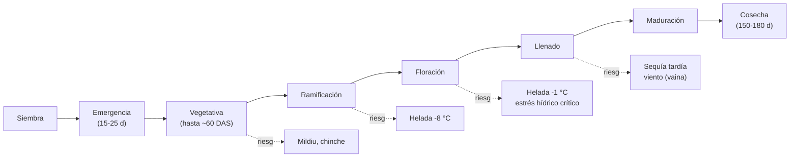
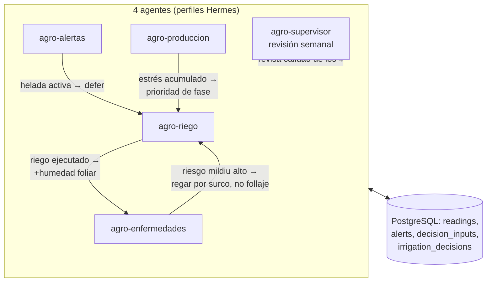

# 15 — Dinámica agrícola de la quinua: más allá del riego

> El piloto no es "un sistema de riego": es un **sistema agrícola para quinua**. El riego
> es solo el primer dominio. Este documento describe el ciclo completo del cultivo, sus
> riesgos principales y los **4 agentes** del sistema — riego, heladas, enfermedades y
> producción/biomasa — con su misión, herramientas, horarios y cómo se coordinan entre sí.

**Fuentes principales:** doc 09 (FAO-56, García et al. 2003, PROINPA, Geerts et al. 2008,
Mujica et al. 2001, IRD/Winkel), CIP/Plantwise (mildiu), Chávez-Centeno 2024 (revisión
mildiu), Danielsen & Ames 2022, Cruces 2024 (IPM quinua), Mamani Ochoa 2006 (IRD,
dinámica de biomasa), SENAMHI (clima).

---

## 1. El ciclo de la quinua y sus riesgos por fase

| Fase | Días (DAS) | GDD aprox. | Riesgos principales | Agente que actúa |
|---|---|---|---|---|
| Siembra/emer- gencia | 0–25 | < 60 | Suelo seco al nacer, heladas tardías de siembra | `agro-riego` (arranque), `agro-alertas` |
| Vegetativa | 25–60 | 60–250 | **Mildiu** (humedad foliar), chinche *Nysius*, malezas | `agro-enfermedades` |
| Ramificación | 60–90 | 250–420 | Helada hasta **−8 °C** tolera; inicio del riego activo | `agro-riego`, `agro-alertas` |
| **Floración** | 90–120 | 420–700 | **Helada −1 °C = daño**, estrés hídrico crítico (no fallar agua) | `agro-riego` (prioridad 1), `agro-alertas` |
| **Llenado** | 120–150 | 700–950 | Sequía tardía, calor >38 °C, viento (vaina seca) | `agro-riego`, `agro-produccion` |
| Maduración/cosecha | 150–180 | > 950 | Lluvia en cosecha, granos no llenos | `agro-produccion` |

- Ciclo total **~150–180 días**; GDD base 3 °C (R8, doc 09).
- **Fases críticas** (R4): floración y llenado no toleran ni estrés hídrico ni helada
  < −1 °C; ramificación tolera −8 °C (Mujica et al. 2001; Lescano 1994).

---

## 2. Los 4 dominios agrícolas

### 2.1 Dominio RIEGO (ya cubierto — resumen)

- **Pregunta que responde:** ¿hay que regar hoy, cuánto y cuándo?
- **Base:** balance hídrico FAO-56 (Dr vs RAW), Kc por fase, pronóstico Agrisignal.
- **Docs:** [06](06-agentes-riego.md), [09](09-conocimiento-agronomico.md) §7–10, [13](13-flujo-48h-detallado.md).

### 2.2 Dominio ALERTAS (`agro-alertas`)

| Elemento | Detalle |
|---|---|
| **Pregunta** | ¿Viene helada o calor? ¿Hay sequía, tanque bajo o sonda fuera de rango? ¿Hay que suspender el riego o activar protección? |
| **Datos** | `get_frost_and_heat_risk` (Agrisignal, 16 d), `get_dry_spell_status`, `temp_aire` c/10 min en ventana, `nivel_tanque`, rangos de `sensor_variables`, SENAMHI |
| **Reglas** | Ramificación tolera −8 °C; **floración/llenado: −1 °C ya es daño** (R4); umbral de alerta = mín pronosticada ≤ 0 °C; calor > 38 °C = aborto floral; tanque < 20 % o sensor fuera de rango → alerta |
| **Acciones** | Alerta roja por WhatsApp; **`defer`** de riego nocturno (R7); sube cadencia de temp a c/10 min; en floración, instrucciones de protección (regar antes del mínimo — riego por aspersión antinieve o cobertura) |
| **Métrica** | Horas de aviso antes del mínimo; falsos positivos (alertas sin helada real); tanque/sonda detectados a tiempo |

### 2.3 Dominio ENFERMEDADES (`agro-enfermedades`)

| Elemento | Detalle |
|---|---|
| **Pregunta** | ¿Hay riesgo de enfermedad/plaga en el cultivo ahora? ¿Qué vigilar? |
| **Datos** | `humedad_aire`, `temp_aire` (c/10 min), lluvia/recuento de días húmedos (`get_dry_spell_status` invertido), pronóstico de rocío, `get_growing_conditions` |
| **Enfermedades reales del altiplano** | **Mildiu** (*Peronospora variabilis* / *P. farinosa*): **la principal** — manchas amarillas en hojas/tallos; favorables: humedad alta, rocío, temperaturas frescas (10–20 °C); puede causar **pérdidas hasta del 90 %** (CIP; Danielsen & Ames 2022; Chávez-Centeno 2024). **Royas** (*Puccinia* spp.) y manchas foliares (*Cercospora*): guía FAO/CIP. **Plaga: chinche** (*Nysius* spp.): chupadores de savia/semilla, ataques en sequía y floración (Cruces 2024, IPM) |
| **Reglas** | Riesgo alto = 3+ días con humedad > 80 % + temp 10–20 °C + lluvia reciente o rocío; bajo riesgo si ≥ 3 días secos y soleados. En floración el riesgo sube (la flor es vulnerable) |
| **Acciones** | Alerta de **inspección** (recomendación humana: revisar hojas abajo, muestreo de chinche); **no automático**: no aplica químico por sí solo — sugiere y espera confirmación. Coordina con `agro-riego`: si hay riesgo alto de mildiu, **evitar mojar el follaje** (regar por surco, no aspersión, y preferir mañana temprano) |
| **Métrica** | Falsos positivos/negativos vs. lo que el técnico ve en campo (registro en `alerts.resolved_by`) |

### 2.4 Dominio PRODUCCIÓN/BIOMASA (`agro-produccion`)

| Elemento | Detalle |
|---|---|
| **Pregunta** | ¿Cómo va el cultivo? ¿Cuánta biomasa/rendimiento voy a tener? ¿Cuándo cosechar? |
| **Datos** | GDD acumulados (base 3 °C), balance hídrico del ciclo (Dr acumulado, días de estrés), días de helada, `get_growing_degree_days`, `v_daily_water_balance` |
| **Base científica** | Dinámica de crecimiento/biomasa potencial de quinua en el altiplano (Mamani Ochoa 2006, IRD); respuesta al déficit: hasta **75 % ETc sin pérdida** significativa, **55 % ETc** umbral mínimo útil (Geerts et al. 2008); heladas + sequía reducen el rendimiento **hasta ~40 %** (estudios citados 2024–2025); escenarios climáticos: −13 % de biomasa fresca (Lordemann 2024) |
| **Reglas** | Rendimiento estimado = f(GDD por fase, días de estrés hídrico, días de helada, población). Estrés en floración/llenado pesa más que en vegetativa. Pronóstico de madurez = GDD acumulados vs. ~950–1100 GDD de madurez |
| **Acciones** | **Informe semanal** (no comandos): biomasa estimada, % avance de ciclo, estrés acumulado, riesgo de cosecha con lluvia, alerta de "fase crítica en N días" |
| **Métrica** | Error vs. rendimiento real al cosechar (t/ha); acierto de fecha de cosecha |

---

## 3. Los 4 agentes: plantillas listas

| | `agro-riego` | `agro-alertas` | `agro-enfermedades` | `agro-produccion` |
|---|---|---|---|---|
| **Misión** | Regar en el momento correcto con FAO-56 | Avisar de helada, calor, sequía, tanque bajo y sonda fuera de rango | Detectar riesgo de mildiu/roya/chinche | Estimar biomasa, rendimiento y cosecha |
| **Skill principal** | `fao-56-balance`, `umbral-riego-quinua` | `ventana-helada-quinua`, `alerta-calor-sequia-tanque` | `riesgo-mildiu-quinua` | `biomasa-rendimiento-quinua` |
| **Tools** | Agrisignal (4 tools) + `agro-control` | `get_frost_and_heat_risk` + `read_latest(temp)` + `publish_alert` | `get_growing_conditions`, `get_dry_spell_status`, `read_series(humedad,temp)` | `get_growing_degree_days`, `get_growing_conditions`, `read_series` |
| **Cron** | c/60 min 06–20 h; c/3 h noche; +45 min post-riego | 05:00 y 17:30 + webhook de `temp_aire` < 2 °C | 08:00 y 20:00 (ventanas de humedad) | Semanal (lunes 07:00) + post-cosecha |
| **Salida típica** | `command {irrigate/skip/defer}` | Alerta WhatsApp + `defer` de riego | Alerta de inspección + recomendación | Informe (tabla + % ) |
| **Guardas** | duración, eventos/día, tanque, helada | — (él mismo es la guardia de alertas) | nunca ejecuta acciones fitosanitarias solo | solo lectura (no comanda equipo) |
| **Métrica de éxito** | acierto en `v_decision_quality`, agua ahorrada | horas de aviso, FPR < 30 % | acierto vs. inspección en campo | error vs. rendimiento real |

**Plantilla de SOUL.md y SKILL.md completas para crearlos: ver [16](16-crear-agente-desde-cero.md).**

> **Paquetes de activación** (Piloto mínimo / Piloto quinua ⭐ / Experto / Personalizado) y
> el **catálogo completo de 16 agentes agrícolas** con checkboxes: ver
> [18](18-catalogo-agentes-agricolas.md). Los límites de cada agente y su entrenamiento:
> ver [19](19-entrenamiento-y-limites-agentes.md).

---

## 4. Cómo se coordinan entre sí

| Regla de coordinación | Detalle |
|---|---|
| **Helada manda sobre riego** | Si `agro-alertas` tiene alerta de helada activa, `agro-riego` pone `defer` (guarda R7) |
| **Enfermedad orienta el método** | Riesgo de mildiu alto → `agro-riego` evita mojar el follaje (riego por surco, no aspersión, mañana temprano) — el comando sigue siendo riego, cambia la recomendación |
| **Riego alimenta a enfermedades** | Tras cada riego, `humedad_aire` sube: `agro-enfermedades` lo pondera en su ventanal de riesgo |
| **Producción da contexto** | En floración (según GDD), `agro-riego` sube la criticidad (nunca fallar agua) y `agro-alertas` sube su umbral a −1 °C |
| **Supervisor revisa todo** | Semanal: calidad de las 4 (`v_decision_quality`), guardas violadas, falsos alertas → propone ajustes de skills |
| **Un solo canal** | Todos entregan por el mismo canal (WhatsApp/Telegram) con etiqueta `[RIEGO]`, `[HELADA]`, `[ENF]`, `[PROD]` |

---

## 5. Por qué 4 agentes y no 1 solo

1. **Permisos mínimos:** `agro-produccion` es solo lectura; no necesita `publish_command`.
   Un agente monolítico tendría poder de más.
2. **Skills distintas:** cada dominio tiene su procedimiento y sus fuentes; no se mezcla
   FAO-56 con fitopatología en un mismo contexto.
3. **Crons distintos:** riego cada hora, enfermedad 2×/día, producción semanal.
4. **Aislamiento de fallos:** si `agro-enfermedades` se cuelga, el riego sigue.
5. **Automejora por dominio:** cada skill se refina con su propia evidencia (Curator).

Y como se explica en [16](16-crear-agente-desde-cero.md), **estos 4 no los "crea la IA":
se crean desde cero con el manual (o con el builder visual)** — son plantillas, no magia.

---

Continúa: [16-crear-agente-desde-cero.md](16-crear-agente-desde-cero.md) — manual y
entorno visual para crear agentes desde 0.
