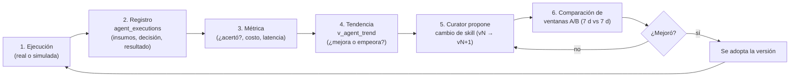

# 17 — Simulación y mejora en el tiempo: cómo saber si un agente va mejorando

> Un agente que no se mide no se puede mejorar. Este documento describe la **metodología**
> (primero documentación, la herramienta simuladora se decide después) para: (1) **simular**
> sin campo, (2) **comparar** agente vs. alternativa simple (A/B), y (3) **rastrear la mejora
> de cada agente en el tiempo, con métricas por cada ejecución** — para ver, en una gráfica,
> cómo va mejorando a raíz de cada ejecución y de cada cambio de procedimiento.

---

## 1. El ciclo de mejora (por qué medir)



**Regla central:** cada ejecución deja un registro con **su resultado**; las métricas se
agregan por día/agente; cada cambio de skill queda **versionado** y comparado contra la
ventana anterior. Así se responde: *"¿el agente mejoró desde el lunes pasado?"* con datos.

---

## 2. Simular sin campo (escenarios sintéticos)

### 2.1 Tipos de simulación

| Tipo | Qué es | Cuándo usarla |
|---|---|---|
| **Escenarios sintéticos** | Serie de lecturas inventadas pero realistas que se inyectan por la API de ingestión (`POST .../readings` con `device_id: "sim-…"`), como si fuera un equipo real | Probar un agente nuevo o un cambio de skill **antes** de tocar el campo |
| **Replay de histórico** | Re-ejecutar el agente sobre las lecturas **reales** guardadas en `readings` de días pasados, con el clima de entonces (replay de `decision_inputs`) | Validar contra casos ya vividos (helada real, sequía real) |
| **A/B con baseline** | Los mismos datos, dos "decisionantes": el agente vs. una regla simple (timer o umbral fijo) | Demostrar que el agente **aporta** sobre lo comercial |

### 2.2 Escenarios por dominio (plantillas)

| Dominio | Escenario | Serie inyectada (ejemplo) | Respuesta esperada del agente |
|---|---|---|---|
| Riego | Sequía 5 días | humedad 24→18 %, ET0 5 mm, sin lluvia | `irrigate` al cruzar Dr ≥ RAW, con lámina y justificación |
| Riego | Lluvia que salva | 14 mm pronosticados antes del umbral | `skip "lluvia ≥ lámina"` (R7) |
| Helada | Mín −1.5 °C floración | temp cayendo 6→−2 °C en 12 h | Alerta [HELADA] + `defer` de riego nocturno |
| Helada | Falso positivo | mín 3.8 °C | `NO_REPLY` (no alarmar de más) |
| Enfermedades | Brote de mildiu | humedad 90 % × 4 d, temp 14 °C, rocío | `[ENF] ALTO` + qué revisar + repetir en 48 h |
| Enfermedades | Día seco soleado | humedad 35 % × 5 d, sol | `NO_REPLY` (riesgo bajo) |
| Producción | Estrés en floración | GDD 500, Dr > RAW 6 días seguidos | Informe con % de estrés acumulado en fase crítica |
| **Robustez** | Sensor roto | humedad 40 cm = −9.5 | Ignorar lectura `suspect`, decidir con el resto, avisar |
| **Robustez** | Datos viejos | lote con 8 h de antigüedad | "sin datos frescos" en vez de decidir mal |

### 2.3 Cómo se inyecta (diseño)

```
generador de escenario → POST /v1/devices/{id}/readings (HMAC de "sim-…")
    → el agente corre igual que en producción (mismo cron/pull-loop)
    → resultado en agent_executions con source='simulation'
```

El device simulado convive con el real (mismo esquema); la columna `source` separa lo
simulado de lo real en **todas** las métricas.

---

## 3. A/B: ¿mejora sobre un timer o un `if`?

| | **Baseline (lo comercial)** | **Agente** |
|---|---|---|
| Riego | Timer: riego fijo 06:00 si lunes/miércoles/viernes | Balance FAO-56 con clima y fase |
| Heladas | `if temp_local < 0 → alarma` | Pronóstico 16 d + fase + defer de riego |
| Enfermedades | `if humedad > 85 % → avisar` | Ventana de 72 h + rocío + lluvia + fase |
| Producción | no existe | GDD + estrés acumulado + informe |

**Protocolo:** mismas lecturas del mismo período → corre el baseline (regla simple
implementada como referencia) y corre el agente → se comparan las métricas de la tabla §5.
El baseline se ejecuta **también** en cada simulación para que la comparación sea continua,
no una sola vez.

---

## 4. Registro por ejecución (`agent_executions`) — la unidad de tracking

**Diseño de tabla** (agrega lo que ya hacen `decision_inputs`/`task_acks`, por agente —
registrada junto a las tablas de auto-mejora en [04](04-base-de-datos.md) §6):

| Campo | Qué guarda |
|---|---|
| `execution_id` | id único |
| `agent` | `agro-riego`, `agro-alertas`, `agro-enfermedades`, `agro-produccion` |
| `started_at` / `finished_at` | cuándo corrió y cuánto tardó (`latency_ms`) |
| `task_kind` | `irrigation_analysis`, `alert_check`, `weekly_report`… |
| `source` | `real` \| `simulation` \| `replay` |
| `inputs_ref` | referencias a `decision_inputs` (qué vio) |
| `skill_version` | **versión de la skill usada** (`riesgo-mildiu-quinua v3`) |
| `decision` | qué respondió (`irrigate 1200 s`, `ALTO`, `NO_REPLY`…) |
| `outcome` | qué pasó después: `correct` \| `error` \| `pending` \| `unknown` |
| `outcome_at` | cuándo se evaluó el resultado (p. ej. al día siguiente en replay) |
| `cost_tokens` / `llm_calls` | cuánto costó (0 si `NO_REPLY`) |
| `baseline_decision` | qué habría decidido el baseline (para A/B continuo) |
| `baseline_correct` | si el baseline habría acertado |

**Cómo se determina `outcome` (el resultado de cada ejecución):**

| Agente | Resultado correcto = | Resultado erróneo = |
|---|---|---|
| `agro-riego` | post-check confirma humedad ≈ CC sin percolación (`v_decision_quality`) | estrés después (skip erróneo) o riego en exceso/riego con lluvia |
| `agro-alertas` | hubo helada real en la ventana avisada (o `defer` evitó mojar) | falsa alarma, o helada no avisada |
| `agro-enfermedades` | la inspección confirmó riesgo (check del técnico en `alerts.resolved_by`) | falsa alarma / riesgo no detectado |
| `agro-produccion` | error bajo vs. rendimiento real (al cosechar) | error alto de estimación |

---

## 5. Métricas en el tiempo (tendencia y mejora)

### 5.1 Agregado diario (`agent_metrics_daily`)

| Métrica | Definición | Meta del piloto |
|---|---|---|
| `executions` | ejecuciones del día (reales) | — |
| `accuracy` | `correct / (correct + error)` | ≥ 80 % y **subiendo** |
| `false_positive_rate` | falsas alarmas / alertas emitidas | < 30 % |
| `false_negative_rate` | eventos no avisados / eventos reales | < 10 % (heladas: 0) |
| `water_saved_mm` | láminas no aplicadas por skips correctos (vs. baseline) | > 0 vs. baseline |
| `avg_latency_ms` | tiempo decisión | < 60 s |
| `llm_calls` / `cost` | llamadas al LLM (las `NO_REPLY` = 0) | tendencia plana o baja |

### 5.2 Vistas de tendencia

| Vista | Pregunta que responde |
|---|---|
| `v_agent_trend` | **¿Mejora el agente en el tiempo?** — accuracy diaria/semanal por agente, con `source='real'` |
| `v_skill_impact` | **¿Mejoró al cambiar la skill?** — métrica 7 días antes vs. 7 días después de cada versión (`skill_versions`) |
| `v_ab_baseline` | **¿Le gana al baseline?** — `accuracy(agente) − accuracy(baseline)` por semana |
| `v_cost_trend` | ¿Está subiendo el costo LLM sin subir accuracy? |

### 5.3 Versionado de skills (el "antes/después" de cada mejora)

Cada refinamiento del Curator (o cambio manual) crea una fila en `skill_versions`:

| Campo | Ejemplo |
|---|---|
| `skill` / `version` | `riesgo-mildiu-quinua` / `v3` |
| `changed_at` / `changed_by` | 2026-10-28, Curator (con evidencia) o humano |
| `reason` | "v2 dio 4 falsos positivos con rocío de madrugada" |
| `metric_before` / `metric_after` | accuracy 0.62 (v2) → 0.81 (v3, ventana 7 d) |

**Cómo se ve en el tablero:** una línea de tiempo por agente — puntos = ejecuciones
(verde/rojo según `outcome`), línea = accuracy móvil de 7 días, y **marcas verticales**
cada vez que cambió una skill. Si tras la marca la línea sube → **la mejora es atribuible
a ese cambio**; si baja, el Curator revierte (comparación de ventanas §1).

### 5.4 Ejemplo de lectura del tablero (2 semanas)

| Día | Ejecuciones | Aciertos | Accuracy 7 d | Versión skill | Evento |
|---|---|---|---|---|---|
| lun 20 | 15 | 10 | 0.66 | v1 | inicio |
| mié 22 | 14 | 9 | 0.64 | v1 | 2 falsos positivos de rocío |
| jue 23 | 16 | 13 | **0.71** | **v2** (Curator: umbral de rocío) | ← cambio marcado |
| sáb 25 | 15 | 13 | 0.78 | v2 | sigue subiendo |
| lun 27 | 15 | 14 | **0.83** | v2 | **+17 puntos vs. v1** |

---

## 6. Umbrales de aceptación (¿cuándo un agente está "listo"?)

| Agente | Aceptar en producción si… |
|---|---|
| `agro-riego` | accuracy ≥ 80 % en 10 simulaciones seguidas **y** ≥ baseline en replay, 0 guardas violadas |
| `agro-alertas` | **0 falsos negativos** en replay de heladas históricas; falsos positivos ≤ 30 % |
| `agro-enfermedades` | accuracy ≥ 75 % vs. inspección en 2 semanas de campo |
| `agro-produccion` | error vs. rendimiento real ≤ 25 % en la primera cosecha |

**Y para cualquier cambio de skill:** solo se adopta si la ventana nueva le gana a la
anterior (§5.3) — si no, se revierte. La mejora es **evidencia, no opinión**.

---

## 7. Resumen

> Este documento describe el **Nivel 0** de auto-mejora (skills y memoria, **sin tocar los
> pesos del modelo**). El **Nivel 1 (SFT/LoRA)** y el **Nivel 2 (RL)** —entrenar el modelo
> propio— con sus helpers y los **límites por agente** (`agent_limits`) están en
> [19](19-entrenamiento-y-limites-agentes.md); las tablas `episodes`/`models_registry` de
> ese flujo, en [04](04-base-de-datos.md) §6.

1. **Simular** = escenarios sintéticos + replay del histórico + A/B continuo vs. baseline.
2. **Cada ejecución queda registrada** (`agent_executions`) con su resultado, su costo y
   **la versión de skill que la produjo**.
3. **Las métricas se agregan diariamente** (`agent_metrics_daily`) y se miran como
   **tendencia** (`v_agent_trend`), no como dato suelto.
4. **Cada cambio de skill se versiona** y se compara 7 d antes vs. 7 d después
   (`v_skill_impact`) → la mejora queda **atribuible y reversible**.
5. El ciclo completo: ejecutar → medir → ver tendencia → Curator propone → comparar
   ventanas → adoptar o revertir → repetir. **Así un agente mejora a raíz de cada
   ejecución, y lo puedes demostrar con una gráfica.**

Continúa: [00-README.md](00-README.md) — índice de la serie.
