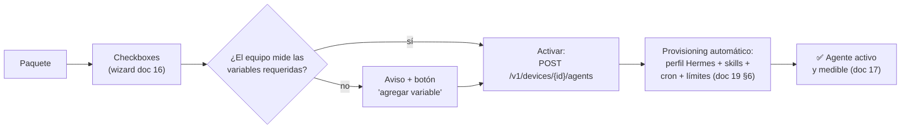

# 18 — Catálogo de agentes agrícolas (selección por checkboxes)

> **Todos los agentes posibles del piloto, en un solo catálogo.** Cada uno se activa en el
> equipo con un **checkbox** (wizard del doc 16) o con un `POST` (doc 12 §6). El catálogo es
> **solo de agricultura/cultivos** — nada de ganadería ni acuacultura. Este documento lista
> los **16 agentes**, sus paquetes, qué variables del equipo necesita cada uno y cómo se
> activan.

---

## 1. Alcance y reglas del catálogo

| Regla | Detalle |
|---|---|
| **Solo agricultura** | El catálogo cubre cultivos (quinua y otros). Los dominios ganaderos del origen (`docs/06`) quedan fuera del piloto. |
| **3 estados** | ✅ **Listo** (plantilla completa, se activa hoy) · 🟡 **En desarrollo** (diseñado, falta pulir la skill) · 🔮 **Futuro** (requiere sensor o fuente externa nueva) |
| **Permisos mínimos** | Cada agente solo puede hacer lo de su misión: quien no decide riego, **no tiene** `publish_command` (doc 10 §1). |
| **Activación por equipo** | Un agente se "contrata" para **un equipo** concreto (`device_agents`); varios agentes pueden estar activos en el mismo equipo (doc 04 §6). |
| **Validación de datos** | Al marcar un checkbox, la plataforma verifica que el equipo mida las **variables requeridas** (§5). Si falta alguna → aviso con opción de agregarla. |

---

## 2. El catálogo completo (16 agentes)

| # | Agente | Misión (la pregunta que responde) | Estado | ¿Comanda equipo? | Métrica clave |
|---|---|---|---|---|---|
| 1 | **`agro-riego`** | ¿Regar hoy, cuánto y cuándo? (FAO-56) | ✅ | **Sí** (`publish_command`) | Acierto en `v_decision_quality`, agua ahorrada vs. baseline |
| 2 | **`agro-alertas`** | ¿Viene helada o calor? ¿Hay sequía, tanque bajo o sonda fuera de rango? | ✅ | No (alerta + `defer`) | Horas de aviso; falsos positivos < 30 % |
| 3 | **`agro-enfermedades`** | ¿Riesgo de mildiu, roya o chinche? ¿Qué revisar? | ✅ | No (solo inspección) | Acierto vs. inspección del técnico |
| 4 | **`agro-produccion`** | ¿Cómo va el cultivo? ¿Cuánta biomasa? ¿Cuándo cosechar? | ✅ | No (solo lectura) | Error vs. rendimiento real (≤ 25 %) |
| 5 | **`agro-supervisor`** | ¿Los otros agentes trabajan bien? | ✅ | No (revisión semanal) | Calidad agregada; propuestas de mejora aceptadas |
| 6 | `agro-fertilizacion` | ¿Qué, cuánto y cuándo fertilizar (N-P-K por fase)? | 🟡 | No (plan, no aplica) | Balance de nutrientes vs. cosecha |
| 7 | `agro-plagas` | Chinche *Nysius*, polilla, pulgones: ¿hay que intervenir? | 🟡 | No (solo alerta) | Acierto vs. muestreo en campo |
| 8 | `agro-suelo` | ¿Cómo está el suelo? (infiltración, estructura, materia orgánica) | 🟡 | No (solo lectura) | Tendencia de salud del suelo por temporada |
| 9 | `agro-riego-mantenimiento` | ¿La línea de riego está sana? (fugas, válvula atascada, bomba) | 🟡 | No (diagnóstico + alerta) | Fallas detectadas antes de la rotura |
| 10 | `agro-equipo` | ¿El equipo de campo funciona? (batería, red, sondas, lotes) | 🟡 | No (salud del equipo) | Tiempo de vida útil; incidentes evitados |
| 11 | `agro-malezas` | ¿Dónde hay malezas y cuándo desherbar? | 🔮 | No | Cobertura de maleza estimada |
| 12 | `agro-pulverizacion` | ¿Cuándo y con qué condiciones aplicar (viento, inv. térmica)? | 🔮 | No (plan) | Aplicaciones dentro de ventana segura (%) |
| 13 | `agro-mercado` | ¿Vender ahora o esperar? (precio, demanda) | 🔮 | No | Error de timing vs. precio real |
| 14 | `agro-asesor` | Consultor libre: responde preguntas agronómicas citando el doc 09 | 🔮 | No (solo lectura) | Utilidad percibida por el usuario |
| 15 | `agro-postcosecha` | ¿Cómo va el almacenamiento? (temp/hum del granero, ventilación) | 🔮 | No (alerta) | Pérdidas postcosecha evitadas |
| 16 | `agro-tareas` | Organiza el calendario del cultivo: siembra, muestreos, mantenimientos | 🔮 | No (recordatorios) | Tareas cumplidas a tiempo |

> **Los 5 ✅ son el piloto de quinua** (doc 15 §3 tiene sus plantillas completas). Los 🟡
> usan los mismos patrones (skill + cron + kit mínimo) y se pulen con el doc 16 + métricas
> del doc 17. Los 🔮 esperan un sensor o fuente nueva (§4).

### 2.1 ➕ Opción extra: crear tu propio agente desde cero (no estás limitado al catálogo)

El catálogo es una **facilidad**, no una jaula: si necesitas un agente que no está aquí
(p. ej. `agro-riego-lote-norte` para otro lote, o un rol completamente nuevo), **se crea
desde cero** con la guía completa:

| Forma de hacerlo | Dónde está la guía | Qué obtienes |
|---|---|---|
| **Manual paso a paso** (7 pasos, comandos reales de Hermes) | **[16](16-crear-agente-desde-cero.md) Parte A** | Perfil completo: `SOUL.md` + skills + kit de herramientas + cron, copiables plantilla por plantilla |
| **Entorno visual** (botones, sin terminal) | **[16](16-crear-agente-desde-cero.md) Parte B** (Profile Builder de Hermes + AgriAgents Builder) | Los mismos archivos, creados con el wizard |
| **Probar antes de activarlo** | **[16](16-crear-agente-desde-cero.md) Paso 7** + [17](17-simulacion-y-mejora.md) §2 | Escenario simulado → respuesta antes de que trabaje en serio |

> En el **wizard del Builder**, la tarjeta **"Personalizado"** del paquete (§4) abre
> exactamente esa guía: eliges el rol, se precarga una plantilla del dominio más cercano y
> la editas. En el **catálogo API**, un agente nuevo se registra primero en la tabla
> `agents` (doc 04 §6) con su `hermes_profile` y ya puede activarse en cualquier equipo.

---

## 3. Fichas de los agentes listos (✅)

| | `agro-riego` | `agro-alertas` | `agro-enfermedades` | `agro-produccion` | `agro-supervisor` |
|---|---|---|---|---|---|
| **Datos/herramientas** | Agrisignal (4 tools) + `agro-control` (`read_*`, `publish_command`) | `get_frost_and_heat_risk`, `get_dry_spell_status`, `read_latest` | `get_growing_conditions`, `get_dry_spell_status`, series 72 h | `get_growing_degree_days`, `get_growing_conditions`, series | Métricas (`agent_metrics_daily`, `v_decision_quality`) |
| **Cron típico** | c/60 min 06–20 h; c/3 h noche; +45 min post-riego | 05:00 y 17:30 + webhook `temp_aire < 2 °C` | 08:00 y 20:00 | Semanal (lunes 07:00) | Semanal (viernes 08:00) |
| **Salida típica** | `command {irrigate/skip/defer}` | Alerta WhatsApp + `defer` | Alerta de inspección `[ENF]` | Informe `[PROD]` | Propuesta de ajuste `[SUP]` |
| **Skill principal** | `fao-56-balance`, `umbral-riego-quinua` | `ventana-helada-quinua`, `alerta-calor-sequia-tanque` | `riesgo-mildiu-quinua` | `biomasa-rendimiento-quinua` | `revision-semanal-agentes` |

---

## 4. Paquetes de activación

| Paquete | Agentes incluidos | Para quién |
|---|---|---|
| **Piloto mínimo** | `agro-riego` + `agro-alertas` | Lo esencial: regar bien y avisar a tiempo |
| **Piloto quinua** ⭐ (recomendado) | Los 5 ✅: riego, alertas, enfermedades, producción, supervisor | El piloto completo documentado en esta serie |
| **Experto** | Los 5 ✅ + los 5 🟡 (10 en total) | Cuando el piloto funcione y quieras diagnóstico de línea, suelo y fertilización |
| **Personalizado** | Los que tú marques (checkboxes libres) | Necesidades particulares del lote |

---

## 5. Variables requeridas por agente (validación al activar)

Inventario del piloto: **7 sensores / 10 variables** (8 de campo + 2 de diagnóstico, doc 12
§3.2). Al marcar un checkbox, la plataforma compara `required_variables` contra las filas
**activas** de `sensor_variables` del equipo:

| Agente | Variables requeridas (mínimo) | ¿En el piloto? |
|---|---|---|
| `agro-riego` | `humedad_suelo_20cm`, `temp_aire`, `humedad_aire`, `caudal_riego`, `estado_valvula`, `nivel_tanque` | ✅ todas |
| `agro-alertas` | `temp_aire`, `nivel_tanque` (+ rangos de todas las variables) | ✅ todas |
| `agro-enfermedades` | `temp_aire`, `humedad_aire` | ✅ todas |
| `agro-produccion` | `temp_aire`, `humedad_suelo_20cm` | ✅ todas |
| `agro-supervisor` | — (lee métricas, no sensores) | ✅ |
| `agro-suelo` | `humedad_suelo_20cm`, `humedad_suelo_40cm` | ✅ todas |
| `agro-riego-mantenimiento` | `caudal_riego`, `presion_linea`, `estado_valvula`, `nivel_tanque` | ✅ todas |
| `agro-fertilizacion` | `humedad_suelo_20cm`, `temp_aire` (+ **EC** recomendada) | ⚠️ falta sensor EC |
| `agro-plagas` | `temp_aire`, `humedad_aire` | ✅ todas |
| `agro-malezas` | **cámara** (visión) | ❌ requiere hardware nuevo |

**Si falta una variable:** el wizard muestra *"Este agente necesita `presion_linea`, que tu
equipo no mide"* con dos botones: **(a) Agregar variable** (la plataforma hace el `POST`
al sensor correspondiente — doc 12 §3.3, cero firmware) o **(b) Activar en modo degradado**
(el agente trabaja solo con lo disponible y lo dice en su salida).

---

## 6. Cómo se activa (checkbox o API — lo mismo)

| Vía | Paso a paso |
|---|---|
| **Visual** (recomendada) | Wizard del AgriAgents Builder → pantalla **1. Catálogo** (checkboxes de este doc) → pantalla **2. Equipo y límites** → ▶ Crear (doc 16 §B.2) |
| **API** | `POST /v1/devices/{id}/agents {"agent_name": "agro-riego", "schedule": …, "limits": {…}}` (doc 12 §6) |

Al activar, el backend ejecuta el **provisioning** (doc 12 §B.1.5 del origen, resumido en
doc 19 §6): crea el perfil Hermes (`~/.hermes/profiles/agro-…/`), escribe `SOUL.md` y
skills de la plantilla, registra `device_agents` + `agent_limits` y crea el cron del
pull-loop. **Desactivar** (`enabled=false` o `DELETE`) detiene el cron sin borrar métricas
ni episodios.

---

## 7. De 🟡/🔮 a ✅: cómo madura un agente del catálogo

1. **Diseño:** ficha del catálogo (misión, datos, métrica) — este documento.
2. **Creación:** plantilla con el manual del doc 16 (SOUL + SKILL + kit + cron).
3. **Prueba:** escenarios sintéticos del doc 17 §2 antes de tocar el campo.
4. **Medición:** métricas por ejecución (doc 17 §4–5) durante 2 semanas.
5. **Aceptación:** si cumple los umbrales del doc 17 §6 → pasa a **✅** y entra en un paquete.

---

## Referencias cruzadas

- Plantillas completas de los 4 agentes del piloto: [15](15-dinamica-agricola-quinua.md) §3.
- Crear un agente desde cero: [16](16-crear-agente-desde-cero.md).
- Métricas para decidir si un agente "está listo": [17](17-simulacion-y-mejora.md) §6.
- Límites por agente y entrenamiento: [19](19-entrenamiento-y-limites-agentes.md).
- API de catálogo y activación: [12](12-api-crud-completa.md) §6.

Continúa: [19-entrenamiento-y-limites-agentes.md](19-entrenamiento-y-limites-agentes.md) —
cómo se **entrenan** y se **limitan** los agentes una vez activados.
