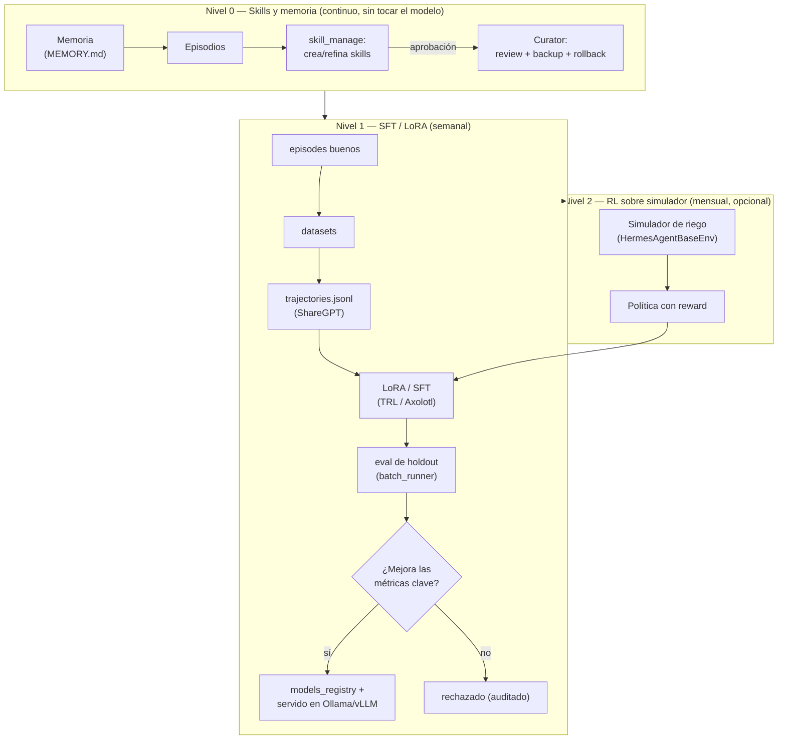
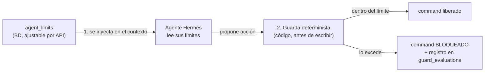
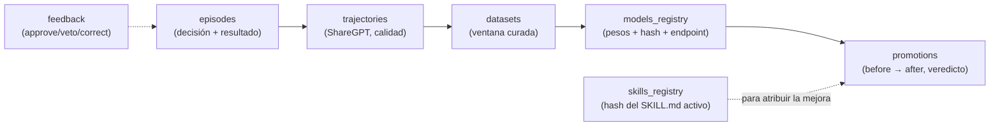

# 19 — Entrenamiento de agentes y límites por agente

> Un agente creado (doc 16) y medido (doc 17) **sigue aprendiendo**. Aquí está toda la
> lógica de **entrenamiento**: los **3 niveles de auto-mejora** (skills → SFT/LoRA → RL),
> los **helpers de Hermes** que hacen el trabajo pesado, los **límites por agente**
> (`agent_limits`, con doble ley) y la **trazabilidad completa** de cada mejora
> (`episodes → … → promotions`).

---

## 1. Los 3 niveles de auto-mejora (de lo diario a lo profundo)



| Nivel | Qué toca | Cadencia | Quién lo hace | Riesgo |
|---|---|---|---|---|
| **N0 — Skills y memoria** | El "cómo hacerlo" (archivos `SKILL.md`, notas) | Continuo | El agente + Curator + humano | Bajo (con aprobación) |
| **N1 — SFT/LoRA** | Los "pesos" del modelo (`agro-riego-v2`) | Semanal | `agro-trainer` + `batch_runner` | Medio (promotion gate obligatorio) |
| **N2 — RL** | La política óptima sobre un simulador | Mensual | Entorno RL + batch_runner | Alto (solo opcional) |

> **El Nivel 0 es el día a día** (ya en operación: doc 17 §5.3 versiona cada cambio de
> skill). Los Niveles 1 y 2 son el **entrenamiento del modelo propio** — aquí se explican
> completos.

---

## 2. Nivel 0 — el corazón diario (resumen; detalle en doc 17)

| Pieza | Qué hace | Config / comando |
|---|---|---|
| `skill_manage` | El agente crea/edita sus propias skills | tool built-in de Hermes |
| Aprobación | Cambios en cola `~/.hermes/pending/skills/` hasta aprobar | `skills.write_approval: true` (producción) / `false` (solo piloto) |
| **Curator** | Uso real de cada skill, detección de obsoletas, review con LLM, **backup y rollback** | `curator.enabled: true`, `interval_hours: 168`; `hermes curator status\|run\|backup\|rollback` |
| Memoria | El agente recuerda calibraciones, presupuestos, incidentes | tool `memory` (`MEMORY.md` / `USER.md`) |
| Feedback humano | Vetar/corregir una decisión → parche de skill el **mismo día** | `POST /v1/agent/feedback` (§7) |

---

## 3. Nivel 1 — SFT / LoRA: entrenar el modelo propio (semanal)

### 3.1 Los 7 pasos

| Paso | Qué se hace | Herramienta |
|---|---|---|
| 1. **Cura** | Seleccionar `episodes` con resultado bueno (`outcome+`) y sin violar guardas (`guard_ok=true`) | SQL sobre `episodes` (doc 04 §6) |
| 2. **Exportar** | Convertir episodios a trayectorias de conversación (formato **ShareGPT**), descartando razonamientos rotos o herramientas alucinadas | `batch_runner.py --dataset_file … --run_name … --model …` |
| 3. **Entrenar** | SFT/LoRA sobre el modelo base → nace `agro-riego-v2` | TRL / Axolotl |
| 4. **Evaluar** | Suite de examen (holdout: datos que el modelo **no** vio): violaciones de guarda, agua ahorrada, acierto, aceptación humana | `batch_runner` (misma herramienta) |
| 5. **Promotion gate** | Solo pasa si **mejora** las métricas clave; si no → rechazo auditado | fila en `promotions` (veredicto) |
| 6. **Servir** | El modelo nuevo se sirve local como proveedor OpenAI-compatible | Ollama / vLLM |
| 7. **Despliegue canario** | 5 % del tráfico primero; si suben las violaciones de guarda → **rollback automático** | config de Hermes |

### 3.2 El modelo nuevo como proveedor (paso 6, literal)

```yaml
# ~/.hermes/config.yaml — el agente sigue igual, solo cambia el cerebro
providers:
  agro-local:
    api: http://127.0.0.1:11434/v1
    transport: openai_chat
    models: [{name: agro-riego-v2, context_length: 32768}]
model: {provider: agro-local, default: agro-riego-v2}
```

> **Regla de oro:** el MCU **no cambia** (cero firmware); la API no cambia; solo cambia el
> cerebro del agente. Y si el modelo nuevo rinde peor, se vuelve al anterior
> (`models_registry.is_active`) sin tocar nada más.

---

## 4. Nivel 2 — RL sobre simulador (opcional, mensual)

- Se usa el código de entornos de Hermes (`HermesAgentBaseEnv`): el agente corre contra un
  **simulador de riego** en vez de datos reales.
- Cada subclase implementa: `setup()`, `get_next_item()`, `format_prompt()`,
  `compute_reward()` y `evaluate()`.
- **Reward** (recompensa) del piloto: `rendimiento estimado − energía − agua gastada −
  guardas violadas` — es decir, se le **cobra** por gastar agua de más.
- Resultado: una política nueva que también pasa por el promotion gate del §3 y se sirve
  igual (Ollama/vLLM).
- ⚠️ **Técnico:** este código vive en la rama `atropos-hermes-agent` de Hermes (**no en
  `main`**) — hay que pinear la rama antes de usarlo. En el piloto se puede **dejar para
  después**: los Niveles 0 y 1 ya mejoran al agente.

---

## 5. Los helpers (quién hace el trabajo pesado)

| Helper | Tipo | Rol en una frase | Comandos típicos |
|---|---|---|---|
| **Curator** | subsistema de Hermes (`curator.*`) | El bibliotecario: revisa skills usadas/obsoletas, limpia, **respalda y revierte** | `hermes curator status\|run\|backup\|rollback` |
| **`agro-trainer`** | perfil Hermes | El "entrenador": convierte buenos episodios en datasets y lanza el examen | perfil con cron semanal |
| **`batch_runner.py`** | herramienta Python de Hermes | La fábrica: genera `trajectories.jsonl` + `statistics.json`; corre evals; `--resume` si se cae | `python batch_runner.py --dataset_file … --run_name …` |
| **`goal_judge`** | juez de metas (`/goal`) | El árbitro de temporada: `done / blocked / continue / wait` sobre la meta (ej. "regar sin estrés hasta floración") | `/goal` en el chat del perfil |
| **`memory`** | tool built-in | El cuaderno: `add / patch / remove` sobre `MEMORY.md` y `USER.md` | tool del agente |
| **`skill_manage`** | tool built-in | El escritor de manuales: crea/edita `SKILL.md` (con aprobación) | tool del agente |
| **Linters** | utilidades (`incident-log-shape`, `references-sprawl`, `oversized-body`) | Los correctores de estilo de cada skill | corre con el Curator |
| **LLM provider** | MiniMax / Ollama LoRA | El cerebro razonador — y el **objeto** del reentrenamiento (Nivel 1) | config del perfil |

---

## 6. Límites por agente (`agent_limits`) — la doble ley

Un agente con buenas intenciones **también** necesita reglas duras. Los límites viven en
`agent_limits` (doc 04 §6), se ajustan por API y se aplican por **doble ley**:



| Campo | Ejemplo (piloto) | Para qué |
|---|---|---|
| `water_budget_l_per_day` | `240000` (2 riegos × 120 m³) | Nunca regar más de X litros al día |
| `allowed_actions` | `["irrigate","skip","defer"]` | Lista blanca de lo que puede decidir |
| `active_window` | `"05:00-20:00"` | No comanda fuera de su horario |
| `max_seconds_per_event` | `1200` | Duración máxima por evento (también guarda API) |
| `require_human_approval_above_l` | `null` (piloto) / `150000` | Si la orden supera X litros → requiere aprobación humana |
| `min_minutes_between_commands` | `120` | No spamea órdenes |
| `extra` (jsonb) | `{"frost_threshold_c": 0.0}` | Límites propios del dominio |

**Ejemplos por agente del piloto:**

| Agente | `allowed_actions` | Límites destacados |
|---|---|---|
| `agro-riego` | irrigate, skip, defer | presupuesto de agua/día, ventana 05:00–20:00, máx 1200 s/evento |
| `agro-alertas` | send_alert, defer | sin presupuesto de agua; `frost_threshold_c` en `extra` |
| `agro-enfermedades` | send_alert | **nunca** acciones fitosanitarias |
| `agro-produccion` | send_report | solo lectura (no comanda equipo) |
| `agro-supervisor` | propose_change | propone, no ejecuta |

**Ajuste por API** (queda auditado: `updated_at`, valor anterior):

```
PUT /v1/devices/{id}/agents/{agent_id}/limits   →  200 (doc 12 §6)
{ "water_budget_l_per_day": 180000, "active_window": "05:00-18:00" }
```

> Aunque el LLM intente exceder un límite, la **guarda 2** lo bloquea en código y queda
> registrado (`guard_evaluations`) — los límites **no son un buen consejo, son una reja**.

---

## 7. Feedback humano (la corrección del usuario)

| Paso | Qué pasa |
|---|---|
| 1 | El usuario ve una decisión y la marca: **👍 apruebo**, **✋ veto** (no debió pasar) o **✏️ corrijo** (debía ser otra) |
| 2 | `POST /v1/agent/feedback {"agent": "agro-riego", "kind": "veto", "comment": "lluvia real no vista"}` |
| 3 | El agente (o el Curator) parchea la skill correspondiente **el mismo día** — y el cambio queda en `skill_versions` (doc 17 §5.3) |
| 4 | La próxima ejecución usa la skill corregida; las métricas del doc 17 muestran si ayudó |

---

## 8. Trazabilidad completa (de la mejora al dato)



| Tabla | La pregunta que responde |
|---|---|
| `episodes` | ¿Qué decidió el agente, con qué resultado y qué recompensa (`reward`)? |
| `trajectories` | ¿Qué tan buena fue esa trayectoria (`quality`) para entrenar? |
| `datasets` | ¿Con qué ventana de episodios se entrenó? |
| `models_registry` | ¿Qué modelo está activo y dónde se sirve (`endpoint`)? |
| `promotions` | ¿Mejoró o empeoró? (`before_val` → `after_val`, `verdict`) |
| `skills_registry` | ¿Qué versión del `SKILL.md` produjo esa decisión? |
| `feedback` | ¿Qué corrigió el humano y cuándo? |

> **Trazabilidad por ejecución** (las unidades de tracking: `agent_executions`,
> `agent_metrics_daily` y `skill_versions`) están definidas en [17](17-simulacion-y-mejora.md)
> §4–5 — el doc 04 §6 las referencia para el esquema completo.

---

## 9. Métricas por agente (`GET …/performance`)

```
GET /v1/devices/{id}/agents/{agent_id}/performance?window=30d
```

Devuelve la serie temporal del agente (accuracy, costo, latencia, agua ahorrada) más la
**comparativa por versión** (skill v2 vs v3, modelo base vs LoRA) — lo que el doc 17 grafica
como tendencia y marcas de cambio.

---

## 10. Resumen

1. **3 niveles:** N0 skills/memoria (ya vivo, doc 17) → N1 SFT/LoRA semanal → N2 RL opcional.
2. **Helpers:** Curator (bibliotecario), `agro-trainer` (entrenador), `batch_runner` (fábrica),
   `goal_judge` (árbitro), `memory` y `skill_manage` (cuaderno y manual).
3. **Promotion gate obligatorio:** un modelo/skill nuevo solo se adopta si las métricas
   mejoran; si no, se revierte — la mejora es **evidencia, no opinión**.
4. **Límites por agente con doble ley:** contexto del agente + guarda determinista en código.
5. **Todo queda trazado:** `episodes → trajectories → datasets → models_registry → promotions`
   (+ `skills_registry`, `feedback`) — cada mejora es atribuible y reversible.
6. **El MCU y la API no cambian nunca** al entrenar: solo mejora el cerebro.

## Referencias (doc oficial Hermes, verificada 2026-10-22)

- Curator: <https://hermes-agent.nousresearch.com/docs/user-guide/features/curator>
- Batch processing: <https://hermes-agent.nousresearch.com/docs/user-guide/features/batch-processing>
- Memory: <https://hermes-agent.nousresearch.com/docs/user-guide/features/memory>
- Skills: <https://hermes-agent.nousresearch.com/docs/user-guide/features/skills>
- Cron: <https://hermes-agent.nousresearch.com/docs/user-guide/features/cron>

Continúa: [00-README.md](00-README.md) — índice de la serie.
